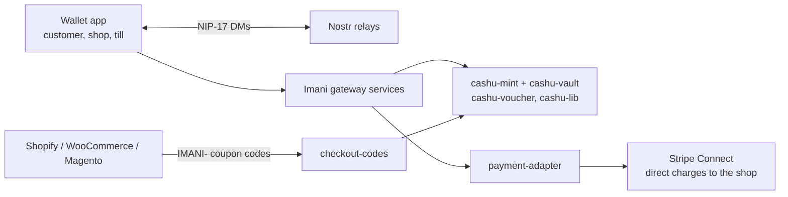

# Imani Wallet

**Gift vouchers for local shops, built on [Cashu](https://cashu.space) ecash.**

A shop sells a voucher. It lands in the customer's phone in seconds. The customer
spends it back **at that same shop**, in full or in part, at the counter or at the
shop's online checkout, and the change comes back as a smaller voucher. No card
reader, no account holding your balance, and no percentage taken on sales.

Watch the 60-second explainer on our [YouTube channel](https://www.youtube.com/@imani.wallet).

## Try it on staging

The staging environment is open to everyone: **<https://wallet.staging.398ja.xyz>**.
Nothing there is real money. Card payments run on Stripe test mode, so use the
test card `4242 4242 4242 4242` with any future expiry and any CVC.

New to Imani? Start with [How Imani works in 50 seconds](https://www.youtube.com/shorts/5X_hBQ4ke7E).

**As a customer**

1. Open the wallet, tap **Register**, pick a handle and a passphrase, and write
   down your backup key when it is shown.
   Video: [How to set up your Imani wallet](https://www.youtube.com/shorts/VoG05jwDn-w)
2. Tap **Receive** and show your code to a shop, or buy a voucher by card.
3. Spend it back at that shop with **Scan**, in full or in part, and watch the
   change come back as a smaller voucher.
4. Give some away. Videos: [Send a voucher to a friend](https://www.youtube.com/shorts/PkT1ouKFofk),
   [Send a voucher as a link (Cashlink)](https://www.youtube.com/shorts/2OpN8y_NR6M)

**As a merchant**

1. Register a second account (another browser or a private window works) and
   set up your shop.
   Video: [How to set up your shop on Imani](https://www.youtube.com/shorts/9pSnOkwOmeE)
2. Use **Sell** to issue a voucher to your customer account's code, and
   **Redeem** to take it back at the till.
   Video: [Sell a voucher and get paid: Redeem vs Pay](https://www.youtube.com/shorts/O3CjYDqJCzA)
3. Let customers buy by card (Stripe test mode on staging).
   Video: [Stripe setup](https://www.youtube.com/shorts/zGAFJiVr7oQ)
4. Add a second device for staff.
   Video: [Terminals](https://www.youtube.com/shorts/oH3RL5uwrvI)
5. Check your records.
   Video: [Dashboard, Vouchers and Transactions](https://www.youtube.com/shorts/zTAHj3bUsgo)

**Online checkout:** the demo WooCommerce store at
<https://shop.staging.398ja.xyz> takes `IMANI-` coupon codes made in the wallet.

**Free test vouchers (the faucet)**

Need vouchers to try spending, splitting or gifting without setting up a shop?
The faucet at **<https://faucet.staging.398ja.xyz>** issues them from test shops
straight into your wallet. It is staging only, and its vouchers are as unreal as
everything else here.

1. In the wallet, open **Settings > Backup**, enter your passphrase and tap
   **Show my backup key**, then **Copy backup key**. It starts with `nsec1`.
2. Open the faucet and paste the key under **Sign in**. It is checked in your
   browser, and only your public key is sent to the faucet.
3. Pick a shop. The **Starter**, **Essentials** and **Pro** filter shows shops on
   each plan.
4. Enter an amount (or tap a suggested one) and tap **Send to my wallet**. The
   voucher arrives in your wallet as a message within a few seconds, and
   **Your requests** shows it as delivered.

Limits: up to the shop's maximum per voucher (2,000 minor units, so £20 or
€20, by default) and 20 requests per account per day.

Use a **customer** account. A key that already runs a shop is refused, so a shop
cannot fund itself. Faucet admins and the super admin cannot request vouchers
either: they create the test shops under **Admin**, and can read the audit log
there. Ask on a GitHub issue if you need a shop added.

The backup key controls your account. Paste it only into the faucet and the
wallet, and only on staging.

Staging is reset from time to time, and feedback is welcome as GitHub issues.

## Two things to know first

1. **Redemption happens at the shop, not at the mint.** Imani vouchers follow
   the Model B design: each one names the shop that issued it, and only that
   shop honours it. The mint signs vouchers and stops double spends, but it
   refuses to `melt` a voucher. There is nothing to cash out.
2. **Sats are only the unit of account.** Cashu counts value in powers of two
   of a base unit, so Imani keeps the `sat` unit to split vouchers precisely.
   They are **not real sats**: no bitcoin backs a voucher and none can be
   withdrawn. What a customer holds is a face value in pounds or euros, written
   in the voucher's signed document.

Details: [docs/units-and-redemption.md](docs/units-and-redemption.md).

## How it fits together



Full component map, Stripe flow and e-commerce flow:
[docs/architecture.md](docs/architecture.md).

## Why it is private

- Keys and vouchers stay on the customer's device. No server keeps a balance.
- Vouchers move as gift-wrapped Nostr messages, so relays see no sender,
  recipient or amount.
- Cashu blind signatures mean the mint can't link a voucher it issued to the one
  it later sees redeemed.
- Card money goes straight to the shop's own Stripe account. Imani never holds
  the float.

## For developers

React 19 + TypeScript + Vite, packaged for Android with Capacitor.

```bash
npm install
./deploy/up.sh     # local stack: relays, gateway, mint, vault, Postgres, stripe-mock
npm run dev        # wallet on :5173, proxies /api to the local gateway
npm run test       # vitest
npm run build      # type-check + production bundle
npm run android    # build + sync the Capacitor Android project
```

| Path | What's there |
| --- | --- |
| `src/` | Screens, components and wallet logic |
| `packages/` | `@imani/*` libraries: wallet core and storage, vouchers, redemption, money, payment requests |
| `services/` | wallet-api, purchase-issuer, audit-api, mailer, subscription |
| `deploy/` | Compose override, nginx edge and relay config for the local stack |
| `e2e/`, `loadtest/` | Playwright and k6 suites |

## Related repositories

`cashu-lib`, `cashu-mint`, `cashu-vault` and `cashu-voucher` (the Java Cashu
stack). The full list is in [docs/architecture.md](docs/architecture.md).

## License

MIT
