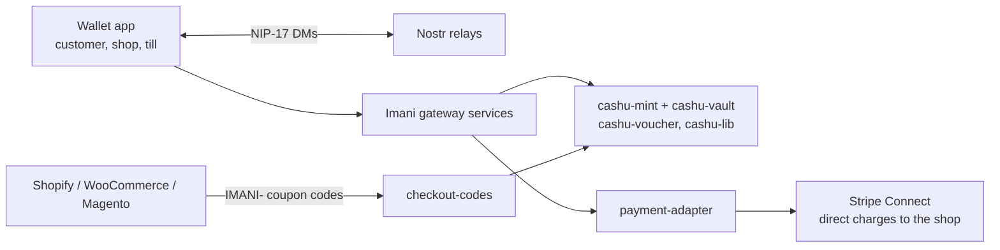

# Imani Wallet

**Gift vouchers for local shops, built on [Cashu](https://cashu.space) ecash.**

A shop sells a voucher. It lands in the customer's phone in seconds. The customer
spends it back **at that same shop**, in full or in part, at the counter or at the
shop's online checkout, and the change comes back as a smaller voucher. No card
reader, no account holding your balance, and no percentage taken on sales.

Watch the 60-second explainer on our [YouTube channel](https://www.youtube.com/@imani.wallet).

## Two things to know first

1. **Redemption happens at the shop, not at the mint.** Imani vouchers follow
   the Model B design: each one names the shop that issued it, and only that
   shop honours it. The mint signs vouchers and stops double spends, but it
   refuses to `melt` a voucher. There is nothing to cash out.
2. **Sats are only the unit of account.** Cashu counts value in powers of two
   of a base unit, so Imani keeps the `sat` unit to split vouchers precisely.
   They are **not real sats**: no bitcoin backs a voucher and none can be
   withdrawn. What a customer holds is a face value in pounds or euros, written
   in the voucher's signed document.

Details: [docs/units-and-redemption.md](docs/units-and-redemption.md).

## How it fits together



Full component map, Stripe flow and e-commerce flow:
[docs/architecture.md](docs/architecture.md).

## Why it is private

- Keys and vouchers stay on the customer's device. No server keeps a balance.
- Vouchers move as gift-wrapped Nostr messages, so relays see no sender,
  recipient or amount.
- Cashu blind signatures mean the mint can't link a voucher it issued to the one
  it later sees redeemed.
- Card money goes straight to the shop's own Stripe account. Imani never holds
  the float.

## For developers

React 19 + TypeScript + Vite, packaged for Android with Capacitor.

```bash
npm install
./deploy/up.sh     # local stack: relays, gateway, mint, vault, Postgres, stripe-mock
npm run dev        # wallet on :5173, proxies /api to the local gateway
npm run test       # vitest
npm run build      # type-check + production bundle
npm run android    # build + sync the Capacitor Android project
```

| Path | What's there |
| --- | --- |
| `src/` | Screens, components and wallet logic |
| `packages/` | `@imani/*` libraries: wallet core and storage, vouchers, redemption, money, payment requests |
| `services/` | wallet-api, purchase-issuer, audit-api, mailer, subscription |
| `deploy/` | Compose override, nginx edge and relay config for the local stack |
| `e2e/`, `loadtest/` | Playwright and k6 suites |

## Related repositories

`cashu-lib`, `cashu-mint`, `cashu-vault` and `cashu-voucher` (the Java Cashu
stack). The full list is in [docs/architecture.md](docs/architecture.md).

## License

MIT
