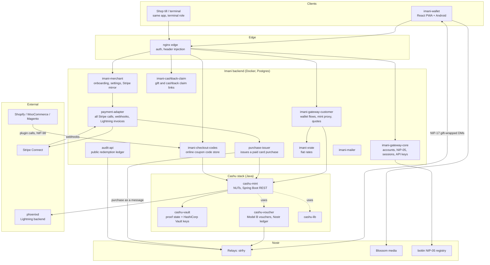
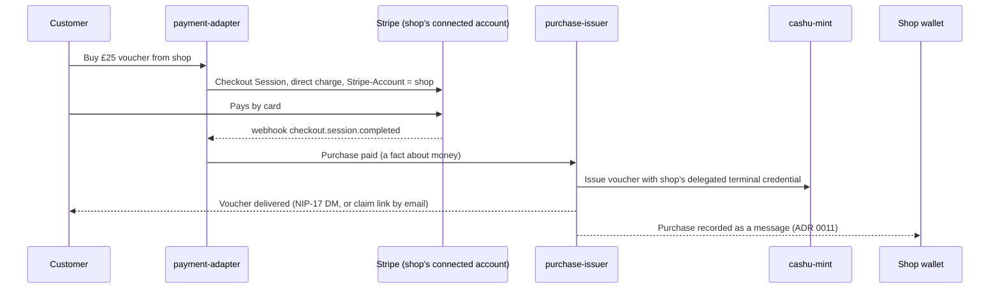
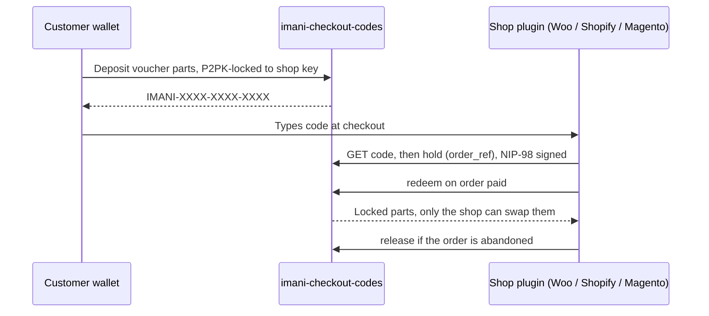

# Architecture

How the Imani wallet fits with the backend stack and with outside services.
For why vouchers never leave the shop, see
[units-and-redemption.md](units-and-redemption.md).

## The big picture

## Components

### The wallet (this repo)

| Part | Role |
| --- | --- |
| `src/` | React 19 + TypeScript + Vite single-page app, packaged for Android by Capacitor. Customer, shop and terminal roles in one app. |
| `packages/` | `@imani/*` libraries: `wallet-core`, `wallet-storage`, `nostr-vouchers`, `voucher-send`, `redemption`, `money`, `payment-requests`, `licence`, `dm-poll`, `imani-qr` and more. |
| `services/wallet-api` | The API that **plans** wallet operations; the caller signs (ADR 0002). |
| `services/purchase-issuer` | A terminal that issues the voucher once a card purchase is paid (ADR 0009, 0010). |
| `services/audit-api` | Public read API over the redemption ledger. |
| `services/imani-mailer` | Gift and receipt emails. |
| `services/subscription` | Paid feature licences, sold as vouchers (ADR 0007). |

Key rule: **the caller holds the key and the vouchers** (ADR 0001). Keys live
on the device. No service keeps a customer's balance.

### Imani backend

| Service | Role |
| --- | --- |
| `imani-gateway-core` | Authentication authority: accounts, NIP-05 handles, recovery, sessions, API keys. |
| `imani-gateway-customer` | Customer wallet flows: token DMs, mint proxy, quotes, wallet sync, terminal credential checks. |
| `imani-merchant` | Shop onboarding and settings. Mirrors Stripe Connect state, never owns it. |
| `payment-adapter` | The only holder of the Stripe platform key. Checkout, webhooks, Connect lifecycle, Lightning invoices. |
| `imani-checkout-codes` | Code store for online coupon codes (Spring Boot, Postgres). |
| `imani-cashback-claim` | Parks a bearer token behind a single-use claim link for gifts to people with no account. |
| `imani-xrate` | Operator-set fiat rates used to convert face value to the sats unit of account. |

### Cashu stack

| Repo | Role |
| --- | --- |
| `cashu-lib` | Java Cashu library: tokens (V4/CBOR), proofs, P2PK, voucher documents by reference. |
| `cashu-mint` | Java mint implementing the NUTs. Refuses vouchers in `melt`. |
| `cashu-vault` | Proof and keyset state in Postgres, private keys in HashiCorp Vault. |
| `cashu-voucher` | Model B vouchers: issuer-signed documents, NIP-33 public ledger, NIP-17/44 private backup, ledger v2. |

### Nostr

Vouchers travel between wallets as **NIP-17 gift-wrapped DMs**, so relays see
no sender, recipient or amount. Identities are Nostr keys with NIP-05 handles
(`alice@imani.casa`, served by `bottin`). Redemption attestations go to a public
ledger on relays. Blossom stores media and support snapshots.

## Integrations

### Stripe (card purchases)

- **Direct charges**: the shop is merchant of record and the money lands in the
  shop's own Stripe account. Imani never holds funds (payment-adapter ADR 0001).
- Paid before issued: no voucher exists until Stripe confirms payment (ADR 0010).
- Issuance never lives in the payments service, so it never holds issuing keys.

### E-commerce platforms

Sold online, redeemed anywhere. A shop can sell vouchers on its website and
take them back at its online checkout and at the counter.

| Platform | Repo | How |
| --- | --- | --- |
| WooCommerce | `imani-woo`, `imani-checkout-woo` | Plugin sells vouchers as products and accepts `IMANI-` codes at checkout. |
| Shopify | `imani-checkout-shopify` | Shopify can't call our code store at checkout, so each code is mirrored as a Shopify gift card (compact form `IMANIXXXXXXXXXXXX`) and settled by the backend. |
| Magento 2 | `imani-checkout-magento` | Module on top of the shared PHP core. |
| Shared core | `imani-coupon-core` (PHP 8.2) | Framework-free code lookup, hold, redeem, release, against the contract. |

Every call is NIP-98 signed by the shop key. The code is a reference, never a
bearer secret. The byte-level contract and test vectors live in
`docs/checkout-codes/`.

## Running it locally

`deploy/up.sh` brings up the full stack with Docker Compose: relays, Blossom,
gateway services, mint and vault, Postgres, `stripe-mock` or `stripe listen`,
`phoenixd-mock` and Mailpit. `npm run dev` then serves the wallet on `:5173`
and proxies `/api` to the local gateway.
