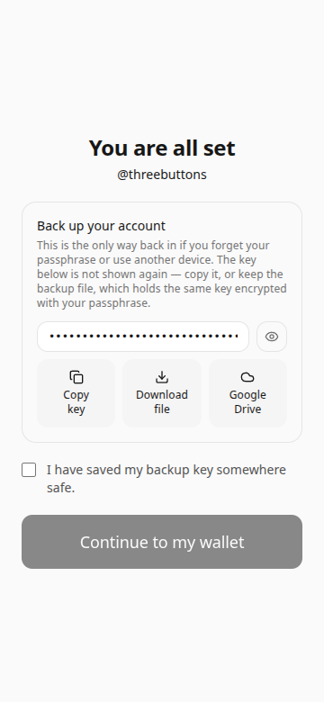

# Shopper's guide

Imani Wallet holds **coupons** from the local businesses you buy from. A coupon
is like a gift card: a merchant gives it a value, sends it to you, and you spend
it with them later, all or part at a time. This guide walks you through it.

- [Setting up](#setting-up)
- [Your wallet at a glance](#your-wallet-at-a-glance)
- [Receiving a coupon](#receiving-a-coupon)
- [Paying with a coupon](#paying-with-a-coupon)
- [Getting change](#getting-change)
- [Keeping your account safe](#keeping-your-account-safe)
- [Common questions](#common-questions)

## Setting up

1. Open the app. Choose **Create an account**.
2. Pick a **handle**, like `alice@imani.casa`. This is the name merchants use to
   send you coupons, so pick something you don't mind sharing. It works like an
   email address for your wallet.
3. Choose a **passphrase**. You'll type it to unlock the wallet on this device.
4. **Save your backup key.** The app shows it once, on a screen you can't skip.
   Write it down and keep it somewhere safe. This is covered in detail
   [below](#keeping-your-account-safe), and it matters more than anything else here.

   

   Three ways to keep the same key: copy it, download the encrypted file, or put
   that file in your Google Drive. One is enough.

   **Google Drive** opens Google's own account chooser. The app asks only for its
   own hidden app folder in your Drive (it cannot see your files), and uploads the
   same file the download gives you, still locked with your passphrase. It goes
   from your browser straight to Google: Imani never sees the file, the key or your
   Google sign-in. To get back in on another device, choose **Log in** on the
   first screen, then **Google Drive**, pick the same Google account, check it's
   your account, and type your passphrase. You can delete the backup any time in Google Drive
   (Settings › Manage apps).

Already have an account? Choose **Log in**, then say where your backup is:
**Google Drive** or **A backup file**. The app shows whose account it is (picture,
name and handle) before it asks for anything, then you type your passphrase. If
you only ever saved the backup key itself, tap **Use your backup key instead** at
the bottom, paste it, and choose a passphrase for this device.

One wallet per device at a time. If this device already holds a different account,
logging in with another one (by backup, by key, or by registering) is refused with
**This device already holds another wallet**, and nothing is changed. Open that
wallet and log out first: logging out checks that every voucher in it is backed up.
Logging back in to the same account is always allowed.

Every account needs a profile. If the account you open doesn't have one yet, the
app asks you to pick a handle before it lets you in (your display name starts as
that handle, and you can change it in Settings).

## Your wallet at a glance

The home screen shows:

- **Your total balance**, added up across all your coupons.
- A **deck of cards**, one per merchant you hold coupons from. Swipe through them.
  Each card is that merchant's identity and their running total with you. Tap one
  to see their coupons and your history together.
- Two buttons: **Scan** (to pay) and **Receive** (to be paid).

Tap a merchant's card to open it, then tap through to a single coupon to see its
value, when it expires, and a QR code for it.

## Receiving a coupon

You don't have to do anything to receive. When a merchant sends you a coupon:

1. A little message pops up: **"[Merchant] sent you €5 — on its way."**
   This appears the instant they send, before the coupon has fully arrived.
2. A few seconds later the coupon lands in your wallet, filed under that
   merchant. Your balance goes up.

To let a merchant send to you, show them your code:

- Tap **Receive**. The app shows a QR code of your handle.
- The merchant scans it, types the amount, and sends.

People and stalls are always shown by their picture, name and handle, never by
a code or a key. If a name has not loaded yet you will briefly see a grey circle;
if it cannot be found the app says **Someone** (or **Unknown stall**) rather
than showing a string of letters and numbers.

That's the whole flow. If a coupon seems slow to arrive, give it a moment: the
"on its way" message means it's already been sent to you.

## Paying with a coupon

To pay a merchant back with the coupons you hold from them:

1. The merchant shows you a **payment request QR** (they create it on their till).
2. Tap **Scan** and point your camera at it. No camera? Use **paste** to drop in
   a code they've sent you.
3. A confirmation screen shows who you're paying, how much, and any note. Check it.
4. Tap **confirm**. The coupon value transfers to the merchant, and you get a
   receipt.

The app only lets you pay a merchant with coupons **from that same merchant**.
If the confirmation screen warns about an expired coupon, not enough balance, or
no matching coupon, it will say so plainly rather than fail silently.

## A merchant's page: Buy and Pay

Scan a merchant's own QR code (or type their handle on **Scan**) and the app opens
**their page**, not a payment. Scanning a friend's code still starts a send.

A merchant's page has two buttons side by side:

- **Buy**: buy a voucher from them by card. Greyed out, with "Card payments aren't
  set up for this merchant", when they don't take cards. If you aren't logged in,
  you log in first and come straight back to the purchase.
- **Pay**: pay them with the vouchers you hold from them. Greyed out, with "You
  have no vouchers from this merchant yet", until you hold at least one that is
  unspent and not expired.

**Send** (give one of their vouchers to someone else) and **Share** sit underneath.

## Getting change

You don't need an exact-value coupon to pay a smaller amount.

- Pay €2 with a €5 coupon, and the €5 coupon is replaced by a new **€3 coupon**
  from the same merchant. Your total drops by exactly what you spent.
- Pay the full value, and the coupon is used up and leaves your wallet.

There is a tiny floor on how small a split can be (it depends on the coupon), but
for everyday amounts you'll never hit it. Paying a coupon in full is always
allowed.

## Sending a Cashlink

A **Cashlink** is a coupon sent as a link or QR code. You can send one to anyone, even someone
with no account yet. (A stall's cashback arrives as a Cashlink too.)

1. Tap **Send**, then **Anyone, as a Cashlink**.
2. Pick the coupon and the amount. Choose how long the link lasts: **1 day**,
   **7 days** (the usual) or **30 days**. It never lasts longer than the coupon
   itself.
3. Check the confirm screen: *"Anyone with the link can claim it. You can take it
   back until it is claimed."* Tap **Make Cashlink**.
4. Tap **Show QR**, **Share link** or **Copy link**, and send it however you like.

The person who opens it sees *"Cashlink from {you}"*, which stall and how much, and taps
**Add to my wallet**. If they have no account, they make one first; the gift waits
for them. Nothing is spent until they tap Add.

Things worth knowing:

- **Treat the link like cash.** Whoever opens it first and taps Add gets the
  coupon. If you know their handle, send it to them directly instead: nobody else
  can claim that.
- **You can take it back.** Open the send in your history (it has a **Cashlink**
  badge) and tap **Take it back**. The coupon comes back to your wallet and the
  link stops working.
- **Unclaimed links come back on their own.** After the link expires, your wallet
  takes the coupon back the next time you open it, and the history says
  **Taken back**. Once someone claims it, the history says **Claimed**.
- **Lost your phone?** Restore your account and your wallet finds the links you
  sent that are still waiting, so it can still take them back.
- At most **10 links** can wait to be claimed at once. A link never asks for your
  key or passphrase; if a page that looks like this wallet does, close it.
- A stall can't send its own coupons this way (it creates a Cashlink from **Sell** instead), a
  subscription, or a terminal pass.

## Keeping your account safe

Imani Wallet is **self-custodial**. That's a fancy way of saying: your coupons
live on your phone, and only your key can spend them. There is no company holding
your balance, which is good for your privacy and control, but it means the
responsibility for the key is yours.

**Your backup key is the master key to your wallet.**

- It's shown once, when you sign up, behind **Show backup key**. Write it down.
  Store it somewhere safe and private, not in a photo on the same phone. You can
  see it again under **Settings → Backup → Show my backup key** after typing
  your passphrase.
- You can also download an **encrypted backup file** from **Settings → Backup**.
  It's protected by your passphrase, so it's safe to keep in cloud storage.
- Anyone who has your key can spend your coupons. Treat it like cash.

**There is no password reset.** Nobody, not even the people who run the service,
can recover your account for you. If you lose both your key and your backup file,
the coupons in that wallet are gone. This is the trade-off for holding your own
value.

To move to a new phone: install the app, choose **Log in**, open your backup
(Google Drive or the file), check it's your account, and type your passphrase.

**Logging out wipes this device.** It erases your key from this phone (the
coupons stay in place but become unusable without the key). Only log out if you
have your backup. The app warns you before it does this.

Logging out stays off until everything of value is confirmed backed up under your
account: every voucher you hold, and any cashback you have claimed that is still
waiting to be added to the wallet. If something can't be confirmed (no connection,
or the wallet is locked), you'll see **You can't log out yet**. Nothing is erased and
your key stays. Check your connection and tap **Try again**. Cashback that was waiting
comes back when you log in again, and is added the next time you open the cashback
screen. A cashback or gift link opened while logging out is not taken: it stays on
its link for you to open again after you log in.

If the wallet is open in more than one tab or window, logging out first pauses the
others: they stop receiving and sending, finish what they were doing, and reload
once the logout is done. If another tab is still busy, or can't be reached, logging
out stays off and says so. Nothing is erased. Close the other tabs, or wait a
moment, and try again. A send started while logging out is refused before anything
moves. If logging out stops part way for any reason, receiving and sending carry on
straight away, without a reload.

## Common questions

**Is this cryptocurrency?**
Under the hood it uses the same kind of technology, but you never see it. To you
it's coupons with a value, sent and spent. No exchanges, no wallets full of
coins, no prices going up and down.

**Do coupons expire?**
They can. Merchants set this when they issue. A coupon that expires within a week carries an
"Expires in N days" label (amber), and one with less than a day left says how many hours (red).
Your coupon list puts the soonest to expire first; tap **Newest** for the order they arrived in.

When you open Imani, it reminds you under the bell a week before a coupon runs out and again on its
last day, and home shows "N vouchers expire this week". Turn this off in **Settings → Notifications
→ Coupons about to expire**. The reminder is worked out on your phone from the coupons you hold:
nothing is sent anywhere, which also means it only appears when you open the app.

An expired coupon is no longer counted in your balance and cannot be spent. It stays visible under
**Expired** at the bottom of that merchant's list, and its page says when it expired.

**Can I use one merchant's coupon at another shop?**
No. A coupon is tied to the merchant who issued it. You spend it back with them.

**I also run a stall. Can my stall's account hold coupons from other shops?**
No. A merchant account can only take its own stall's vouchers: it refuses a coupon or a Cashlink
from another stall, and says *"Merchant accounts can only take their own stall's
vouchers. To use a voucher from another stall, use a customer account."* Nothing is spent when it
refuses, so the voucher still waits for you. To shop at other stalls, keep a separate customer
account (register a second handle, without the merchant profile) and open the link there: on the
refusal screen, **Switch account** keeps the voucher parked and brings it back after you log in.
Sending a gift to a customer is unaffected.

**A shop gave me a code (`CB-…`). Where do I type it?**
Codes are no longer used. Ask the shop to show you the Cashlink QR again, and scan it with your
phone camera (or open the link they send you).

**What if I get a new phone?**
Choose **Log in**, open your backup (Google Drive or the file) and type your
passphrase. Your coupons come back from the
network. (Any coupon you'd already spent stays spent, which is correct.)

**Someone sent me a coupon but it hasn't shown up.**
You'll have seen the "on its way" message if it was sent. Settlement takes a few
seconds. If it's much longer, check your connection and reopen the app.

---

Want to understand what's really happening when you send and receive?
Read **[How it works](how-it-works.md)**.
