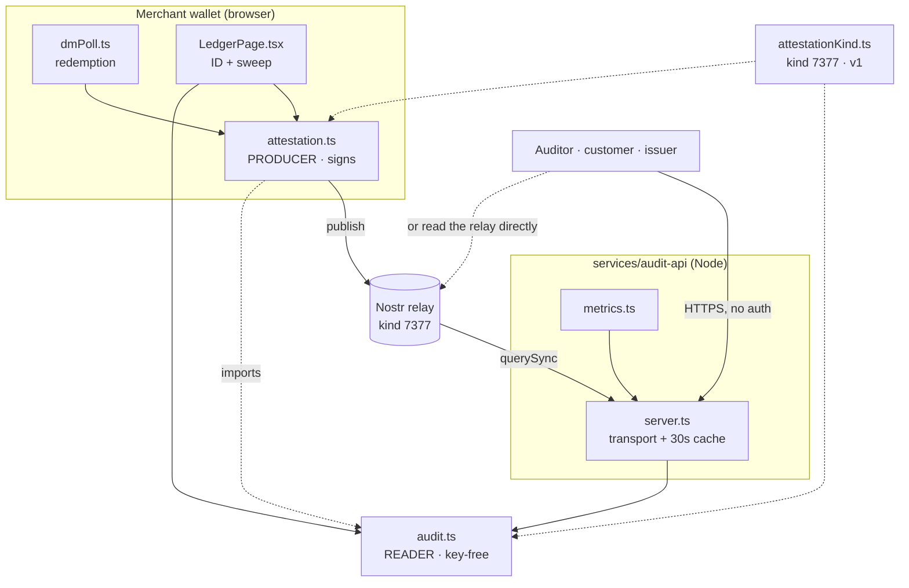

# The redemption ledger — technical guide

A pseudonymous, publicly verifiable record of coupon redemptions, published as
kind-7377 Nostr events. This document covers the wire format, the cryptography,
the producer and reader, the hosted API, and the failure modes that have already
bitten.

The design document is `docs/research/redemption-attestation-privacy.md`. Every
claim in it was executed rather than reasoned about; this guide is the
implementation view.

- [The requirement](#the-requirement)
- [Architecture](#architecture)
- [Cryptographic scheme](#cryptographic-scheme)
- [Wire format](#wire-format)
- [The producer](#the-producer)
- [The reader](#the-reader)
- [The reconciliation sweep](#the-reconciliation-sweep)
- [The hosted audit API](#the-hosted-audit-api)
- [Operations](#operations)
- [Threat model](#threat-model)
- [Known limits and open work](#known-limits-and-open-work)

## The requirement

> For any merchant one can fetch the attestations to audit the sales/numbers,
> possibly without knowing which merchant it is.

The sealed kind-7376 history (`txRecords.ts`) is NIP-44 encrypted to the
merchant's own key: perfect for privacy, useless for audit. This is the other
half — one small unencrypted event per redemption carrying only what an audit
needs.

### Three problems, kept apart

Conflating these was the main error in the first draft.

1. **Access** — who may read the relay. NIP-42 answers this.
2. **Authorisation** — which events a reader may see. strfry's
   `restrictReadToInvolvedPubkey` answers this and is **the wrong control
   here**: "read only what you are a party to" forbids the third-party audit
   this feature exists for.
3. **Disclosure** — what a *legitimate* reader learns. Only the payload decides
   this. An auditor is authenticated by definition, so access control cannot
   protect against the reader you are deliberately admitting.

Pseudonymisation is problem 3. It is a property of the payload, not the
transport.

### Why not just use the mint?

The mint prevents double-spend, but it operates on proofs and has no concept of a
voucher. It cannot distinguish a merchant crediting 2,500 XAF from one crediting
1,800 against the same coupon — both burn 2,500 sats identically. **The face
value credited lives only here.**

## Architecture



### The one-way dependency

`attestation.ts` (producer) imports from `audit.ts` (reader). **Never the
reverse.** That direction is a safety property, not a style preference:

- the reader cannot reach key derivation, so **a reader can never forge what it
  is meant to check**;
- the hosted service loads the reader without loading a signer, so a total
  compromise of the API forges nothing.

The key-free primitives (`commitTo`, `verifyDisclosedTotal`) therefore live in
the reader and are re-exported by the producer for merchant-side callers.
`verifyDisclosedTotal` was originally stranded in the signing module, which is
exactly why the hosted API could not offer the disclosure check and the design's
"read one merchant's totals — only on disclosure" row was undeliverable by
anyone.

### Why the wire constants are their own module

`attestationKind.ts` exists because the producer reaches `./nap` and `./relay`,
which reach `@imani/nap-client-web` and `import.meta.env` — a browser dependency
graph and a Vite-only global. The Node audit API has neither. Importing the
producer to learn a kind number would drag the whole wallet into a service that
must never be able to sign anything. Declared once, re-exported, so producer and
reader cannot drift about what is on the wire.

### Why the API is Node and not Spring

Every other backend in this estate is Java. The reader is ~300 lines of
signature checking and payload validation **whose correctness is the product**. A
Java port would be a second implementation of the security boundary, free to
drift, and the drift would take the form of an auditor being told a forged
record is genuine. Reusing the TypeScript reader makes that class of bug
impossible.

## Cryptographic scheme

### Ledger key — a pseudonym that is also a fetch handle

```
ledgerSk  = SHA256("imani-ledger-key-v1:" || merchantSk)
ledgerPub = schnorr.getPublicKey(ledgerSk)
```

Attestations are signed by `ledgerSk`, so `{ authors: [ledgerPub] }` fetches
exactly one merchant's set. That is what makes "audit any merchant's numbers" a
single relay query rather than a scan.

**Derived from the SECRET key, not the public one.** This is the difference
between a pseudonym and a fig leaf: `issuerId` is signed inside every voucher a
merchant issues, so anyone holding one of their coupons knows their public key. A
ledger ID hashed from that public key is recomputable by any of their customers,
and the pseudonym breaks the first time somebody looks.

**Hashes the key's BYTES, not its hex string.** Hashing the string binds the
pseudonym to an *encoding* rather than to a key. `privkeyHex()` returns whatever
was passed to `createWalletSigner`/`setKey` verbatim and neither normalises case,
so restoring the same key in uppercase would derive a different ledger identity
and silently orphan the entire published history. Measured before fixing:
uppercase moved the pubkey from `9d3309d7…` to `92dac1d2…`; hashing bytes gives
`a6170926…` for both.

The raw secret never leaves the module. `ledgerKey()` is module-private, callers
get `ledgerPubkey()`, and the borrowed private key copy is wiped (`priv.fill(0)`)
as soon as the derivation input is built.

### Nullifier — double-spend detection without identity

```
nullifier = SHA256("imani-redeem-v1:" || token)
```

Monero calls this a key image, for the same reason: it detects a double-spend
without revealing what was spent or by whom. Same token redeemed twice → same
nullifier → anyone can see it.

**Keyed on the TOKEN, never the voucher.** A £10 voucher legitimately comes back
as £4 then £6; `redemptionLedger.ts` states that tokens legitimately share a
`voucher_id`, and a split preserves voucher identity byte-for-byte. A
voucher-keyed tag **collides on an honest partial redemption** and reports a
double-spend that did not happen.

**Bound to the token's own secret bytes.** `token_id` is `sha256(token)` and
appears in the merchant's UI, so a tag derived from ids alone could be computed
— and **published first** — by anyone who had seen the coupon, framing an honest
redemption as a replay. The full token is held only by the parties to the
payment.

### Commitments — Pedersen, with derived blinding

```
r_i = SHA256("imani-blind-v1:" || hex(ledgerSk) || ":" || nullifier)  mod (n-1), +1
C_i = amount_i * G + r_i * H
```

Emitted as a 33-byte compressed point in hex, matched by `/^0[23][0-9a-f]{64}$/`.

**H has an unknown discrete log wrt G.** If anyone knew `x` with `H = x*G` they
could open a commitment to any value they liked and the binding property would be
worthless. `pedersenH()` hash-and-increments from the fixed string
`imani-pedersen-H:{i}`, so the point is one nobody chose. The loop is necessary,
not defensive: roughly half of candidate x values are not on the curve.

**Derived, not random.** This is what makes self-audit survive a device wipe. A
random blind would have to be stored, and a merchant who lost it could never
re-open their own commitment — locked out of auditing their own history by the
very mechanism meant to protect it.

**Never zero.** The reduction is `(raw mod (n-1)) + 1`. A zero blind is no blind
at all: the commitment reduces to `amount * G`, brute-forceable over plausible
amounts.

**`commitTo(0, r)` is special-cased** to `H*r`, because `G.multiply(0n)` throws
on the identity point.

Commitments also defeat the amount-fingerprint attack. With cleartext amounts, a
customer who bought for exactly 2,500 at 09:14 finds that record and unmasks the
pseudonym permanently — one counterparty breaks it for everyone. Verified:
recomputing a commitment from a known amount matches nothing, because the blind
is secret.

### Homomorphic disclosure

```
blindSum = (Σ r_i) mod n                 -- merchant, needs ledgerSk
verify:  Σ C_i  ==  commit(total, blindSum)   -- auditor, needs no key
```

`blindSumFor` refuses a disclosure spanning more than one unit. The curve does
not know what the scalars denominate, so "total 5000" over XAF and EUR verifies
perfectly and means nothing. Refusing at construction is the only place it can be
caught: by the time an auditor sees the total, the units are gone.

`verifyDisclosedTotal` reduces the supplied scalar mod n, so a hand-assembled or
externally-summed blind that is arithmetically equal still verifies. It also
rejects anything that is not 66 hex characters **before** parsing:
`Point.fromHex` accepts 65-byte uncompressed input, and the comparison is against
`toHex(true)`, so an honestly-formatted uncompressed commitment would silently
false-negative. A verification tool reporting "does not reconcile" for a correct
set is worse than one that refuses the input.

**What a `true` binds.** The disclosed *set* sums to the disclosed total. It does
**not** bind the merchant to a period: they choose which nullifiers go in, and
omitting one reconciles perfectly at a lower total. Set completeness must come
from elsewhere. An earlier version of both this comment and the design document
claimed the stronger property; review caught it.

## Wire format

Kind **7377**, regular (not replaceable, not ephemeral). Append-only is exactly
right for a redemption ledger: a replaceable kind would let a later publish
quietly erase an earlier redemption. 7377 sits beside NIP-60's 7375 (token) and
7376 (history) because it is the same family of record. It is **not** a
registered NIP-60 kind; if one is standardised, move to it.

```json
{
  "kind": 7377,
  "pubkey": "<ledgerPub>",
  "created_at": 1789840995,
  "tags": [
    ["n", "<nullifier hex64>"],
    ["unit", "EUR"],
    ["v", "1"]
  ],
  "content": "{\"v\":\"1\",\"nullifier\":\"…\",\"commitment\":\"03…\",\"unit\":\"EUR\"}",
  "sig": "<BIP-340>"
}
```

**The nullifier is both tag and content.** As a tag so an auditor (or a customer
checking their own coupon) can look up one redemption with a `#n` filter instead
of fetching and parsing the whole stream. In the content because that is what is
signed. The reader cross-checks them — see below.

**`v` is a tag for filtering and in the content for authority.** Version is read
from the content, which is signed; the tag carries no more authority than any
other tag.

**Publishing the event IS the attestation.** `pubkey` and `sig` are a BIP-340
claim over the canonical serialisation, the same scheme as the voucher signatures
this wallet already verifies. No second signature layer. `buildAttestation` uses
`finalizeEvent` rather than `signer.signEvent` deliberately: the signer signs as
the merchant, and signing this as the merchant is precisely what the design
exists to avoid.

### Cadence: one event per redemption

A deliberate choice and the one thing here expected to change.

Per-redemption publication is the simplest thing that works and the only shape
that lets a customer check their coupon the moment they are handed it. The cost
is that **timing is itself information**: an observer watching one ledger key
learns that stall's trading hours, rhythm, and roughly how busy it is, without
reading an amount or a name.

Batching (one event per day carrying many nullifiers) collapses that to "traded
on this day" — strictly better privacy, strictly worse product, since a customer
cannot verify a coupon that has not been published yet.

What the migration costs, checked against the staging relay rather than assumed:

- **The customer check survives untouched.** A batched event carries one `n` tag
  per nullifier and a relay matches `#n` against all of them. Verified: a filter
  for a single nullifier matched an event carrying two. `couponCheckFilter` keeps
  working.
- **The auditor reader does NOT.** Content goes from one `{nullifier,
  commitment}` to a list, and a v1 reader breaks on it. Hence the version marker
  from the first event — events already published cannot be amended.

## The producer

`src/lib/attestation.ts`. Entry point `attestRedemption`, called from
`dmPoll.ts` after the redemption completes.

```ts
attestRedemption({ token, faceValue, unit, signatureValid })
  → AttestationReceipt | null
```

### It never throws

The money has already moved and the row is already written when this runs. A
relay that will not take the record has undone neither, so a failure here must
not turn a completed redemption into a reported error — the same rule
`publishVoucher` and `announceArrival` follow.

Returns `null` on `result.ok === 0`, which is load-bearing: **the row must not
claim a public record that nothing holds.** The gap is real and the sweep is what
finds and stamps it later.

### `signatureValid` is required, and the attestation is skipped without it

`faceValue` for a coupon with no verified voucher comes off the DM envelope,
which the *sender* writes. `dmCrypto` says so directly: "a genuine low-value
token could be announced at any face value at all". Committing to that number
would have the merchant signing "I credited N" where N is a figure a counterparty
supplied and nobody established.

The card forbids exactly this shape: *a merchant may attest to what they
redeemed; they may not mint a voucher on the issuer's behalf.* A signature over
an unestablished claim is the same error as a fabricated child voucher, wearing a
more respectable suit.

Plain ecash therefore produces no attestation. It carries no issuer claim, so
there is nothing to attest to — the same distinction `hasValidationClaim` draws
for the Checks badge.

### Receipts and row stamping

`AttestationReceipt` is `{ nullifier, eventId, at }`, written onto the
transaction row so the merchant's receipt can show the redemption was published.

- **Deliberately not the commitment.** A reader holding the row already knows the
  amount and the commitment is recomputable from it; printing it beside the
  amount invites treating a public value as a private one.
  `verifyOwnCommitment` is the supported way to re-open it.
- **`at` is the event's own `created_at`**, not the row's timestamp and not
  "now". A sweep can publish months after the redemption, and the receipt dates
  the publication rather than the sale.

`dmPoll.ts` stamps `attestationNullifier`, `attestedValue` (from
`meta.faceValue`) and `attestedUnit` onto the row **at redemption time**, and
this is what makes everything downstream possible. The nullifier hashes the
*received* token, which `TokenRedemption.redeem` swaps at the mint. It cannot be
recomputed afterwards, and `txRecords` deliberately never writes a token to a
relay because it is bearer value. Storing the nullifier discloses nothing new —
it is already published — and without it, self-audit after a device wipe is
simply unreachable.

### Self-audit

```ts
verifyOwnCommitment(nullifier, commitment, amountMinorUnits): boolean
```

Re-derives the blind from `(ledgerSk, nullifier)` and re-opens the commitment.
Works on any device holding the key, but **only for a nullifier the merchant
still has**. Only works for one's own attestations: another merchant's blind
comes from their ledger key, so the same amount produces a different commitment.

## The reader

`src/lib/audit.ts`. Every function takes events and returns verdicts, which is
what lets the same code serve an external auditor, the hosted API, and a merchant
auditing themselves.

**There is deliberately no privileged reader.** An internal tier that could
resolve a `ledgerPubkey` to a real stall through a disclosure granted at
onboarding was designed, never built, and in 2026-09 decided against outright. A
stored `ledgerPub → stall` mapping is the single artefact whose breach
de-anonymises every merchant at once, retroactively, for every attestation ever
published. It is the same chokepoint as dual-encryption in a different costume,
and sitting in a table rather than a key does not change its blast radius.

> **Do not add a parameter here that widens what a caller may learn.** The
> absence of one is the privacy guarantee, not an oversight.

### Parsing is defensive to the point of rudeness

Anyone can publish a kind-7377 event. The stream is public and unauthenticated by
design, so a reader that trusts its shape can be fed anything. Every defect is a
**rejection with a reason**, never a throw and never a silent skip — an audit tool
that quietly drops what it cannot read reports a clean ledger for a broken one.

| `AttestationDefect` | Cause |
|---|---|
| `wrong_kind` | Not 7377. The caller filtered wrongly, or the relay ignored the filter. |
| `bad_signature` | BIP-340 fails. Forged, corrupted, or mis-serialised. |
| `missing_nullifier` | No `n` tag. Nothing to look it up by, so it audits nothing. |
| `unparseable_content` | Content is not JSON. |
| `nullifier_mismatch` | Tag and content disagree about which redemption this is. |
| `bad_commitment` | Absent, or not a 33-byte compressed point in hex. |
| `unknown_version` | A payload version this reader cannot read. |

`unit` is the one field that falls back rather than rejecting. A missing unit
makes the record useless for summing but still perfectly good for "was this
coupon honoured", which is the check that matters most.

### The cached-verdict hole

**A real hole, found by a test that expected a forgery to be refused and watched
it audit clean.** `verifyEvent` memoises its result onto the event as a
`Symbol(verified)` property. Symbols are copied by object spread and by
`Object.assign`:

```ts
const forged = { ...genuine, sig: 'ff…' }   // carries Symbol(verified) = true
verifyEvent(forged)                          // true. The sig is never checked.
```

An attacker only has to hand the reader an object derived from any genuine event
to have arbitrary content accepted as signed. Measured: spreading a signed event
and replacing the signature verifies `true`; the same object round-tripped
through JSON verifies `false`, because the symbol does not survive serialisation.

Relay events arrive as JSON and so were never at risk in production, which is
exactly why this could sit unnoticed — unreachable until someone passes an
in-memory object, and then total. `stripCachedVerdict` deletes every own symbol
before verifying: one object copy, and the class of bug goes rather than the one
instance.

### Batch detection is structural as well as by version

```ts
if (Array.isArray(content.batch)) return reject('unknown_version')
const version = content.v ?? ATTESTATION_VERSION
if (String(version) !== ATTESTATION_VERSION) return reject('unknown_version')
```

The staging relay really does hold a two-nullifier batch published during the
design work with **no `v` at all** (event `6a3688bf…`). An absent version
defaults to v1, so without the structural check the only thing standing between a
batch and a mis-read is the nullifier cross-check — which happens to catch it,
but reports `nullifier_mismatch` and tells the operator the publisher is
malformed rather than ahead of this reader.

### Duplicates

`findDuplicates` groups by nullifier **across ledger keys**, not within one. A
merchant double-crediting their own coupon and two different stalls both claiming
the same token are both frauds, and a per-merchant view would miss the second
entirely.

A duplicate is a flag, not a verdict. Republication is byte-identical by design
(derived blinds), so the honest, expected duplicate is *same nullifier, same
commitment, same author* and is reported as `benign: true`, separately from the
case that indicates fraud.

### Coupon verdicts

```ts
checkCoupon(nullifier, attestations, redeemedAt?, now?) → CouponCheck
```

| Verdict | Meaning |
|---|---|
| `honoured` | Attested, all copies agree. **Proof.** |
| `conflicting` | Attested more than once with differing commitment or author. |
| `pending` | Not attested, not yet late. Says nothing. |
| `missing` | Not attested, past the SLA. **Evidence only.** |

`ABSENCE_SLA_MS` is **one hour**, and it is a product decision rather than a
constant picked to make a test pass. A gap has innocent explanations — the tab
closed mid-publish, a relay dropped the event, the sweep has not run. Reporting
those as a dishonest merchant makes the tool a false-accusation generator and
destroys exactly the trust the feature exists to build. An hour is long enough
for a wallet to reopen and sweep, short enough that a same-day dispute still gets
an answer.

**No `redeemedAt`, no `missing` verdict at all.** A caller that does not know when
the redemption happened cannot obtain an accusation. That is the correct failure
direction and it is enforced in the reader, so every caller inherits it.

Conflicting claims are never reported as a "yes". A customer told `honoured`
while two stalls claim the same coupon has been given a clean answer to a dirty
situation.

## The reconciliation sweep

`reconcileAttestations(rows, stamp?)`, reachable at **Settings → Redemption
ledger → Check now**.

**This is the gate that makes absence mean anything.** The design orders the work
producer → sweep → reader for this reason, and no customer-facing check ships
before it.

The set-difference is on nullifiers and only works because
`attestationNullifier` is stamped at redemption time. Rows without one are
**skipped, not treated as gaps**: they predate the feature or never qualified,
and republishing them is impossible anyway since the blind needs a nullifier.

Two classes of row get a receipt, and the second is easy to miss:

1. a gap the sweep republishes, which had no receipt by definition;
2. a row whose attestation is **already published** but carries no receipt —
   every redemption from before the receipt feature, and any whose write-back was
   lost. The event is right there in the fetch, so stamping costs nothing and is
   the only way those rows ever show one.

Details that matter:

- **Oldest wins.** The `seen` map keeps the earliest event per nullifier, because
  a receipt should name the first time a redemption was recorded, not the most
  recent retry.
- **Republishes `attestedValue`, not `amount`.** The attestation commits
  `meta.faceValue` while `amount` comes off the voucher's `token_amount`. Where
  they differ, reading `amount` would republish a second, conflicting commitment
  for one redemption — worse than the gap.
- **Idempotent by construction.** Derived blinds mean a republish after a partial
  relay failure reproduces byte-identical content rather than a conflicting
  commitment.
- **Receipts written only on success.** A row must never claim a public record no
  relay accepted; the next sweep finds it as a gap again, which is correct.
- **A failed local write never aborts the sweep.**

`LedgerPage.tsx` re-reads the stream *after* the sweep, so the merchant sees the
ledger as it now stands rather than the state that prompted it.

### A failure the jsdom tests could not see

The sweep reaches IndexedDB through `listTransactions`, which throws "Wallet not
opened yet" whenever the store is not open. The tests mocked `listTransactions`,
so the whole failure path was invisible: driving the real screen in a real
browser showed the promise rejecting, the button re-enabling, and the screen
rendering **nothing**. A merchant taps "Check now" and gets silence, which reads
as a dead button rather than a failure they could act on. Hence `sweepFailed`
state and an explicit message.

## The hosted audit API

`services/audit-api/server.ts`. Transport plus a cache; all logic is the shared
reader. Deployed only to staging, at `audit.staging.398ja.xyz`.

### Endpoints

| Method | Path | Returns |
|---|---|---|
| GET | `/health` | `ok` / `degraded`, plus counts once warm |
| GET | `/metrics` | Prometheus text. **Not public** — 404 at the edge |
| GET | `/api/v1/audit/summary` | Stream-wide totals, defect tally, units |
| GET | `/api/v1/audit/ledgers` | Every ledger key with its summary |
| GET | `/api/v1/audit/ledger/{id}` | One ledger's summary + its attestations |
| GET | `/api/v1/audit/coupon/{nullifier}` | Verdict for one coupon |
| GET | `/api/v1/audit/duplicates` | Conflicting claims only |
| POST | `/api/v1/audit/verify-total` | Checks a disclosed total |

Query parameter on the coupon endpoint: `redeemedAt`, epoch ms.

### `/ledger/{id}` always returns 200

Even for a key with no records. A stall that has redeemed nothing and a stall
that does not exist are indistinguishable on a pseudonymous stream **by
construction**, and a 404 would invent a distinction the data cannot support.

Note that both ledger IDs and nullifiers are 64-hex and `HEX64` accepts either,
so passing a ledger ID to `/coupon/` yields a verdict about a coupon that never
existed. That is a caller error, not a finding.

### `redeemedAt` is bounded, and that is a security control

It is caller-supplied and a `missing` verdict is quotable at a merchant.
Unvalidated, `?redeemedAt=0` returned `missing` instantly for any nullifier — the
SLA gated the caller's honesty rather than the passage of time, which is no gate
at all on a public endpoint. Caught in review; measured before fixing.

Two bounds, both against the server's clock:

- **not in the future** (5 min skew tolerance), refused rather than clamped,
  because clamping would push `reportableAt` out rather than in;
- **not older than 30 days**. A redemption from before the ledger existed cannot
  be judged by it, and backdating to force `missing` is exactly the abuse this
  endpoint must not serve.

### Truncation suppresses accusations

A truncated snapshot drops the **oldest** attestations, so a coupon whose record
fell off the end would read `missing`. The service downgrades `missing` to
`pending` while truncated, with a note saying absence means nothing right now.

`honoured` and `conflicting` survive truncation untouched: those are claims about
records we *have*, and finding fewer records cannot make a found record untrue.

### `verify-total` semantics

- Refuses a **partial set**. Ten disclosed nullifiers of which two are unpublished
  would otherwise get a cheerful `true` for a total covering eight —
  arithmetically fine, and an answer to a different question than the one asked.
  Returns `verified: false` with `unknownNullifiers`.
- Refuses a **mixed-currency** disclosure, for the reason `blindSumFor` does.
- Caps at `AUDIT_DISCLOSURE_LIMIT` (500). This is the only caller-controlled
  unbounded input and it drives elliptic-curve work: 1,000 entries measured at
  ~82 ms of blocked event loop, 5,000 at ~400 ms. 500 keeps a request
  comfortably sub-50 ms and is far more than a stall discloses in a trading day.
- The `note` in every successful response states the completeness limit, in the
  payload rather than in a document nobody reading JSON will open.

### Caching and load

`CACHE_MS` 30 s, well inside the one-hour SLA, so a cached answer can never be
the reason a coupon looks missing. `inFlight` collapses concurrent misses into
one relay query — without it, a dashboard refresh and two auditors on a cold
cache open three websockets and verify everything three times, at the relay's
expense.

**Serves stale rather than failing.** An audit answer from 90 seconds ago is
enormously more useful than a 502, and the alternative — reporting `missing`
because the relay was briefly unreachable — is the false-accusation failure the
whole feature exists to avoid.

### Rate limiting

60 requests/minute per socket address. The service has no caller identity by
design, so the address is the only key available: weaker than wallet-api's
per-key limit, far better than none on an endpoint doing curve work for anyone
who asks.

Every response carries `access-control-allow-origin: *` by design, so a flood
needs no attacker infrastructure — a malicious ad on any page turns its viewers
into the source. `/health` is exempt so a liveness probe is never shed, and it
deliberately does not touch the relay, so it keeps answering 200 while the
service is saturated.

The JSON body cap (1 MB) is checked **as the body arrives**, before the parse.
Node is single-threaded and `JSON.parse` of a megabyte blocks the event loop for
every caller.

### Configuration

| Variable | Default | Notes |
|---|---|---|
| `AUDIT_API_PORT` | `8090` | |
| `AUDIT_RELAY_URL` | none | **No safe default.** Must be `wss://` in production |
| `AUDIT_ALLOW_PLAINTEXT_RELAY` | unset | Local test stacks only |
| `AUDIT_CACHE_MS` | `30000` | |
| `AUDIT_FETCH_LIMIT` | `5000` | Raise before the stream outgrows it |
| `AUDIT_DISCLOSURE_LIMIT` | `500` | |

## Operations

Deployment runbook: `imani-deploy/docs/runbooks/deploy-audit-api.md`.

### Three failure modes worth internalising

**1. The missing WebSocket.** nostr-tools talks to relays through a global
`WebSocket`, which browsers provide and Node 20 does not. Without it the service
starts cleanly, connects to nothing, and answers every query with **zero events**
— no error, no warning, no failed health check. An empty stream does not read as
"broken", it reads as "no redemptions", so every coupon check answers `missing`
and the API accuses **every merchant on the deployment** of not publishing.
`audit_api_relay_up` cannot catch it, because the query succeeds. Hence a hard
`useWebSocketImplementation(WebSocketImpl)` rather than a health probe.

**2. The two module instances.** `SimplePool` and `useWebSocketImplementation`
must both come from `nostr-tools/pool`. The root and the subpath are separate
module instances, each with its own module-level `_WebSocket`. Importing them
from different paths sets the transport on one instance while the pool reads the
other — measured: the connection opens, EOSE arrives, and every query returns 0
of 30 events.

**3. Metrics must take their own snapshot.** Rendering whatever happened to be
cached meant the `audit_ledger_*` gauges did not exist until somebody called an
API endpoint. Nothing calls this API on a schedule, so Prometheus scraped `up`,
collected the request counters, and six dashboard panels read "No data"
indefinitely. Caught by pointing real Prometheus at the service with the repo's
own config: 6 of 15 dashboard queries came back empty. **Verify by scraping
cold** — a check that warms the cache with a summary call and then scrapes proves
the metric names resolve, not that a scrape produces them.

### The cleartext relay accusation

`resolveRelayUrl` refuses non-`wss://` in production. Attestations are
individually signed, so a party on the wire cannot forge an `honoured` — **it
does not need to. It can withhold.** Dropping one chosen merchant's events makes
`/coupon/` answer `missing`, manufacturing a public accusation against any
merchant the attacker picks. The truncation guard does not help: it triggers when
*more* events arrive than the limit, and this attacker sends fewer.

The first version threw on any non-wss URL, which was right about the risk and
wrong about the rollout: the Dockerfile ships `ENV
AUDIT_RELAY_URL=ws://nostr-relay:7777`, so the guard refused to start the image
it was added to protect. A control that stops the service booting gets reverted
wholesale and the finding returns with it. Now: loud every start, fatal only in
production.

### Metrics

`audit_api_*` describe the service; `audit_ledger_*` describe the stream.

| Metric | Type | Meaning |
|---|---|---|
| `audit_ledger_redemptions` | gauge | Attestations that audit cleanly |
| `audit_ledger_refused` | gauge | Events the reader will not read |
| `audit_ledger_refused_by_defect` | gauge | Split by `AttestationDefect` |
| `audit_ledger_merchants` | gauge | Distinct ledger keys |
| `audit_ledger_conflicts` | gauge | Non-benign duplicates |
| `audit_ledger_snapshot_truncated` | gauge | 1 while the fetch hit its limit |
| `audit_ledger_snapshot_age_seconds` | gauge | Staleness of the served view |
| `audit_api_relay_up` | gauge | Last fetch did not throw |
| `audit_api_coupon_checks_total` | counter | By verdict |
| `audit_api_disclosure_checks_total` | counter | By verified/rejected |

Seven alerts in `observability/prometheus/redemption-audit-alerts.yml`. None
page: no money is at risk while the audit service is wrong. Every rule carries an
explicit `route: slack-vouchers-ops`, which is load-bearing — Alertmanager's
route tree is first-match-wins and the `severity: warning` catch-all lands in a
webhook stub pointing at `localhost:9999`.

Two easy misreadings, both documented in the runbook:

- **Relay reachable = 1 does not mean events are arriving.** Pair it with the
  redemptions gauge; a live relay beside a flat zero is the transport fault.
- **`unknown_version` means a publisher is ahead of this reader** — a scheduled
  upgrade, not an attack. `bad_signature` is the one that means forgeries.

### Why there is no production deployment

`docker-compose.prod.yml` runs no Prometheus, Grafana or Alertmanager, so a prod
audit-api would come up with no dashboard, no scrape and no alerting — exactly
the blind service the checks exist to prevent. When prod gains a monitoring
stack, **four things** move across: the compose service, the scrape job, the
dashboard JSON, and the alert rules. Copying the service alone reproduces the
"up but empty" failure with nobody watching.

## Threat model

### What an unaided reader can and cannot do

| Question | Unaided? |
|---|---|
| Fetch one merchant's whole set | **Yes** — `{ authors: [ledgerPub] }` |
| Is each attestation authentic? | **Yes** — BIP-340 |
| Was a token redeemed twice? | **Yes** — duplicate nullifier |
| How many redemptions in a period? | **Yes** — cardinality |
| What was each amount? | **No** — commitments |
| What was the period total? | **Only on disclosure**, then unforgeably |
| Which real merchant is this? | **No** — unless they link it |

### Attacks the design defeats

| Attack | Defence |
|---|---|
| Compute a merchant's ledger ID from a coupon they issued | Derived from the secret key |
| Recover an amount by searching known values | Secret derived blind |
| Forge redemptions under a competitor's pseudonym | BIP-340 verified on every event |
| Bypass verification with a spread event object | `stripCachedVerdict` |
| Pre-publish a nullifier to frame an honest redemption as a replay | Bound to the token's secret bytes |
| Index under someone else's redemption | Tag/content nullifier cross-check |
| Backdate `redeemedAt` to manufacture `missing` | Clock bounds, 30-day window |
| Withhold events on the wire to manufacture `missing` | `wss://` required in production |
| Make an honest partial redemption look like a double-spend | Nullifier keyed on token, not voucher |
| Exhaust the server with a huge disclosure | 500-entry cap, 1 MB streamed body cap, rate limit |

### Residual leaks

Not fixable by cryptography; traded by batching and rotation.

| Leak | Mitigation | Cost |
|---|---|---|
| Cardinality — a busy stall is visibly busy | none meaningful | — |
| Timing — trading hours and rhythm | batch daily | freshness |
| Longevity — a pseudonym accumulates a profile | rotate per epoch | cross-epoch audit needs linkage |
| Unit — a rare currency identifies | scope the ledger per unit | smaller anonymity sets |

### The honest limit: omission

A merchant who redeems four coupons and publishes three produces a ledger that is
authentic, duplicate-free and internally consistent. Nothing inside it reveals
the fourth.

This is not a weakness of pseudonymisation — a cleartext ledger has exactly the
same hole. **You cannot see what was never written.**

What closes it is already in the system: **the mint**. Redemption burns proofs
and NUT-07 checkstate reports `SPENT`. A coupon spent at the mint with no
corresponding attestation is an unreported redemption, and the comparison needs
no cooperation from the merchant.

> The mint is the completeness oracle; the ledger is the detail. Neither alone is
> sufficient, and any audit procedure should say so.

## Known limits and open work

**The customer-facing check does not exist and cannot be built in the wallet
today.** `couponCheckFilter` is written and unreachable. The nullifier hashes the
bytes the merchant *received*, and on the atomic-send path those are the
gateway's `send_token`. `AtomicSendResponse` states it outright: *"The send_token
is NEVER returned during the saga — it stays server-side. Only returned via
reclaim."* The customer holds `keep_token`, their change, and never the bytes
that were redeemed.

The fix is a small gateway change — return the send token's **nullifier** (a
hash, not bearer value) to the sender on COMPLETED — and it has its own card.
Until then a customer-facing check cannot be built, honestly or otherwise.

`couponCheckFilter` is kept rather than deleted because it pins two properties
that are easy to lose and are asserted in tests: it filters on a **tag** (so it
survives a move to batched events) and carries **no author** (so a customer never
has to know which stall redeemed their coupon).

Other open items:

- **Batching** is the expected next change. Version the payload to `2` and make
  the reader handle both shapes.
- **`AUDIT_FETCH_LIMIT` has no paging.** Raise it before the stream approaches
  5,000, or `missing` verdicts get suppressed wholesale.
- **No production deployment** until prod has a monitoring stack.
- **Key rotation per epoch** is in the design as a mitigation and is not
  implemented; it would need a cross-epoch linkage story for audit.

## Reference

| Concern | File |
|---|---|
| Wire constants | `src/lib/attestationKind.ts` |
| Producer, sweep, self-audit | `src/lib/attestation.ts` |
| Reader, commitments, verdicts | `src/lib/audit.ts` |
| Merchant UI | `src/pages/LedgerPage.tsx` |
| Redemption hook, row stamping | `src/lib/dmPoll.ts` |
| Receipt write-back | `src/lib/wallet.ts` |
| Hosted API | `services/audit-api/server.ts` |
| Metrics | `services/audit-api/metrics.ts` |
| Design + verification | `docs/research/redemption-attestation-privacy.md` |
| Deployment | `imani-deploy/docs/runbooks/deploy-audit-api.md` |
| Alerts | `imani-deploy/observability/prometheus/redemption-audit-alerts.yml` |
| Dashboard | `imani-deploy/observability/grafana/dashboards/redemption-audit-ledger.json` |
