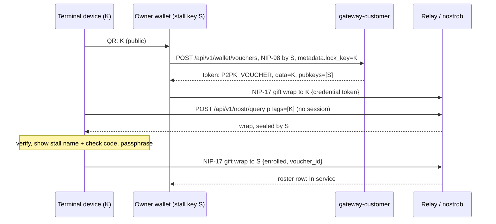

# Spec: putting a terminal into service

**Issue:** [imani-wallet#160](https://github.com/398ja/imani-wallet/issues/160).
**Status:** Accepted. The product owner's decisions on the open questions are
recorded in section 9 (2026-10-04, and decision 5 on 2026-10-07). Built phase
by phase, see section 8.
**Repos:** imani-wallet, imani-gateway-customer, imani-gateway-core,
imani-gateway-portal, cashu-voucher.
**Builds on:** [ADR 0005](adr/0005-terminals-are-authorised-by-locked-vouchers.md)
(terminals are locked vouchers), [ADR 0006](adr/0006-a-voucher-guarded-request-is-signed-by-its-lock-key.md)
(the lock key signs), [ADR 0009](adr/0009-a-card-purchase-issues-through-a-terminal.md)
(the gateway already honours a terminal credential), and the
[terminals guide](terminals.md).

Code references are `repo:path:line` against `origin/main` on 2026-10-04.
`wallet:` means imani-wallet, `customer:`, `core:` and `portal:` mean the three
gateways.

## 1. Goal

A stall owner and a member of staff, each with their own phone and no developer
tools, can put a device into service as a terminal, open it on the till after a
reload with a passphrase, redeem and sell from it within its role, and have it
refused after the owner revokes it. All of it runs in a real two-browser e2e
against staging with no injected state.

The domain logic for this exists and is tested. This spec is mostly wiring, plus
the security fixes the wiring would otherwise expose (section 4.5).

## 2. User journeys

### 2.1 The owner adds a terminal

1. Owner: **Settings → Terminals → Add a terminal**. Name, role, scan the code
   on the device (unchanged UI).
2. **Add terminal** refuses a key that is not a valid secp256k1 point, then
   mints the credential (section 5.1), checks the minted token really is a
   `P2PK_VOUCHER` locked to the scanned key with the metadata intact, and sends
   it to the device by NIP-17 DM.
3. The screen says what is true: *"Sent to Front counter. Finish on that device.
   Check code 482 913."* The roster row reads **Waiting for the device**.
4. When the device confirms (section 2.2 step 6), the row becomes **In
   service**. Only then is "can trade for your stall" said anywhere.
5. A waiting row can be **Cancelled**, which is a revocation (section 2.6).
6. A waiting row that is not confirmed within **24 hours** expires: the owner's
   wallet cancels it (spends the credential with the stall key, section 4.3) the
   next time it opens, and the device refuses a credential DM older than 24
   hours. A stall may have **at most 2 waiting rows** at a time. **Add terminal**
   is refused while two are waiting, with *"Two terminals are already waiting
   for their device. Finish or cancel one first."* Waiting rows do **not** count
   against the free terminal (decision 4), so a botched setup never blocks a
   retry. gateway-customer enforces the same limit and the 24 hours when the
   credential is minted (section 5.2), so a second phone or a cleared browser
   cannot get round it; the wallet's own count is a hint shown before the form.
   **Add terminal** also refuses a device key that already holds a live
   credential on the roster: replacing that row would drop the only handle that
   can revoke the first credential.
7. The owner chooses the **idle lock** on the same form: on by default at 10
   minutes, adjustable, and it can be switched off (decision 2). It travels to
   the device in the credential DM (section 5.1).

### 2.2 A fresh device becomes a terminal

1. The logged-out screen (`/onboarding`) gains **Set this device up as a
   terminal**, routed to `/terminal/setup`.
2. If the device holds a key (`keyStore.hasKey()`), setup refuses and sends the
   user to log out first, where they see `LOGOUT_WARNING`
   (`wallet:src/lib/logout.ts:34`). One account per device, as decided on #160.
3. The device calls `beginEnrolment()` and shows the QR and copyable key, with
   *"This code is not a secret. Keep this screen open until setup finishes."*
   The key lives only in memory, so a reload starts over with a new code.
4. The device polls for a credential DM addressed to its key (section 5.2).
5. The operator scans the **setup code** the owner's screen now shows
   (section 4.2). The device accepts only the credential DM that code names.
   On receipt it shows the stall's public name and the check code, and asks
   the operator to confirm they match the owner's screen.
6. The operator sets a passphrase (required, **at least 8 characters**,
   decision 2). `completeEnrolment` verifies and stores. The device sends a signed
   "enrolled" DM back to the stall, confirms the credential with
   gateway-customer (`POST /api/v1/wallet/terminal-credentials/{id}/confirm`),
   and lands on the till.

### 2.3 Login and unlock

`Entry` (`wallet:src/App.tsx:766`) learns a third state. Key present and a
terminal record present: `/terminal/unlock`. Key present without one: `/login`
as today. No key: `/onboarding`.

Unlock decrypts `K` with the passphrase and builds a signer. It does **not**
open a NAP session: a terminal has no account and is not a customer (the #160
follow-up shows NAP would log it in as one). The app then runs the terminal
login: the credential is re-verified from the token's own bytes, the mint is
asked whether it is still unspent, and a 12-hour local session opens FULL or
REDUCED exactly as `loginTerminal` already decides (`wallet:src/lib/terminalLogin.ts:98`).

On top of the 12-hour session, an unlocked till locks itself after the owner's
**idle lock** period with no touch or key press (default 10 minutes, or off,
decision 2). Locking drops the in-memory signer and returns to
`/terminal/unlock`. It does not end the 12-hour session's mint check: unlocking
again within the session needs only the passphrase.

### 2.4 The till

A new `TerminalApp`, sibling to `AuthedApp`, rendered when the terminal login
admits an actor. It does not depend on `canTrade` (`wallet:src/lib/merchant.ts:335`),
starts no DM poll, wallet sync or push subscription, and reads the stall's
`MerchantProfile` from its public record (`fetchMerchantRecord`,
`wallet:src/lib/merchant.ts:547`, ADR 0012).

| Screen | Redemption only | Sell and redeem, FULL | Sell and redeem, REDUCED | Owner |
|---|---|---|---|---|
| Home: terminal name and stall name | yes | yes | yes | n/a |
| Redeem | yes | yes | yes | yes |
| Sell | no | yes (phase 5) | no | yes |
| Cashback issue | no | yes (phase 5) | no | yes |
| Settings → Security → Take out of service | yes | yes | yes | n/a |
| Lock | yes | yes | yes | yes |
| Profile, Dashboard, Vouchers, Transactions, Backup, Restore, Terminals | no | no | no | yes |

A refusal, a revoked credential or a lapsed subscription shows `NotTrading` as
today.

### 2.5 Redeem on a terminal

The payment request already names the stall, not the terminal
(`wallet:src/lib/vreq.ts:73`), so the coupon is gift-wrapped to the stall and
the terminal receives nothing. Today the Redeem screen learns of payment from
its own wallet (`reconcileRequests`, `wallet:src/lib/vreq.ts:158`, watched at
`wallet:src/pages/RedeemPage.tsx:229`), which on a terminal never changes. On a
terminal it instead polls `GET /api/v1/atomic/fulfilment/{paymentRequestId}`
(`core:.../atomic/controller/VoucherFulfilmentController.java:56,75`), NIP-98
signed by `K`. That endpoint exists for exactly this: a party that issued a
request and holds neither sender nor recipient key. The stall's own device
receives and burns the coupon when it next unlocks, as for any redemption.

### 2.6 Revoking, and a lost device

The owner taps **Revoke** (or **Cancel** on a waiting row). The wallet spends
the credential at the mint with the **stall's** key (section 4.3), using the
existing `revokeCredential` (`wallet:src/lib/credentialRevocation.ts:128`). The
row is marked revoked only when the spend lands or the mint reports it already
spent. Otherwise the screen says it did not land and offers a retry.

The device is never consulted, so a lost, stolen or dead device is revoked the
same way. Effect: Sell is refused within the verifier cache window (30 s), and
the device is refused at its next unlock. A revoked redeem-only terminal that is
still unlocked can keep showing payment requests until its 12-hour session
ends. That is harmless by construction: the money goes to the stall (ADR 0005).

Decommissioning from the device is unchanged (`wallet:src/lib/terminalDecommission.ts:81`).

### 2.7 Expiry and re-issue

A credential is minted for **365 days** (decision 1,
`wallet:scripts/mint-terminal-credential.mjs:115`). The owner's roster reads the
expiry from the token's own signed bytes and warns **30 days** and again **7
days** before it: a badge on the row and a notice on the Terminals screen,
*"Front counter stops on 12 March. Renew it."* **Renew** is one tap: the wallet
mints a fresh 365-day credential locked to the **same** device key `K` (taken
from the row), DMs it to the device, and revokes the old one only after the
device confirms the new one with the enrolled DM. The device accepts a re-issue
at its next unlock without a new setup or passphrase, provided it is locked to
its own `K`, issued by its own stall and has the same role or a smaller one. A
re-issue that changes the role is not a renewal: the owner adds the device
again.

## 3. Why "Add terminal" mints nothing and reaches no device today

| # | Gap | Where |
|---|---|---|
| G1 | The owner's page builds the credential and throws it away. `prepareEnrolment` is called, and only `recordTerminal` uses the result | `wallet:src/pages/TerminalEnrolPage.tsx:80-99` |
| G2 | Minting exists only as a script, by design of ticket 05 | `wallet:src/lib/terminalIssue.ts:28-33`, `wallet:scripts/mint-terminal-credential.mjs:103-122` |
| G3 | Success is claimed with no call made | `wallet:src/pages/TerminalEnrolPage.tsx:107` |
| G4 | Nothing delivers anything to the device | none |
| G5 | Nothing calls `beginEnrolment` or `completeEnrolment` | `wallet:src/lib/terminalEnrol.ts:91,155` |
| G6 | An empty device can only reach customer onboarding | `wallet:src/App.tsx:766-775`, `:720` |
| G7 | Terminal screens need a NAP session and `canTrade`, which a terminal key never has | `wallet:src/App.tsx:350,388`, `core:.../service/MerchantAclService.java:169-180` |
| G8 | Login never asks the mint, so every terminal is REDUCED | `wallet:src/App.tsx:290`, `wallet:src/lib/useTerminalIdentity.ts:103` |
| G9 | The device key checked at login is read from the record being checked | `wallet:src/lib/useTerminalIdentity.ts:110` |
| G10 | Owner revocation only marks a local row, and `revocationSecret` is never written. It cannot be: the credential is locked to `K` alone, so no secret the owner holds can spend it | `wallet:src/lib/terminalRoster.ts:64,172-186`, `customer:.../adapter/VoucherAdapter.java:2528` |
| G11 | Setup would overwrite the wallet key in the single key slot | `wallet:src/lib/terminalEnrol.ts:186` |
| G12 | Redeem on a terminal can never see the payment arrive | `wallet:src/pages/RedeemPage.tsx:229` |
| G13 | The gateway's revocation check reads a status that is hard-coded `ISSUED` | `customer:.../voucher/TerminalCredentialVerifier.java:115`, `customer:.../voucher/VoucherResponseBuilder.java:166` |
| G14 | Portal Sell refuses any caller acting for another stall | `portal:.../controller/PortalVoucherController.java:684,727-751` |
| G15 | No `terminal` warrant can be built or verified (there is no form for a terminal's own signature) | `wallet:src/lib/issuanceWarrant.ts:314`, `wallet:src/lib/warrantSigner.ts:186`, `portal:.../warrant/PortalIssuanceWarrant.java:222` |

## 4. Trust model

### 4.1 What a terminal holds

One thing: a **terminal credential**, a 1-sat `P2PK_VOUCHER` minted by the
gateway with `issuer_id` = the stall and signed `merchant_metadata`
`{terminal: true, stall_pubkey, role, lock_key, name}`
(`wallet:src/lib/terminalCredential.ts:66`), locked to `K`, a key the device
generated and never discloses. This is ADR 0005 unchanged. No NAP permission
row and no gateway table exist per terminal.

Authority is the **equality** `lock_key == the key that signed this request`,
plus `issuer_id == stall_pubkey`. It is what `credentialActor`
(`wallet:src/lib/terminalCredential.ts:168`) and `TerminalCredentialVerifier`
(`customer:.../voucher/TerminalCredentialVerifier.java:144,151`) already check.
The role grants `voucher:redeem:<stall>` and, for *Sell and redeem*,
`voucher:issue:<stall>` (`wallet:src/lib/terminalRole.ts:158`). It never grants
`coupon:issue`, which is the owner's permission and gates the dashboard,
campaigns, policies and cashback records (`portal:.../config/PortalPermissions.java:41`).

### 4.2 Issue and transport



**Delivery is a NIP-17 DM, not a credential QR.** The token is 1.6 to 2.6 KB
(`wallet:src/lib/__tests__/fixtures/live-terminal-*.token`), a dense QR phones
read badly, and the DM is the "notify the terminal" the issue asks for. The
device needs no session to fetch it: `/api/v1/nostr/query` is a public write on
both gateways (`core:gateway-core-rest/src/main/resources/application.yml:293`,
`customer:.../config/CustomerSecurityConfiguration.java:95`). The owner wraps
and publishes the way the transfer signature already does: relay plus gateway
mirror (`wallet:src/lib/transferSignature.ts:616-679`). The device unwraps with
the pending key inside `terminalEnrol.ts`, which keeps its promise that nothing
outside the module sees `K`'s private half.

**Binding to the right stall.** `K` is public, so anyone watching the screen can
DM it a credential for *their* stall. The device therefore shows the stall's
public name and a check code, and the operator confirms it matches the owner's
screen. Check code = first 6 decimal digits of
`sha256(voucher_id ‖ stall_pubkey ‖ K)`.

**The check code is not a grinding bound on its own.** The device checks the
credential's signature against a key carried inside the token
(`verifyVoucher`), so an onlooker can self-sign a credential for their own
stall with any `voucher_id` they like, and matching six digits offline takes
milliseconds. (An earlier draft said it cost "about 10^6 mints"; that holds
only if the gateway chose every `voucher_id`, which a self-signed fake does
not need.) What binds the device to the right stall is the **setup code**:
after **Add terminal** the owner's screen shows
`imani-terminal:1:<stall_pubkey>:<voucher_id>` as a QR and text, the operator
scans it on the device, and the device accepts only a credential DM **sealed
by that stall** for **that voucher**. Nobody but the stall can seal as the
stall, so an onlooker's offer is refused (`not-the-expected-offer`) however
its check code reads, and the device never chooses among offers. The check
code stays as the operator's confirmation that both screens show the same
credential. The device also refuses a DM dated more than 5 minutes ahead,
which would otherwise never go stale, and, where the build sets
`VITE_VOUCHER_ISSUER_PUBKEYS`, a credential signed by an unknown key.

### 4.3 Revocation, and the one change to the lock

A credential locked to `K` alone can be spent only by the device (G10). Fix:
for a voucher whose signed metadata has `terminal: true`, gateway-customer adds
the **issuer's** key to the NUT-11 `pubkeys` tag with `n_sigs = 1`, beside `K`
in `data`. The mint already accepts any one of `data` plus `pubkeys` on the
primary path (`cashu-mint:.../validator/P2PKSpendingCondition.java:117,156`), so
either the device or the stall can spend it, and nobody else can. The key is
taken from the resolved issuer, never from the request, so a caller cannot name
a third party. Authority is unaffected because every verifier binds to
`merchant_metadata.lock_key`, not to the spending keys, and the stall already
holds all the authority a terminal could.

The owner's roster keeps the **token** (not a `revocationSecret`). Revoking is
`revokeCredential(token)`: a swap witnessed by the stall key. `witness.ts`
learns to sign for a secret whose `pubkeys` tag includes the wallet's key
(`lockedToPubkey` reads only `data` today, `wallet:src/lib/witness.ts:55`).

Propagation: revocation is a spent proof, and every check reads NUT-07.

| Check | Where | Bites |
|---|---|---|
| Terminal unlock | wallet, `credentialState` (`wallet:src/lib/credentialRevocation.ts:70`) via public `/api/v1/wallet/token/validate` | next unlock, at most 12 h |
| Sell, cashback | gateway-customer verifier, NUT-07 on the stored token (via `WalletPort.validateToken`), cached 30 s, positive answers only. Shipped in phase 1 | 30 s |
| Redeem | none needed: the money goes to the stall | n/a |

### 4.4 Per-request verification

The terminal signs every request NIP-98 with `K` and presents its credential as
`X-Imani-Terminal-Credential: <voucher_id>`, the header gateway-customer already
honours (`customer:.../rest/controller/VoucherController.java:67,277-299`) and
ADR 0009 verified end to end. ADR 0006 puts the voucher in the body because a
header is unsigned. That objection does not bite here: the header carries an id
the gateway looks up in its own store, and the result must be locked to the
signer, so swapping it can only select another credential locked to the same
`K`. Recorded as a deliberate reuse, not an oversight.

Verification order, in `TerminalCredentialVerifier.stallFor`, all local before
the mint is asked (ADR 0006 ordering):

1. the voucher exists in the gateway's store and is a terminal credential;
2. `lock_key == NIP-98 signer`;
3. `issuer_id == stall_pubkey`;
4. role permits the action;
5. NUT-07 says UNSPENT. Unknown fails closed for issuance. (Shipped in
   phase 1, with a check before it that a V27 waiting credential has been
   confirmed.)

### 4.5 Threats

| Threat | Mitigation |
|---|---|
| Stolen device, locked | `K` is passphrase-encrypted at rest. Owner revokes without the device. Sell refused within 30 s |
| Stolen device, unlocked mid-shift | The idle lock (default 10 minutes) re-locks an unattended till. Otherwise as above. Redeem-only damage is nil (money goes to the stall). Close the stall if Sell must stop sooner |
| Weak passphrase on a shared till | At least 8 characters, refused before `completeEnrolment` |
| Owner hoards unconfirmed credentials | At most 2 waiting per stall and a 24-hour lapse, enforced by gateway-customer at mint time (409 `TERMINAL_PENDING_LIMIT`), not only by one phone's roster. An unconfirmed credential may not issue |
| Modified terminal sells through a licence lapse | The portal refuses terminal Sell for a stall without a current licence beyond its free terminal (section 5.4), from cached state with a 72-hour grace |
| Replayed enrolment code | `K` is public by design. The pending key lives in memory only, so an old code from a reloaded device yields an inert credential. Waiting rows can be cancelled |
| Replayed or forwarded credential DM | Inert without `K`. `completeEnrolment` refuses a credential not locked to the pending key (`wallet:src/lib/terminalEnrol.ts:179`) and runs once |
| Wrong-stall credential (hijack) | The device accepts only the offer the owner's setup code names, sealed by that stall; the operator then confirms stall name and check code (section 4.2) |
| Edited `localStorage` raises the role | Login derives role, stall and lock from the **token's signed bytes** (`verifyVoucher` plus `issuerAllowlist`), never from stored fields. Closes IW-15 (`wallet:src/lib/terminalEnrol.ts:269-281`) |
| Edited record names another device | The device key comes from the unlocked signer and must equal `lock_key`. Closes G9 |
| Terminal mints another terminal | **New refusal:** gateway-customer refuses `merchant_metadata.terminal` or a licence marker when the issuer was resolved from a terminal credential (`customer:.../rest/controller/VoucherController.java:277`). Without it, today's code would let a *Sell and redeem* terminal mint terminal credentials for its stall |
| Terminal reaches owner surfaces | It never holds `coupon:issue`. Only `POST /api/v1/portal/vouchers` and cashback issue accept `voucher:issue:<stall>` |
| Off-curve `K` mints an unlocked bearer credential | Refused before minting, and the minted secret is checked for kind and lock. If either fails the owner spends it at once and reports failure |
| Setup destroys a person's wallet key | Refused while `keyStore.hasKey()` (G11) |
| Mint unreachable | REDUCED session: redeem only. Unchanged |
| Issuing service mints a till for any stall | Today a `terminal` warrant verifies on gateway-customer's signature alone, so whoever holds that key can mint a credential for any stall under their own `K` and the coupons read `verified` (imani-wallet#196 review, HIGH). Closed by the owner attestation, section 4.6 |

### 4.6 The owner attests each terminal (decision 5)

**The problem.** A terminal credential is signed by one key, gateway-customer's
issuing key. `verifyTerminal` (cashu-voucher 0.16.x) and its wallet mirror
`verifyTerminalWarrant` (imani-wallet#196) accept a `terminal` warrant when
that key signed a credential naming the stall, a selling role and `lock_key`
`K`, and `K` signed the sale. The stall itself signs nothing. So the one key
issuance warrants exist to distrust can mint a credential for any stall under
a `K` it holds, sign sales with `K`, and every customer wallet shows the
coupons as `verified`. A `merchant` warrant does not have this hole: it is
signed by the stall key (`wallet:src/lib/warrantSigner.ts`). A `delegated`
warrant does not either: the stall signs the delegation
(`wallet:src/lib/issuerDelegation.ts`). `terminal` is the only form where the
stall's consent is the service's word alone.

**The fix.** At enrolment, the owner's wallet signs an **owner attestation**
with the stall key, the key that signs `merchant` warrants. The attestation
says: *this stall lets `K` act as `role` until `T`*. Every verifier of a
`terminal` warrant then checks two independent signatures: the service's over
the credential, and the stall's over the attestation.

#### 4.6.1 Where the signature lives: in the credential's signed metadata (option A)

Two placements were considered:

- **Option A: inside the credential.** A stall-signed attestation in
  `merchant_metadata`, so it sits under gateway-customer's signature.
- **Option B: beside the credential.** A separate stall-signed artefact,
  carried in the credential DM, kept in the device record and sent as a new
  `attestation` field in the `terminal` warrant.

| | A: in `merchant_metadata` | B: separate artefact in the warrant |
|---|---|---|
| Transport | None new. It travels inside the token through every existing path: the DM, the device record (`token` is the only authority, phase 3), `credentialFromToken`, the warrant's `credential` field and the portal's `parseCredential` | New field in the credential DM, in `StoredTerminal`, in the warrant, and in the renewal DM. Each is a place where the token and its attestation can be paired wrongly |
| Can it name `voucher_id`? | No. The owner signs before the mint, and gateway-customer picks the id (`customer:.../adapter/VoucherAdapter.java:592`) | Yes, signed after the mint |
| Replay onto another credential | Possible by any service key a build trusts, for the **same** `K`, role, stall and expiry. The attestation is public: it travels in every `terminal` warrant. It is useless without `K` (section 4.6.4) | Not possible |
| Revocation | Unchanged: spend the credential (section 4.3). The attestation dies with it, because no verifier accepts an attestation without a live credential at issuance | Unchanged |
| Renewal (phase 6) | Each renewal is a new mint, so the owner signs a new attestation. Nothing extra to deliver | The renewal DM must carry the new attestation too |
| Canonical form | The signature covers a fixed digest of named fields (section 4.6.2), never JSON text. Gateway-customer re-serialises the metadata object, so key order and spacing cannot matter | The same digest, plus a second size budget in a warrant that is already capped at 4096 characters (`portal:.../warrant/IssuanceWarrantGate.java:33`, `customer:.../voucher/DelegatedWarrantLedger.java:44`) |
| Old verifiers | They ignore an unknown metadata key, so a 0.16.x verifier still accepts the credential, and still on the service's word alone. That is why the cutover is coordinated (section 4.6.5) | They ignore an unknown warrant field. Same situation |

**Decision: option A.** Its one weakness is that it cannot name `voucher_id`.
That buys nothing here (section 4.6.4), and in exchange the attestation can
never be separated from its credential. It also gives the device itself a way
to refuse a credential the stall never signed (section 4.6.3).

**Wire form.** One new key in the credential's `merchant_metadata`. All values
are strings, so Java and TypeScript read the same characters and no JSON
number is involved:

```json
{
  "terminal": true,
  "stall_pubkey": "<S>",
  "role": "issue-and-redeem",
  "lock_key": "<K>",
  "name": "Front counter",
  "idle_lock_minutes": 10,
  "owner_attestation": {
    "v": "1",
    "expires_at": "1823212800",
    "nonce": "<64 lowercase hex>",
    "sig": "<128 lowercase hex>"
  }
}
```

The value must be an object with exactly these four keys. Any other key, a
repeated key or a non-string value is refused. `v` is the literal `"1"`.
`expires_at` is a canonical decimal epoch-seconds integer (`0|[1-9][0-9]{0,18}`).
`nonce` is 32 random bytes the owner chooses.

#### 4.6.2 What the owner signs

`sig` is BIP-340 by the stall key `S` over:

```
attestationDigest = sha256(utf8(join(US,
    "imani-terminal-attestation", v, S, K, role, expires_at, nonce)))
```

`US` is U+001F, the separator `warrantSaleDigest` already uses. `S` and `K`
are lowercase x-only hex. `role` is the catalog string. The domain string
comes first, so an attestation digest can never equal a sale digest, whose
preimage starts with a 64-hex stall key. A signature made for one can
therefore never verify as the other.

The digest covers `K`, `role` and `S` as **read back from the same
metadata**, never a separate copy. A verifier rebuilds it from `lock_key`,
`role` and `stall_pubkey`, so the attestation cannot disagree with the
credential it sits in. `name` and `idle_lock_minutes` are not covered. They
are display and device settings, not authority. The owner still checks both
byte for byte after the mint (section 4.6.3, `credentialDefect`), so a service
cannot change them unnoticed, without putting free-text Unicode into a
cross-language digest.

The digest does not name the issuing service (`issuer_pubkey`). That was
considered and rejected for v1: during a key rotation the owner cannot know
which trusted key will sign. The cost is that an attestation can be
transplanted into a credential minted by another key the same build trusts.
That still needs `K` (section 4.6.4).

**Expiry.** The owner picks `T` = the credential's expiry (decision 1,
365 days). Gateway-customer **uses `T` as the credential's `expires_at`** for
a terminal credential, instead of computing it from `expires_in_days`. Every
verifier requires `credential.expires_at <= attestation.expires_at`. The
service therefore cannot extend a till beyond what the owner signed.

**`T` on the wire.** The wallet sends `X-Idempotency-Expires-At: T` with the
mint, beside `expires_in_days`. Gateway-customer refuses a terminal mint whose
header and attestation `expires_at` disagree (400
`TERMINAL_ATTESTATION_INVALID`), and writes `T` **verbatim** as the
credential's `expires_at`, with no rounding to whole days. Rounding would make
`ATTESTATION_EXCEEDED` fire on every credential. An IT pins credential
`expires_at` == `T`, and idempotent replay compares the same instant
(`requireExpiryMatchesDays`).

**Signing at enrolment.** `credentialRequestBody`
(`wallet:src/lib/terminalMint.ts`) builds the attestation with the same signer
`buildIssuanceWarrant` uses for a `merchant` warrant (`getSigner()`, asserted
equal to the stall). The `minting` roster row persists the attestation
alongside its `Idempotency-Key`, so a resumed mint (`resumeMinting`,
`wallet:src/lib/terminalRevoke.ts`) sends the identical body and the gateway's
idempotent replay matches. A fresh signature would carry a fresh nonce, and
the replay would be refused as a different request.

#### 4.6.3 What each verifier checks

All of them add the same step, **owner attestation**, to the checks they
already run.

1. `owner_attestation` is present and well-formed (section 4.6.1).
2. `sig` verifies, BIP-340, over `attestationDigest` built from
   `stall_pubkey`, `lock_key` and `role` in the same metadata, against
   **`issuerId`**. `issuerId` is the coupon's `issuer`, which `WRONG_STALL`
   already requires to equal the credential's `issuer` and `stall_pubkey`.
3. `credential.expires_at <= attestation.expires_at`.

| Verifier | Where | When | Expiry instant |
|---|---|---|---|
| cashu-voucher `IssuanceWarrant.verifyTerminal` | after `LOCK_MISMATCH`, before the sale signature | every `TerminalSale` | `ExpiryCheck` as today (the credential's `expires_at`, now bounded by `T`) |
| cashu-voucher `IssuanceWarrant.verifyOwnerAttestation(credential, issuerId)` | new, public, used by the two gateways below | n/a | none, it checks the signature only |
| Portal (`PortalIssuanceWarrant.terminalRefusal`) | through `verifyTerminal` | issuance of every terminal Sell and cashback | `ExpiryCheck.at(now)` |
| Customer wallet, offline (`verifyTerminalWarrant`) | the line-by-line mirror | coupon receipt and every re-check | `skip-offline`, unchanged: a coupon sold before expiry stays valid |
| gateway-customer at mint (`VoucherController`) | `verifyOwnerAttestation` against the **resolved** issuer, pre-mint | `POST /api/v1/wallet/vouchers` with terminal metadata | n/a. Also sets `expires_at := T` |
| gateway-customer verifier (`TerminalCredentialVerifier`, internal endpoint) | the same | each lookup. Reports `attested`. An unattested credential is never `live` for issuance | n/a |
| The terminal itself (`credentialFromToken`) | the same, at unlock and on a renewal. A **missing** attestation opens the till for Redeem only (section 4.6.5). A **present but invalid** one refuses the credential outright: the stall never signed it | login | n/a |
| The owner (`credentialDefect`) | the **whole** requested `merchant_metadata` came back byte for byte as sent: stall, lock, role, `name`, `idle_lock_minutes` and the attestation. `idle_lock_minutes` is security-relevant (a device holder must not switch it off) | after every mint | n/a |

New cashu-voucher refusals: `OWNER_ATTESTATION_MISSING` (absent or malformed),
`BAD_OWNER_ATTESTATION` (the signature does not verify against `issuerId`) and
`ATTESTATION_EXCEEDED` (the credential outlives `T`). Each has a wallet
`TERMINAL_REFUSAL` with the same name. The portal's exhaustive `terminalTag`
switch must then name them, so a 0.17.0 upgrade cannot compile without
handling them. They map to a new metric label, `owner_attestation`.

**Customer verdicts.** A **missing** attestation (`OWNER_ATTESTATION_MISSING`)
maps to `unwarranted`: the sale is unsigned by the stall, not tampered with.
That is also what the same coupon reads in 5a, so its verdict does not change
at the cutover. Only `BAD_OWNER_ATTESTATION` and `ATTESTATION_EXCEEDED` map to
`failed` ("Does not match its signature"). Both are refused before the swap
(`refuseIfUnwarranted`).

**Is the gateway's signature still needed? Yes, but for a different job.**
After this change, `verified` means *the stall signed this till, and the till
signed this sale*. The service's signature no longer carries that claim. It
stays a required check because it does four other jobs:

1. **It makes the credential revocable at issuance.** Revocation is a NUT-07
   spend of a proof the service minted (section 4.3). The mint answers
   `UNSPENT` for a proof it never signed (section 4.5, *Forged credential and
   NUT-07*), so liveness means something only for a credential the service
   actually issued and registered (V28). The service signature makes
   revocation bite at the **portal**, when coupons are issued. Offline
   verifiers skip liveness, so for them the grant runs to `T` either way
   (section 4.6.4).
2. **It pins what the attestation does not cover.** That is the P2PK lock
   (`data` = `K`, `pubkeys` = `[S]`, so the stall can revoke it), `issuer`, and
   the canonical secret bytes the portal and the wallet both parse.
3. **It scopes the deployment.** `trustedServiceKeys` and
   `VITE_VOUCHER_ISSUER_PUBKEYS` decide which issuing service's tills a build
   accepts at all.
4. **Creating a till now takes two keys, not one.** Forging a **new**
   selling till takes the stall's key **and** the service key. The stall's
   key alone already lets an attacker sign `merchant` warrants, so a stolen
   stall key gains nothing here. The service key alone now gains nothing
   either. **Continuing to sell after revocation is a different case**: it
   takes the service key plus `K` (section 4.6.4), and `K` is the weakest key
   in the system.

#### 4.6.4 Replay, revocation and renewal

- **The attestation is public.** It sits in the credential, the credential
  travels in every `terminal` warrant, and the warrant travels in every
  coupon. Every customer holding a coupon from that till holds the full
  attestation (`sig`, `nonce`, `expires_at`). Any service key the build
  trusts (`trustedServiceKeys` and `VITE_VOUCHER_ISSUER_PUBKEYS` can list
  more than one, for rotation) could put it on another credential for the
  same `K`, role, stall and expiry. That grants nothing without `K`.
- **Residual risk after revocation: service key plus `K`, until `T`.** Two
  cases, stated separately:
  - *Creating a till* needs the stall key and a service key (section 4.6.3,
    point 4).
  - *Continuing to sell after revocation* needs a service key and the `K` of
    a revoked or stolen till. `verifyTerminal` ("Not checked: liveness",
    cashu-voucher 0.16.1 `IssuanceWarrant.java:490`) and the wallet mirror
    (`skip-offline`) accept a **revoked** credential offline. So that pair can
    sign sales with `K`, attach the original revoked credential, mint coupons
    directly and have customers read them `verified` until `T`. No twin
    credential is needed. `K` is passphrase-encrypted (at least 8 characters)
    on a device that can be stolen, so this is the realistic path.
  - **Exposure window: `T`, 365 days after enrolment**, for a lost device if
    the service is also compromised.
  Binding `voucher_id` would not close this: offline verifiers cannot check
  liveness either way. The V28 unique `owner_attestation_nonce` limits one
  attestation to one credential only against an **honest** gateway-customer.
  It is bookkeeping, not a defence. The one place a twin or transplant is
  detectable is the stall's own wallet when a coupon comes home (open
  question 2).
- **Revocation.** Unchanged (section 4.3). No separate revocation of the
  attestation exists, or is needed: the portal refuses issuance on a spent
  credential, and coupons sold before the revocation stay valid, as today.
- **Renewal (phase 6).** A renewal is a new mint with a new attestation (new
  `T`, new nonce, same `K`). The device accepts a renewal only when the new
  credential's attestation verifies against its own stall. The roster offers
  **Renew** on a credential without an attestation as well as near expiry,
  which is how the migration below is carried out.

#### 4.6.5 Migration: refuse and renew

Existing credentials carry no attestation. There are few, they are on
staging, and terminals are not live in production. **Recommendation: refuse
and renew, with no grace period.** A grace period would be exactly the
interval in which `verified` still rests on the service key alone, which is
the hole this section closes.

- From cashu-voucher 0.17.0 on, every verifier refuses an unattested
  credential for **Sell and cashback**. The portal answers 403 with metric
  label `owner_attestation`, and customer wallets read the coupon
  `unwarranted` (section 4.6.3, *Customer verdicts*), so it is refused before
  the swap.
- **Existing terminal-sold coupons.** None exist in production: Sell has
  never shipped (main refuses at `issuanceWarrant.ts:~314`). Staging coupons
  from #196 e2e runs move from `verified` to `unwarranted`. That is
  acceptable.
- **Redeem keeps working.** A redeem-only or unattested till still unlocks.
  Redeem needs no warrant, and the money goes to the stall (ADR 0005). The
  till shows *"Ask the owner to renew this terminal to sell"*. The owner's
  roster shows the row as **Renew to keep selling**.
- **Re-enrol until Renew ships.** "Add the device again" is not one step.
  `checkEnrolment` refuses a key that already holds a live credential
  (`ENROLMENT_REFUSAL.ALREADY_LIVE`, `terminalIssue.ts:197`), and
  `completeEnrolment` refuses while the device already holds `K` (G11,
  `terminalEnrol.ts:243`). The real steps are:
  1. The owner revokes the credential on the roster.
  2. The till is refused, "no longer in service".
  3. The operator takes the device out of service (`terminalDecommission`),
     which wipes `K`.
  4. Full setup again: Add terminal on the owner's phone, a new `K`, a new
     passphrase and the setup code.
  The till's *"Ask the owner to renew"* and the roster's *"Renew to keep
  selling"* name these four steps until phase 6's one-tap Renew replaces
  them. On staging that is acceptable. Production has no terminals to move.
- **Gateway-customer requires the attestation only for a selling role.** It
  **validates** an attestation whenever one is present, and **requires** one
  only for `role == issue-and-redeem` (400 `TERMINAL_ATTESTATION_INVALID`,
  pre-mint, listed in `mintNotStarted`). A redeem-only credential without an
  attestation still mints. This matches the device-side rule (missing means
  Redeem only) and keeps **Add terminal** working for redeem-only tills during
  a staggered deploy, whatever order gateway-customer (5b-2) and the wallet
  (5b-5) reach production. Without it, a gc deployed before the wallet would
  break Add terminal for every role on any owner app from 0.14.2/0.14.3 on
  (#181, #184). Its internal endpoint reports `attested`.
- **The free terminal is issue-and-redeem only** (owner decision,
  2026-10-07). Only an attested `issue-and-redeem` credential can occupy the
  stall's `free` slot. A redeem-only or unattested credential never does.

**Version.** cashu-voucher **0.17.0**, a minor bump. Credentials that 0.16.x
accepted are now refused, and `TerminalRefusal` gains members, which breaks
any exhaustive `switch`. Wire impact:

| Component | Change | Compatible with the old peer? |
|---|---|---|
| Credential (metadata) | additive key | Yes, on the wire. A 0.16.x verifier ignores the key and still accepts on the service key alone, so every verifier moves to 0.17.0 together |
| `terminal` warrant | unchanged | Yes |
| gateway-customer | validates any attestation at mint, requires one only for `issue-and-redeem`, sets `expires_at := T`, records `nonce`, reports `attested` | An old wallet still mints redeem-only tills. It gets 400 only for an unattested `issue-and-redeem` mint, which it could not sell with anyway. So 5b-2 and 5b-5 may deploy in either order |
| gateway-core | grants `voucher:issue:<stall>` only when `attested` | A new core with an old customer reads a missing `attested` as false (fail closed) |
| Portal | 0.17.0 `verifyTerminal` | Refuses unattested credentials |
| Customer wallet | mirror | An older wallet (before #196) refuses the `terminal` form outright, which is safe. A #196 wallet without the mirror would accept on the service key alone. That is why #196 must not reach customers as it stands (section 4.6.6) |

#### 4.6.6 The open phase 5 PRs

| PR | Change for this decision |
|---|---|
| cashu-voucher#56 (0.16.1) | **Done.** Merged and released as v0.16.1 on 2026-10-07. 5a builds on 0.16.1. A new PR adds the attestation as 0.17.0, a clean minor on top, with golden digest and signature vectors that the wallet's tests also load |
| imani-bom#92 (0.2.10) | **Retarget `cashu-voucher.version` from 0.16.0 to 0.16.1 before it is released.** portal#80 consumes bom 0.2.10, and on 0.16.0 it would ship `verifyTerminal` without the 0.16.1 parity fixes (one value per row, lowercase `lock_key`, lone-surrogate refusal) that #196's parity fixture (`terminalWarrantParity0161.json`) already assumes |
| imani-wallet#196 | **Before merge, three changes.** (1) A `terminal` warrant that passes today's checks returns `unwarranted`, not `verified`. `validationStatus` already reads `unwarranted` as failed and `refuseIfUnwarranted` already refuses it before the swap. A tampered one still returns `failed`. Not `claimed`: that would label the sale *Recorded by a processor*. (2) `mayWarrantSale` stays false for a terminal actor, so the till keeps showing *"Selling from a terminal is not available yet"*. The routes, warrant builder and parity tests stay, gated. (3) **The e2e (`e2e/terminalSetup.e2e.ts`) changes with the gate:** invert *"B3 offers Sell and Redeem"* (:379) and the `tillSells` path (:407) to assert the till shows *"Selling from a terminal is not available yet"*; drive the 403 (revoked B3, :483), 409 and dashboard-refusal checks as direct `K`-signed API calls from B3's context, or move them to the 5b e2e; move *"C's coupon from B3 has warrant verdict verified"* (:424) to 5b. No check is deleted silently. **Follow-up PR (5b-5):** lift the gate, sign at enrolment, `credentialDefect` over the full metadata, `credentialFromToken`, the `verifyTerminalWarrant` mirror and its three refusals, the roster's *Renew to keep selling*, the till's notice, a customer-facing variant of the `unwarranted` copy, and a rewrite of the stale terminal wording in `issuedVoucherWording.ts` (`unwarranted`: *"That is what a terminal issues, because a terminal's key is not the stall's"*, and `absent`: *"…and every sale made on a terminal…"*), which is false once terminal sales read `verified` |
| imani-gateway-portal#80 | Before merge: build on bom 0.2.10 with cv 0.16.1. **Deploy to production with `GATEWAY_PORTAL_TERMINAL_TRUSTED_SERVICE_KEYS` unset** (the kill switch, below). Follow-up: bump to 0.17.0, add the new refusals to `terminalTag`, give `TerminalSellIT`'s fixture credentials attestations, add an IT that an unattested credential gets 403, and set the trusted service keys in production with 5b-4 |
| imani-gateway-customer#204 | V28 is not merged, so add `owner_attestation_nonce` (unique) and `attested` to it now. Otherwise they go in V29. Follow-up: mint-time validation, `expires_at := T`, and `attested` in the internal endpoint and in `free` |
| imani-gateway-core#130 | Small: read `attested` and grant `voucher:issue:<stall>` only when it is true. Missing reads as false |

**Can they merge first, with the attestation as a follow-up? Yes, on two
conditions.** (1) No build that turns a `terminal` warrant into `verified` on
the service key alone may reach customers. (2) **The server path stays dark
behind a kill switch, not only behind the client gate.** In 5a the portal on
cv 0.16.x accepts a `terminal` Sell and cashback on the service signature
alone, and gateway-core#130 grants `voucher:issue:<stall>`. Relying on the
wallet's `mayWarrantSale` gate alone leaves a modified till holding a
genuinely enrolled `K` (the stall's own staff) able to mint:

- **Sell:** the customer's wallet refuses the coupon before the swap. The
  customer has paid at the counter and holds nothing.
- **Cashback:** worse. The cashback claim path records and does not refuse
  (`cashbackValidation.ts`, "Recorded, not refused"). The coupon lands in the
  customer's wallet with a red badge, and the stall then refuses it on receipt
  (`refuseIfUnwarranted`), so it is **stranded**.

portal#80 already has the switch: with
`gateway.portal.terminal.trusted-service-keys` unset, every terminal warrant
is refused with tag `service_keys_unset` (`TerminalConfiguration.java`,
`PortalIssuanceWarrant.terminalRefusal`). So **5a deploys the portal with
`GATEWAY_PORTAL_TERMINAL_TRUSTED_SERVICE_KEYS` unset in production**, and it
is set only with 5b-4. Then 5a deploys no new path that accepts a terminal
sale or cashback, no cashback coupon can be stranded, and no 0.16.x portal can
linger as the one verifier that accepts unattested credentials. Staging may
set the keys to run `TerminalSellIT`-style checks.

With #196 changed as above and the kill switch off, the PRs can merge and
deploy. What a customer sees in 5a:

| Till | Portal | Customer sees |
|---|---|---|
| Unmodified | any | Nothing. Sell shows *"Selling from a terminal is not available yet"* |
| Modified | kill switch (keys unset, production) | Nothing. The portal answers 403 before any coupon exists |
| Modified | keys set (staging only) | The receipt is refused before the swap with the **"Coupon not authorised"** toast (`announceRefusal`, `refusalToast.ts`), and a line on the payment (`recordRefusal`). That copy is written for a stall receiving a coupon (*"Ask the customer where it came from…"*), so 5b-5 adds a customer-facing variant. A cashback coupon is stranded as above |

In production nobody sees this, because no stall has a selling terminal and
the portal refuses terminal warrants. The 5a server pieces (the gc endpoint
and V28, core permissions, the portal filter and V15, the licence stub) are
all 5b prerequisites and stay protected by their ITs. On staging, phase 5's
AC *"C's wallet accepts a coupon B sold, verdict `verified`"* moves to 5b.
Until it lands, the till's Sell screen says *"Selling from a terminal is not
available yet"*, so no operator takes money for a coupon the customer will
refuse.

**The interim label "sold by a terminal of this stall".** Not recommended.
"Of this stall" asserts the stall's consent, which is precisely what only the
service vouches for until section 4.6 lands. A label is also the wrong lever:
if the coupon is **accepted**, the HIGH stands whatever the badge says,
because a forged till's coupons still swap and spend. If an interim label is
needed at all (say, for an owner reviewing a staging sale), it should be
neutral, not green, and accurate: *"Sold on a till the issuing service
registered for this stall. The stall's own signature is not on this sale."*
Customers should keep refusing such coupons until the attestation ships.

#### 4.6.7 Effort and phasing

| Step | Repos | Estimate |
|---|---|---|
| 5a. Merge the open PRs with #196's interim verdict, the #196 e2e rewrite, bom#92 retargeted to cv 0.16.1 and released, portal deployed with the kill switch | wallet, imani-bom, portal config | 1 to 1.5 days plus review |
| 5b-1. Attestation and 0.17.0 release | cashu-voucher | 1 day: digest, `verifyOwnerAttestation`, three refusals, golden vectors, mutants |
| 5b-1b. imani-bom 0.2.11 release with cv 0.17.0 | imani-bom | 0.25 day |
| 5b-2. Mint-time validation (required only for `issue-and-redeem`), `T` verbatim from `X-Idempotency-Expires-At`, V28/V29 columns, `attested`, free slot issue-and-redeem only | gateway-customer | 1 to 1.5 days including ITs |
| 5b-3. `attested` gates `voucher:issue` | gateway-core | 0.5 day |
| 5b-4. 0.17.0 via bom 0.2.11, refusal labels, ITs, trusted service keys set in production | portal | 0.5 to 1 day |
| 5b-5. Sign at enrolment (persisted across `resumeMinting`), owner full-metadata check, device and customer checks, parity mirror against golden vectors, verdict mapping, roster and till copy for the re-enrol steps, stale copy rewrite, e2e | wallet | 3 to 4 days |
| Cutover | staging: revoke, decommission and set up each terminal again (section 4.6.5) | under an hour |

**8 to 10 developer days**, or **2 to 3 calendar weeks** with review rounds.
Recent phase 5 PRs (#196, gc#204, portal#80) each took 3 to 4 rounds, and the
last 0.16.x mirror needed a parity fuzz and a patch release. The critical
path is cv 0.17.0, then bom 0.2.11, then gateway-customer and portal, then
the staging e2e. 5b-1 must be **released**, and bom 0.2.11 with it, before
5b-2 and 5b-4 can build. 5b-5 can start in parallel against the golden
vectors. Thanks to section 4.6.5, gateway-customer and wallet may deploy in
either order. Phase 5's e2e AC (*verdict `verified`*) is met at the end of 5b.

## 5. API and wire changes

### 5.1 imani-wallet

- **Owner mint**, from `TerminalEnrolPage`: `POST /api/v1/wallet/vouchers`
  signed by the stall, body exactly as the script
  (`wallet:scripts/mint-terminal-credential.mjs:105-117`), then
  `GET /api/v1/wallet/vouchers/{id}` until `ISSUED` with a token. Move the
  curve check (`:168-182`) into `checkEnrolment`.
- **Credential DM** (kind-14 rumor, gift-wrapped to `K`, sealed by the stall):
  `{"type":"imani-terminal-credential/1","voucher_id","token","stall_pubkey","name","idle_lock_minutes"}`.
  `idle_lock_minutes` is a whole number, `0` meaning off, default `10`. The
  rumor's `created_at` bounds the 24-hour waiting window on the device side.
- **Waiting rows:** at most 2 per stall, expired and cancelled after 24 hours.
  Not counted by the free-terminal allowance. The roster's count is a UX hint;
  gateway-customer is the bound (section 5.2). A `minting` row, with the
  request's `Idempotency-Key`, is written before the mint request and gains the
  voucher id when the gateway names it, so a lost answer or a failed cancel is
  finished or cleared on the next open rather than orphaning a live
  credential. Cancel also calls `POST /api/v1/wallet/terminal-credentials/{id}/cancel`.
- **Setup code** (section 4.2): `imani-terminal:1:<stall_pubkey>:<voucher_id>`,
  shown by the owner after Add, scanned by the device.
- **Renewal** (section 2.7): the same credential DM, with `"renews":"<old voucher_id>"`.
- **Enrolled DM** (gift-wrapped to the stall, sealed by `K`):
  `{"type":"imani-terminal-enrolled/1","voucher_id","terminal_pubkey"}`. The
  owner's DM poll marks the matching roster row **In service** and ignores one
  whose seal is not that row's `K`.
- **Terminal requests:** `signedFetch` with the terminal signer and the
  credential header. No cookie.
- **Terminal warrant** (phase 5), wire form:
  `{"form":"terminal","sale_total","face_decimals","unit","nonce","signature","credential"}`.
  Named `terminal`, not `delegated`: `delegated` is already the shipped
  card-purchase form (a stall-signed `imani:issuer-delegation` event, scope
  `coupon:issue`, liveness by NIP-40 expiry), whose nonce gc#190's
  `DelegatedWarrantLedger` spends once. A terminal's evidence is different (a
  gateway-attested credential, `voucher:issue:<stall>`, liveness by NUT-07,
  never `coupon:issue`), and the portal splits an oversized Sell into parts
  under one warrant, so sharing the name would get part 2 refused with 409.
  Older customer wallets refuse an unknown form, as they refuse `delegated`
  today, so the new name costs nothing there.
  `signature` is BIP-340 by `K` over the existing `warrantSaleDigest`
  (`issuerId` = the stall). `credential` is the credential's signed voucher
  fields (secret only, never the proof's `C`, so it is not spendable).

### 5.2 imani-gateway-customer

- `VoucherAdapter.lockedFrom` (`customer:.../adapter/VoucherAdapter.java:2528`):
  for `merchant_metadata.terminal == true`, add `pubkeys = [02‖issuer_id]`,
  `n_sigs = 1`.
- `VoucherController.resolveIssuer` (`:277`): refuse credential-shaped metadata
  (`terminal`, licence marker) when the issuer came from a terminal credential.
  403 `TERMINAL_CANNOT_DELEGATE`.
- `VoucherController`: a terminal credential whose `stall_pubkey` is not the
  resolved issuer is refused, 400 `TERMINAL_STALL_NOT_ISSUER`, rather than
  minted without a co-key.
- `TerminalCredentialVerifier`: the NUT-07 step on the stored token
  (**shipped in phase 1**, pulled forward by the review): `UNSPENT` admits,
  `SPENT`, `PENDING` or an unreachable mint refuses issuance, positive answers
  cached 30 s. Phase 4 adds returning the role, so callers other than issuance
  can use it.
- **Waiting credentials (decision 4), phase 1, migration V27**
  (`terminal_credential_pending`): an owner's terminal-credential mint
  reserves one of the stall's 2 slots under a per-stall advisory lock, or gets
  409 `TERMINAL_PENDING_LIMIT`. `POST /api/v1/wallet/terminal-credentials/{id}/confirm`
  (device or stall; 410 `TERMINAL_CREDENTIAL_EXPIRED` after 24 hours) and
  `/cancel` (stall). An unconfirmed credential may not issue. One row per
  waiting credential, not per terminal, and it carries no authority.
- **New** `GET /internal/v1/terminal-credentials/{voucherId}?caller=<hex>`,
  service-credential only: `200 {"stall","role","lock_key","live":true|false|null,"free":true|false}`
  (`free`: this is the stall's earliest-issued live terminal credential, used by
  the portal's licence check, decision 3)
  or `404`. The one verifier the other gateways call, so there is one
  definition of a valid credential.

### 5.3 imani-gateway-core

- `GET /internal/v1/merchants/{pubkey}/permissions` gains optional
  `credential=<voucherId>` (`core:.../controller/MerchantPermissionsController.java:77`).
  With it, core asks gateway-customer's verifier and returns
  `["terminal", "voucher:redeem:<stall>"]`, plus `"voucher:issue:<stall>"` when
  the role allows and `live == true`. Never `coupon:issue`. A suspended stall
  (`MerchantAclService`) yields `[]`.

### 5.4 imani-gateway-portal

- A `TerminalCredentialAuthFilter` after `Nip98AuthFilter`
  (`portal:.../config/PortalSecurityConfiguration.java:286`): with the header
  present and a NIP-98 principal, fetch the permissions above (cached 60 s,
  answers only, as `:161` does) and add them as authorities.
- `POST /api/v1/portal/vouchers` and cashback issue: method-level
  `MERCHANT_ONLY or hasAuthority('terminal')`, overriding the class rule
  (`portal:.../controller/PortalVoucherController.java:93`) for these two only.
- `issuingStall` (`:684`) returns the stall from `voucher:issue:<stall>` for a
  terminal. `DelegatedIssuanceUnsupportedException` goes away. A terminal
  without `voucher:issue:` gets 403.
- Warrant: Sell and cashback accept `terminal` only from a terminal caller, and
  `merchant` only from the owner. `PortalIssuanceWarrant` verifies `terminal`
  with cashu-voucher's new `verifyTerminal` and checks the embedded
  credential's voucher id equals the one that authenticated the request. Nonce
  single use through `issuance_warrant_use` (portal#54), keyed so every part of
  one split Sell shares it. The `terminal` form is added to
  `IssuanceWarrantGate.ALL_FORMS` and `WarrantObservability`.
- **Licence enforcement (decision 3).** Terminal Sell and cashback are refused
  with 402 `TERMINAL_UNLICENSED` when the credential is not the stall's free
  terminal and the stall has no current licence. The internal verifier
  (section 5.2) reports `free: true` for the stall's earliest-issued live
  terminal credential, so the portal never counts terminals itself. The
  licence check reads only the portal's **own cached licence state**
  (`stall_licence_state`: stall, `licensed_until`, `refreshed_at`), refreshed in
  the background and never called live on a Sell. A stall stays licensed for
  **72 hours** after `licensed_until` (grace), and a failed refresh never moves
  a stall from licensed to unlicensed, so an outage cannot stop a stall mid-day.
  An owner's own Sell is never licence-checked.

### 5.5 cashu-voucher

- `IssuanceWarrant.verifyTerminal(issuerId, credentialFields, signature, …)`
  and a new `Form.TERMINAL` (the existing `Form.DELEGATED` stays the
  card-purchase form):
  the credential's issuer signature verifies, its `issuer_id == issuerId`, its
  metadata is a terminal with an issuing role, and `signature` verifies against
  `lock_key`. The procedure is already specified offline
  (`core:docs/issuance-authorisation-warrant.md:253,382`), there under the
  name `delegated`, which this spec does not reuse (section 5.1). The wallet's
  `verifyIssuanceWarrant` gains a `terminal` member that mirrors it.
- **0.17.0 (decision 5, section 4.6):** `verifyTerminal` also requires the
  owner attestation in the credential's metadata, signed by `issuerId`, with
  the credential's `expires_at` no later than the attestation's. A new
  `verifyOwnerAttestation(credential, issuerId)` exposes the same check to
  gateway-customer. New refusals `OWNER_ATTESTATION_MISSING`,
  `BAD_OWNER_ATTESTATION` and `ATTESTATION_EXCEEDED`.

## 6. Data model and migrations

**One gateway-customer migration, V27** (`terminal_credential_pending`, phase
1, decision 4). It bounds credentials *waiting* for their device and records
when each was confirmed; it is not a per-terminal record of authority, which
still lives only in the credential. Otherwise ADR 0005's property holds:
gateway-customer stores the credential as an issued voucher. Portal reuses `issuance_warrant_use` (`portal:.../db/migration/portal/V9__issuance_warrant_use.sql`).
The one new table is portal's per-stall licence cache for decision 3
(`stall_licence_state`, phase 5), which is per stall, not per terminal. Its
Flyway number is chosen against portal's open PRs when phase 5 lands.

Wallet `localStorage`, read with the existing validate-don't-cast style:

| Key | Change |
|---|---|
| `imani-wallet:terminal` (device) | Keep `stallPubkey, role, terminalPubkey, name, enrolledAt, idleLockMinutes` as display hints. `token` and **new** `voucherId` are the authority. Drop `permissions`, `merchantMetadata`, `issuerId`: login derives them from the token. A record without `token` reads as not enrolled |
| `imani-wallet:terminals:<stall>` (owner) | Replace `revocationSecret` with `token` and `voucherId`. Add `status: 'waiting' \| 'in-service' \| 'revoked'`, `idleLockMinutes` and `expiresAt` (display only, re-read from the token). Existing rows have no token and cannot be revoked. They are shown as *Set up before revocation existed: add it again* and do not count against the allowance |
| key store `imani-wallet-key` | Unchanged slot. Holds `K` on a terminal device, guarded by `hasKey()` |

Roster sync across the owner's devices (phase 6): one NIP-44 self-encrypted
kind-30078, `d=imani:terminals`, replaceable, the same pattern as
`wallet:src/lib/voucherRecords.ts:57-68`. It makes revocation survive the loss
of the owner's own phone, which is the case revocation exists for. Each row
also carries the credential's `voucher_id`, attestation `nonce` and `T`, so
the stall's wallet can run the home-coming roster check (section 9, decision
5, question 2).

## 7. Issuance warrants on a terminal

A terminal's Sell must carry a warrant the customer's wallet verifies, or it is
refused on receipt (#159). **The terminal key `K` signs each sale, as a
`terminal` warrant. The owner does not sign per sale. The owner signs once, at
enrolment, the attestation inside the credential (decision 5, section 4.6).**
(Not `delegated`: that name is the shipped card-purchase form, section 5.1.)

The owner cannot sign per sale: the digest covers sale total and nonce, which
only exist at the counter, and a blanket owner signature made in advance is a
bearer authority to mint, which is what this design refuses. What the owner
signs in advance is narrower: "this stall lets `K` issue, as this role, until
`T`", with the stall key, embedded in the credential the gateway mints and
revocable by spending it. (Until decision 5 this read "signed through the
gateway", and the stall's consent was the gateway's word alone. That was the
imani-wallet#196 review's HIGH.) The `terminal` form chains the two, offline:
the owner attestation proves the stall delegated to `K`, and `K`'s signature
proves this sale. Liveness is
checked online at issuance by the portal, so a coupon cannot be minted on a
revoked credential, and coupons sold before a revocation stay valid, as they
should.

## 8. Phased plan

Each phase ships alone and leaves the app honest. Phases 1 to 4 are
redemption; 5 is selling; 6 is resilience. Every e2e runs two browser contexts
on staging with no injected `localStorage`, replacing `beATerminal()`
(`wallet:e2e/terminals.e2e.ts:88`) phase by phase. It survives only as a
labelled unit-level shortcut.

### Phase 0: stop lying, stop destroying (wallet)

- Success copy says *sent / waiting*, never *can now trade*. Off-curve keys
  refused. `completeEnrolment` refuses while `keyStore.hasKey()`.
  `useTerminalIdentity` takes the device key from the unlocked signer.
- **AC:** the owner screen never claims trading. A unit test proves setup on a
  device holding a wallet key leaves that key loadable. A record naming another
  pubkey is not treated as a terminal.
- **E2E:** add a terminal with an off-curve key, see refusal. Add with a valid
  key, see "Waiting", never "can trade".

### Phase 1: the owner mints a real, revocable credential (customer, wallet)

- gateway-customer: stall co-key on terminal credentials. Refuse credential
  minting through a terminal credential. Wallet: mint from `TerminalEnrolPage`,
  check kind, lock and metadata, store token in the roster. Waiting rows:
  at most 2, cancelled after 24 hours, not counted against the free terminal.
- **AC:** the decoded secret is `P2PK_VOUCHER`, `data` = `K`, `pubkeys` =
  `[S]`, metadata intact. A *Sell and redeem* credential presented to
  `POST /api/v1/wallet/vouchers` with `terminal: true` metadata gets 403.
- **E2E:** one API call observed on Add. The token from the roster decodes as
  above. Cancelling the waiting row spends it (NUT-07 `SPENT`).

**Review additions to phase 1 (2026-10-04).** gateway-customer: NUT-07
liveness on terminal issuance, the server-side waiting limit (V27), and
refusing a credential whose stall is not its issuer. Wallet: refuse re-adding
a live device key, the `minting` row and resume, exact co-key set, and phase 0
token-less waiting rows not counted and removable.

### Phase 2: the device receives its authority (wallet)

- `/terminal/setup` entry, code screen, DM poll on `K`, stall name and check
  code, passphrase (at least 8 characters), `completeEnrolment`, enrolled DM,
  owner row → In service. The idle-lock setting travels in the credential DM
  and is stored on the device record.
- **AC:** the private key never appears in DOM, storage before completion,
  network payloads or logs (extends `terminalEnrol.test.ts`). A credential for
  another key, or sealed by another stall than confirmed, is refused and
  nothing is stored.
- **E2E:** context A owner adds; context B shows code, receives, confirms,
  sets passphrase. A's row turns In service without a reload.

### Phase 3: terminal login and Redeem (wallet)

- `Entry` routes to `/terminal/unlock`. Unlock without NAP. `TerminalApp`
  shell and menu. `useTerminalIdentity` gets the mint client. Login derives
  from token bytes. Redeem polls `/api/v1/atomic/fulfilment/{id}`. Idle lock
  enforced (section 2.3).
- **AC:** with the mint reachable a live credential opens FULL. With it
  blocked, REDUCED. No call to `/api/v1/auth/*` from a terminal. Menu shows
  only the items in section 2.4.
- **E2E:** B reloads, unlocks, lands on the till naming the stall. A customer
  context C pays B's Redeem request. B shows Paid. A redeem-only B has no Sell
  route.

### Phase 4: revocation that bites (wallet, customer)

(The gateway's NUT-07 check for issuance already shipped in phase 1. Phase 4
keeps the unlock-time refusal and returning the role.)

- Owner revoke spends with the stall key (witness for `pubkeys`). Verifier
  NUT-07. Roster marks only on success.
- **AC:** revoke with B offline, then B is refused at next unlock with
  *no longer in service*. A failed spend leaves the row live with a retry.
- **E2E:** A revokes, B reloads, unlock refused. Decommission from B still
  works and A's row shows revoked.

### Phase 5: terminal Sell and cashback (cashu-voucher, customer, core, portal, wallet)

- Depends on portal#54. `verifyTerminal` on both sides. Internal verifier
  endpoint. Core permissions with credential. Portal filter, per-method rule,
  `issuingStall` from credential, `terminal` accepted for terminals only.
  Portal licence cache and `TERMINAL_UNLICENSED` (decision 3).
  Wallet builds `terminal` and lifts `mayWarrantSale` and the gates at
  `wallet:src/lib/issue.ts:644` and `wallet:src/lib/cashbackIssue.ts:85`.
- **Owner attestation (decision 5, section 4.6):** split into 5a (merge the
  open PRs with a terminal sale reading `unwarranted` and terminal Sell still
  gated) and 5b (the attestation, cashu-voucher 0.17.0, then the rest). The
  `verified` AC below is met at the end of 5b. An unattested credential gets
  403 on Sell, and its coupons read `failed`.
- **AC:** C's wallet accepts a coupon B sold, verdict `verified`. A replayed
  warrant nonce gets 409. A Sell split into two parts under one `terminal`
  warrant mints both parts. B's credential gets 403 on dashboard, campaigns,
  policies and SSE. Revoked B gets 403 on Sell within 30 s. A REDUCED B is
  refused before minting.
- **E2E:** B sells to C, C holds it. A sees the coupon attributed to B. A
  revokes, B's next Sell is refused.

### Phase 6: roster sync and docs (wallet, imani-docs)

- Encrypted roster event. Expiry warnings at 30 and 7 days and one-tap
  renewal (section 2.7). Roster rows carry `voucher_id`, attestation `nonce`
  and `T`, and a coupon from a `terminal` warrant that comes home to the
  stall alerts if its credential `voucher_id` is not on the roster (section
  9, decision 5, question 2). Update `docs/terminals.md` (Adding a terminal,
  Known gaps, Common questions) and imani-docs
  `warrants/merchant/how-to-sell-on-a-terminal.md`.
- **AC:** a terminal added on phone A appears on phone A' after restore from
  backup and can be revoked from A'. A coupon coming home from a credential
  not on the roster raises the alert.
- **E2E:** restore A into a fresh context, revoke B from there, B refused.

## 9. Decisions

The product owner decided the open questions on 2026-10-04. Each is folded into
the sections named.

1. **Credential lifetime: 365 days, with warnings and one-tap renewal.** The
   owner is warned 30 days and 7 days before a credential expires, and offered
   a one-tap re-issue to the same device key. Sections 2.7, 5.1, phase 6.
2. **Passphrase at least 8 characters, and an owner-configurable idle lock.**
   The idle lock defaults to 10 minutes and can be switched off. It applies on
   top of the 12-hour session. Sections 2.1, 2.2, 2.3, 4.5, 5.1, phases 2 and 3.
3. **The portal enforces the licence for terminal Sell.** It refuses terminal
   Sell (and cashback) for a stall with no current licence beyond its free
   terminal. The check reads the portal's own cached licence state, never a
   live call, with a 72-hour grace after a lapse, so an outage never stops a
   stall mid-day. Sections 4.5, 5.4, 6, phase 5.
4. **Waiting credentials do not count against the free terminal.** Instead a
   waiting credential expires after 24 hours (the owner's wallet cancels it),
   and a stall may have at most 2 waiting at a time. Sections 2.1, 4.5, 5.1,
   phase 1.
5. **The stall owner signs each terminal's credential, and customers' wallets
   verify that signature** (2026-10-07). A terminal sale is then backed by the
   stall, not only by gateway-customer's issuing key. Sections 4.5, 4.6, 5.5,
   7, phase 5, and the ADR below.
6. **The free terminal slot goes only to an issue-and-redeem terminal**
   (2026-10-07). A redeem-only terminal never occupies the stall's free slot.
   Sections 4.6.5, 5.2.
7. **Licensing stays at one free terminal per stall** (2026-10-07). Any
   change to the allowance is follow-up imani-wallet#197. Sections 4.5, 6.

### ADR: the stall owner attests each terminal credential (decision 5, 2026-10-07)

**Status:** Accepted (product owner, 2026-10-07, imani-wallet#160). The design
is section 4.6. Nothing is implemented yet.

**Context.** A `terminal` warrant (section 7) proves that `K` signed the sale
and that a credential signed by gateway-customer's issuing key names `K` as a
selling till of the stall. The stall itself signs nothing, so `verified` on a
terminal-sold coupon rests on the issuing key alone. That is the key issuance
warrants exist to distrust: its holder can mint a credential for any stall
under their own `K`, and the coupons read `verified`. This was the HIGH in
the imani-wallet#196 review. `merchant` and `delegated` warrants do not have
this hole, because the stall signs them.

**Decision.**

1. At enrolment the owner's wallet signs an **owner attestation** with the
   stall key, the same key and signer that sign `merchant` warrants. It
   covers `(v, stall, K, role, expires_at, nonce)` under a domain-separated
   digest (section 4.6.2).
2. The attestation is **embedded in the credential's signed
   `merchant_metadata`** as `owner_attestation` (option A). It is not carried
   beside the credential in the warrant (option B), so it can never be paired
   with the wrong credential, and it needs no new transport, storage or
   warrant field.
3. Every verifier of a terminal's authority to **sell** checks it against the
   stall's pubkey, which equals `issuerId`: cashu-voucher `verifyTerminal`
   (so the portal, at issuance), the customer wallet offline, gateway-customer
   at mint and in its verifier, and the device at unlock. The credential's
   `expires_at` may not exceed the attestation's.
4. **The gateway's signature stays required.** It no longer carries the
   stall's consent. It is what makes the credential revocable (NUT-07 means
   something only for a proof the service minted), it pins the lock and the
   canonical bytes, and it scopes which service's tills a build accepts.
   Revocation bites at the portal, at issuance. **Two keys holds only for
   creating a till:** a new selling till needs the stall key and a service
   key. Continuing to sell after revocation needs a service key plus the
   till's `K`, and offline verifiers skip liveness, so such coupons read
   `verified` until `T` (365 days). The attestation is public (it travels in
   every warrant), so this residual risk does not depend on who saw it first
   (section 4.6.4).
5. **Migration: refuse and renew, no grace period.** Unattested credentials
   keep Redeem but cannot Sell. A missing attestation reads `unwarranted`, a
   bad or exceeded one `failed`. Until phase 6's Renew, the owner revokes,
   the operator decommissions the device, and the device is set up again
   (section 4.6.5). Gateway-customer requires the attestation only for
   `issue-and-redeem`, so deploy order does not matter. cashu-voucher
   **0.17.0**, released through imani-bom 0.2.11.
6. **The open phase 5 PRs may merge first** (5a), provided no customer build
   reads a terminal sale as `verified` on the service key alone: #196 maps
   today's `terminal` verdict to `unwarranted`, keeps terminal Sell gated and
   rewrites its e2e accordingly, and the portal runs in production with
   trusted service keys unset (the kill switch), so no server path accepts a
   terminal sale or strands a cashback coupon. The attestation follows as 5b
   (section 4.6.7). The interim label *"sold by a terminal of this stall"* is
   not adopted, because it asserts the very consent that is unproven.

**Consequences.**

- Stall consent to a till becomes verifiable offline by any customer wallet,
  with no new trust in the gateway.
- One more signature at Add terminal and at every renewal, by a key the owner's
  device already holds. No extra tap.
- gateway-customer takes the credential's expiry from the owner (`T`) rather
  than from `expires_in_days`.
- Terminal Sell reaches customers one release later than the phase 5 PRs.
- A lost device plus a compromised service can keep selling `verified`
  coupons offline until `T`. Detection is the stall's home-coming roster
  check (question 2, decided by the owner on 2026-10-07).
- About 8 to 10 developer days (section 4.6.7).

**Rejected.**

- *Option B (attestation in the warrant).* It binds `voucher_id`, but that
  closes no case a compromised service could not reach anyway (section
  4.6.4). It costs a new field on four wire forms and warrant size budget.
- *Grace period for unattested credentials.* The grace window is exactly the
  hole being closed, and there are no production terminals to protect.
- *Owner signs per sale.* Impossible: the sale exists only at the counter
  (section 7).
- *Reuse the shipped `delegated` form* (an `imani:issuer-delegation` event to
  `K`). It is an equivalent stall signature, but it has a different scope
  (`coupon:issue`) and its single-use nonce ledger refuses a split Sell's
  second part (section 5.1). It would also add a second artefact beside the
  credential, which is option B.
- *Bind the issuing service (`issuer_pubkey`) in the digest.* During a key
  rotation the owner cannot know which trusted key will sign. Transplanting
  between trusted keys still needs `K`, so the gain is small.

**Questions for the owner.** Questions 1 and 2 were **decided by the owner,
2026-10-07**, adopting the design reviewer's recommendations.

1. Should the attestation also bind the credential's `name`, so a modified
   service cannot rename a till that customers see? **Decided: no, plus a
   full-metadata `credentialDefect` check (decided by the owner,
   2026-10-07).** Customers
   are not shown `name` today: the till reads its own record and the roster
   its own row. Free-text Unicode in a Java/TypeScript digest would bring back
   the canonicalisation risk 0.16.1 just fixed. Instead the owner's
   `credentialDefect` compares the whole requested metadata byte for byte,
   which covers `name` and `idle_lock_minutes`. Revisit in `v: "2"` if a
   customer screen ever shows the till's name.
2. Should the owner's wallet publish its attestations (or their nonces) in the
   encrypted roster event (phase 6)? **Decided: yes, the attestation nonces
   are published in the phase 6 roster event, plus a home-coming roster check
   (decided by the owner, 2026-10-07).** Store
   `voucher_id`, `nonce` and `T` per row in the phase 6 roster. When a coupon
   from a `terminal` warrant comes home to the stall, the stall's wallet
   checks that the warrant's credential `voucher_id` is on its roster, and
   alerts if not. That is the only place a twin or transplanted credential
   (section 4.6.4) is detectable. It needs no server.
3. ~~Should cashu-voucher 0.16.1 (#56) be released on its own, or folded into
   0.17.0?~~ **Resolved, moot:** 0.16.1 was released on 2026-10-07. 5a builds
   on it, imani-bom#92 is retargeted to 0.16.1 before release, 0.17.0 is a
   clean minor on top, and imani-bom 0.2.11 carries 0.17.0 (section 4.6.7).
