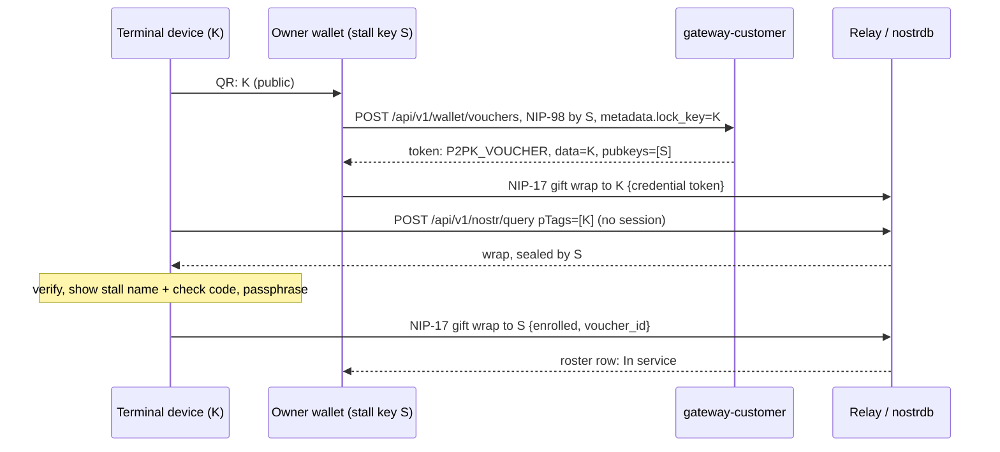

# Spec: putting a terminal into service

**Issue:** [imani-wallet#160](https://github.com/398ja/imani-wallet/issues/160).
**Status:** Accepted. The product owner's decisions on the open questions are
recorded in section 9 (2026-10-04). Built phase by phase, see section 8.
**Repos:** imani-wallet, imani-gateway-customer, imani-gateway-core,
imani-gateway-portal, cashu-voucher.
**Builds on:** [ADR 0005](adr/0005-terminals-are-authorised-by-locked-vouchers.md)
(terminals are locked vouchers), [ADR 0006](adr/0006-a-voucher-guarded-request-is-signed-by-its-lock-key.md)
(the lock key signs), [ADR 0009](adr/0009-a-card-purchase-issues-through-a-terminal.md)
(the gateway already honours a terminal credential), and the
[terminals guide](terminals.md).

Code references are `repo:path:line` against `origin/main` on 2026-10-04.
`wallet:` means imani-wallet, `customer:`, `core:` and `portal:` mean the three
gateways.

## 1. Goal

A stall owner and a member of staff, each with their own phone and no developer
tools, can put a device into service as a terminal, open it on the till after a
reload with a passphrase, redeem and sell from it within its role, and have it
refused after the owner revokes it. All of it runs in a real two-browser e2e
against staging with no injected state.

The domain logic for this exists and is tested. This spec is mostly wiring, plus
the security fixes the wiring would otherwise expose (section 4.5).

## 2. User journeys

### 2.1 The owner adds a terminal

1. Owner: **Settings → Terminals → Add a terminal**. Name, role, scan the code
   on the device (unchanged UI).
2. **Add terminal** refuses a key that is not a valid secp256k1 point, then
   mints the credential (section 5.1), checks the minted token really is a
   `P2PK_VOUCHER` locked to the scanned key with the metadata intact, and sends
   it to the device by NIP-17 DM.
3. The screen says what is true: *"Sent to Front counter. Finish on that device.
   Check code 482 913."* The roster row reads **Waiting for the device**.
4. When the device confirms (section 2.2 step 6), the row becomes **In
   service**. Only then is "can trade for your stall" said anywhere.
5. A waiting row can be **Cancelled**, which is a revocation (section 2.6).
6. A waiting row that is not confirmed within **24 hours** expires: the owner's
   wallet cancels it (spends the credential with the stall key, section 4.3) the
   next time it opens, and the device refuses a credential DM older than 24
   hours. A stall may have **at most 2 waiting rows** at a time. **Add terminal**
   is refused while two are waiting, with *"Two terminals are already waiting
   for their device. Finish or cancel one first."* Waiting rows do **not** count
   against the free terminal (decision 4), so a botched setup never blocks a
   retry.
7. The owner chooses the **idle lock** on the same form: on by default at 10
   minutes, adjustable, and it can be switched off (decision 2). It travels to
   the device in the credential DM (section 5.1).

### 2.2 A fresh device becomes a terminal

1. The logged-out screen (`/onboarding`) gains **Set this device up as a
   terminal**, routed to `/terminal/setup`.
2. If the device holds a key (`keyStore.hasKey()`), setup refuses and sends the
   user to log out first, where they see `LOGOUT_WARNING`
   (`wallet:src/lib/logout.ts:34`). One account per device, as decided on #160.
3. The device calls `beginEnrolment()` and shows the QR and copyable key, with
   *"This code is not a secret. Keep this screen open until setup finishes."*
   The key lives only in memory, so a reload starts over with a new code.
4. The device polls for a credential DM addressed to its key (section 5.2).
5. On receipt it shows the stall's public name and the check code, and asks the
   operator to confirm they match the owner's screen.
6. The operator sets a passphrase (required, **at least 8 characters**,
   decision 2). `completeEnrolment` verifies and stores. The device sends a signed
   "enrolled" DM back to the stall and lands on the till.

### 2.3 Login and unlock

`Entry` (`wallet:src/App.tsx:766`) learns a third state. Key present and a
terminal record present: `/terminal/unlock`. Key present without one: `/login`
as today. No key: `/onboarding`.

Unlock decrypts `K` with the passphrase and builds a signer. It does **not**
open a NAP session: a terminal has no account and is not a customer (the #160
follow-up shows NAP would log it in as one). The app then runs the terminal
login: the credential is re-verified from the token's own bytes, the mint is
asked whether it is still unspent, and a 12-hour local session opens FULL or
REDUCED exactly as `loginTerminal` already decides (`wallet:src/lib/terminalLogin.ts:98`).

On top of the 12-hour session, an unlocked till locks itself after the owner's
**idle lock** period with no touch or key press (default 10 minutes, or off,
decision 2). Locking drops the in-memory signer and returns to
`/terminal/unlock`. It does not end the 12-hour session's mint check: unlocking
again within the session needs only the passphrase.

### 2.4 The till

A new `TerminalApp`, sibling to `AuthedApp`, rendered when the terminal login
admits an actor. It does not depend on `canTrade` (`wallet:src/lib/merchant.ts:335`),
starts no DM poll, wallet sync or push subscription, and reads the stall's
`MerchantProfile` from its public record (`fetchMerchantRecord`,
`wallet:src/lib/merchant.ts:547`, ADR 0012).

| Screen | Redemption only | Sell and redeem, FULL | Sell and redeem, REDUCED | Owner |
|---|---|---|---|---|
| Home: terminal name and stall name | yes | yes | yes | n/a |
| Redeem | yes | yes | yes | yes |
| Sell | no | yes (phase 5) | no | yes |
| Cashback issue | no | yes (phase 5) | no | yes |
| Settings → Security → Take out of service | yes | yes | yes | n/a |
| Lock | yes | yes | yes | yes |
| Profile, Dashboard, Vouchers, Transactions, Backup, Restore, Terminals | no | no | no | yes |

A refusal, a revoked credential or a lapsed subscription shows `NotTrading` as
today.

### 2.5 Redeem on a terminal

The payment request already names the stall, not the terminal
(`wallet:src/lib/vreq.ts:73`), so the coupon is gift-wrapped to the stall and
the terminal receives nothing. Today the Redeem screen learns of payment from
its own wallet (`reconcileRequests`, `wallet:src/lib/vreq.ts:158`, watched at
`wallet:src/pages/RedeemPage.tsx:229`), which on a terminal never changes. On a
terminal it instead polls `GET /api/v1/atomic/fulfilment/{paymentRequestId}`
(`core:.../atomic/controller/VoucherFulfilmentController.java:56,75`), NIP-98
signed by `K`. That endpoint exists for exactly this: a party that issued a
request and holds neither sender nor recipient key. The stall's own device
receives and burns the coupon when it next unlocks, as for any redemption.

### 2.6 Revoking, and a lost device

The owner taps **Revoke** (or **Cancel** on a waiting row). The wallet spends
the credential at the mint with the **stall's** key (section 4.3), using the
existing `revokeCredential` (`wallet:src/lib/credentialRevocation.ts:128`). The
row is marked revoked only when the spend lands or the mint reports it already
spent. Otherwise the screen says it did not land and offers a retry.

The device is never consulted, so a lost, stolen or dead device is revoked the
same way. Effect: Sell is refused within the verifier cache window (60 s), and
the device is refused at its next unlock. A revoked redeem-only terminal that is
still unlocked can keep showing payment requests until its 12-hour session
ends. That is harmless by construction: the money goes to the stall (ADR 0005).

Decommissioning from the device is unchanged (`wallet:src/lib/terminalDecommission.ts:81`).

### 2.7 Expiry and re-issue

A credential is minted for **365 days** (decision 1,
`wallet:scripts/mint-terminal-credential.mjs:115`). The owner's roster reads the
expiry from the token's own signed bytes and warns **30 days** and again **7
days** before it: a badge on the row and a notice on the Terminals screen,
*"Front counter stops on 12 March. Renew it."* **Renew** is one tap: the wallet
mints a fresh 365-day credential locked to the **same** device key `K` (taken
from the row), DMs it to the device, and revokes the old one only after the
device confirms the new one with the enrolled DM. The device accepts a re-issue
at its next unlock without a new setup or passphrase, provided it is locked to
its own `K`, issued by its own stall and has the same role or a smaller one. A
re-issue that changes the role is not a renewal: the owner adds the device
again.

## 3. Why "Add terminal" mints nothing and reaches no device today

| # | Gap | Where |
|---|---|---|
| G1 | The owner's page builds the credential and throws it away. `prepareEnrolment` is called, and only `recordTerminal` uses the result | `wallet:src/pages/TerminalEnrolPage.tsx:80-99` |
| G2 | Minting exists only as a script, by design of ticket 05 | `wallet:src/lib/terminalIssue.ts:28-33`, `wallet:scripts/mint-terminal-credential.mjs:103-122` |
| G3 | Success is claimed with no call made | `wallet:src/pages/TerminalEnrolPage.tsx:107` |
| G4 | Nothing delivers anything to the device | none |
| G5 | Nothing calls `beginEnrolment` or `completeEnrolment` | `wallet:src/lib/terminalEnrol.ts:91,155` |
| G6 | An empty device can only reach customer onboarding | `wallet:src/App.tsx:766-775`, `:720` |
| G7 | Terminal screens need a NAP session and `canTrade`, which a terminal key never has | `wallet:src/App.tsx:350,388`, `core:.../service/MerchantAclService.java:169-180` |
| G8 | Login never asks the mint, so every terminal is REDUCED | `wallet:src/App.tsx:290`, `wallet:src/lib/useTerminalIdentity.ts:103` |
| G9 | The device key checked at login is read from the record being checked | `wallet:src/lib/useTerminalIdentity.ts:110` |
| G10 | Owner revocation only marks a local row, and `revocationSecret` is never written. It cannot be: the credential is locked to `K` alone, so no secret the owner holds can spend it | `wallet:src/lib/terminalRoster.ts:64,172-186`, `customer:.../adapter/VoucherAdapter.java:2528` |
| G11 | Setup would overwrite the wallet key in the single key slot | `wallet:src/lib/terminalEnrol.ts:186` |
| G12 | Redeem on a terminal can never see the payment arrive | `wallet:src/pages/RedeemPage.tsx:229` |
| G13 | The gateway's revocation check reads a status that is hard-coded `ISSUED` | `customer:.../voucher/TerminalCredentialVerifier.java:115`, `customer:.../voucher/VoucherResponseBuilder.java:166` |
| G14 | Portal Sell refuses any caller acting for another stall | `portal:.../controller/PortalVoucherController.java:684,727-751` |
| G15 | No `delegated` warrant can be built or verified | `wallet:src/lib/issuanceWarrant.ts:314`, `wallet:src/lib/warrantSigner.ts:186`, `portal:.../warrant/PortalIssuanceWarrant.java:222` |

## 4. Trust model

### 4.1 What a terminal holds

One thing: a **terminal credential**, a 1-sat `P2PK_VOUCHER` minted by the
gateway with `issuer_id` = the stall and signed `merchant_metadata`
`{terminal: true, stall_pubkey, role, lock_key, name}`
(`wallet:src/lib/terminalCredential.ts:66`), locked to `K`, a key the device
generated and never discloses. This is ADR 0005 unchanged. No NAP permission
row and no gateway table exist per terminal.

Authority is the **equality** `lock_key == the key that signed this request`,
plus `issuer_id == stall_pubkey`. It is what `credentialActor`
(`wallet:src/lib/terminalCredential.ts:168`) and `TerminalCredentialVerifier`
(`customer:.../voucher/TerminalCredentialVerifier.java:144,151`) already check.
The role grants `voucher:redeem:<stall>` and, for *Sell and redeem*,
`voucher:issue:<stall>` (`wallet:src/lib/terminalRole.ts:158`). It never grants
`coupon:issue`, which is the owner's permission and gates the dashboard,
campaigns, policies and cashback records (`portal:.../config/PortalPermissions.java:41`).

### 4.2 Issue and transport

**Delivery is a NIP-17 DM, not a credential QR.** The token is 1.6 to 2.6 KB
(`wallet:src/lib/__tests__/fixtures/live-terminal-*.token`), a dense QR phones
read badly, and the DM is the "notify the terminal" the issue asks for. The
device needs no session to fetch it: `/api/v1/nostr/query` is a public write on
both gateways (`core:gateway-core-rest/src/main/resources/application.yml:293`,
`customer:.../config/CustomerSecurityConfiguration.java:95`). The owner wraps
and publishes the way the transfer signature already does: relay plus gateway
mirror (`wallet:src/lib/transferSignature.ts:616-679`). The device unwraps with
the pending key inside `terminalEnrol.ts`, which keeps its promise that nothing
outside the module sees `K`'s private half.

**Binding to the right stall.** `K` is public, so anyone watching the screen can
DM it a credential for *their* stall. The device therefore shows the stall's
public name and a check code, and the operator confirms it matches the owner's
screen. Check code = first 6 decimal digits of
`sha256(voucher_id ‖ stall_pubkey ‖ K)`. The gateway chooses `voucher_id`, so
matching it costs an attacker about 10^6 mints, not an offline grind.

### 4.3 Revocation, and the one change to the lock

A credential locked to `K` alone can be spent only by the device (G10). Fix:
for a voucher whose signed metadata has `terminal: true`, gateway-customer adds
the **issuer's** key to the NUT-11 `pubkeys` tag with `n_sigs = 1`, beside `K`
in `data`. The mint already accepts any one of `data` plus `pubkeys` on the
primary path (`cashu-mint:.../validator/P2PKSpendingCondition.java:117,156`), so
either the device or the stall can spend it, and nobody else can. The key is
taken from the resolved issuer, never from the request, so a caller cannot name
a third party. Authority is unaffected because every verifier binds to
`merchant_metadata.lock_key`, not to the spending keys, and the stall already
holds all the authority a terminal could.

The owner's roster keeps the **token** (not a `revocationSecret`). Revoking is
`revokeCredential(token)`: a swap witnessed by the stall key. `witness.ts`
learns to sign for a secret whose `pubkeys` tag includes the wallet's key
(`lockedToPubkey` reads only `data` today, `wallet:src/lib/witness.ts:55`).

Propagation: revocation is a spent proof, and every check reads NUT-07.

| Check | Where | Bites |
|---|---|---|
| Terminal unlock | wallet, `credentialState` (`wallet:src/lib/credentialRevocation.ts:70`) via public `/api/v1/wallet/token/validate` | next unlock, at most 12 h |
| Sell, cashback | gateway-customer verifier, NUT-07 on the stored token (`customer:.../service/ParallelProofStateService.java:78`), cached 60 s, positive answers only | 60 s |
| Redeem | none needed: the money goes to the stall | n/a |

### 4.4 Per-request verification

The terminal signs every request NIP-98 with `K` and presents its credential as
`X-Imani-Terminal-Credential: <voucher_id>`, the header gateway-customer already
honours (`customer:.../rest/controller/VoucherController.java:67,277-299`) and
ADR 0009 verified end to end. ADR 0006 puts the voucher in the body because a
header is unsigned. That objection does not bite here: the header carries an id
the gateway looks up in its own store, and the result must be locked to the
signer, so swapping it can only select another credential locked to the same
`K`. Recorded as a deliberate reuse, not an oversight.

Verification order, in `TerminalCredentialVerifier.stallFor`, all local before
the mint is asked (ADR 0006 ordering):

1. the voucher exists in the gateway's store and is a terminal credential;
2. `lock_key == NIP-98 signer`;
3. `issuer_id == stall_pubkey`;
4. role permits the action;
5. **new:** NUT-07 says UNSPENT. Unknown fails closed for issuance.

### 4.5 Threats

| Threat | Mitigation |
|---|---|
| Stolen device, locked | `K` is passphrase-encrypted at rest. Owner revokes without the device. Sell refused within 60 s |
| Stolen device, unlocked mid-shift | The idle lock (default 10 minutes) re-locks an unattended till. Otherwise as above. Redeem-only damage is nil (money goes to the stall). Close the stall if Sell must stop sooner |
| Weak passphrase on a shared till | At least 8 characters, refused before `completeEnrolment` |
| Owner hoards unconfirmed credentials | At most 2 waiting rows, each cancelled after 24 hours |
| Modified terminal sells through a licence lapse | The portal refuses terminal Sell for a stall without a current licence beyond its free terminal (section 5.4), from cached state with a 72-hour grace |
| Replayed enrolment code | `K` is public by design. The pending key lives in memory only, so an old code from a reloaded device yields an inert credential. Waiting rows can be cancelled |
| Replayed or forwarded credential DM | Inert without `K`. `completeEnrolment` refuses a credential not locked to the pending key (`wallet:src/lib/terminalEnrol.ts:179`) and runs once |
| Wrong-stall credential (hijack) | Stall name plus check code confirmed by the operator (section 4.2) |
| Edited `localStorage` raises the role | Login derives role, stall and lock from the **token's signed bytes** (`verifyVoucher` plus `issuerAllowlist`), never from stored fields. Closes IW-15 (`wallet:src/lib/terminalEnrol.ts:269-281`) |
| Edited record names another device | The device key comes from the unlocked signer and must equal `lock_key`. Closes G9 |
| Terminal mints another terminal | **New refusal:** gateway-customer refuses `merchant_metadata.terminal` or a licence marker when the issuer was resolved from a terminal credential (`customer:.../rest/controller/VoucherController.java:277`). Without it, today's code would let a *Sell and redeem* terminal mint terminal credentials for its stall |
| Terminal reaches owner surfaces | It never holds `coupon:issue`. Only `POST /api/v1/portal/vouchers` and cashback issue accept `voucher:issue:<stall>` |
| Off-curve `K` mints an unlocked bearer credential | Refused before minting, and the minted secret is checked for kind and lock. If either fails the owner spends it at once and reports failure |
| Setup destroys a person's wallet key | Refused while `keyStore.hasKey()` (G11) |
| Mint unreachable | REDUCED session: redeem only. Unchanged |

## 5. API and wire changes

### 5.1 imani-wallet

- **Owner mint**, from `TerminalEnrolPage`: `POST /api/v1/wallet/vouchers`
  signed by the stall, body exactly as the script
  (`wallet:scripts/mint-terminal-credential.mjs:105-117`), then
  `GET /api/v1/wallet/vouchers/{id}` until `ISSUED` with a token. Move the
  curve check (`:168-182`) into `checkEnrolment`.
- **Credential DM** (kind-14 rumor, gift-wrapped to `K`, sealed by the stall):
  `{"type":"imani-terminal-credential/1","voucher_id","token","stall_pubkey","name","idle_lock_minutes"}`.
  `idle_lock_minutes` is a whole number, `0` meaning off, default `10`. The
  rumor's `created_at` bounds the 24-hour waiting window on the device side.
- **Waiting rows:** at most 2 per stall, counted from the roster, expired and
  cancelled after 24 hours. Not counted by the free-terminal allowance.
- **Renewal** (section 2.7): the same credential DM, with `"renews":"<old voucher_id>"`.
- **Enrolled DM** (gift-wrapped to the stall, sealed by `K`):
  `{"type":"imani-terminal-enrolled/1","voucher_id","terminal_pubkey"}`. The
  owner's DM poll marks the matching roster row **In service** and ignores one
  whose seal is not that row's `K`.
- **Terminal requests:** `signedFetch` with the terminal signer and the
  credential header. No cookie.
- **Delegated warrant** (phase 5), wire form:
  `{"form":"delegated","sale_total","face_decimals","unit","nonce","signature","credential"}`.
  `signature` is BIP-340 by `K` over the existing `warrantSaleDigest`
  (`issuerId` = the stall). `credential` is the credential's signed voucher
  fields (secret only, never the proof's `C`, so it is not spendable).

### 5.2 imani-gateway-customer

- `VoucherAdapter.lockedFrom` (`customer:.../adapter/VoucherAdapter.java:2528`):
  for `merchant_metadata.terminal == true`, add `pubkeys = [02‖issuer_id]`,
  `n_sigs = 1`.
- `VoucherController.resolveIssuer` (`:277`): refuse credential-shaped metadata
  (`terminal`, licence marker) when the issuer came from a terminal credential.
  403 `TERMINAL_CANNOT_DELEGATE`.
- `TerminalCredentialVerifier`: add the NUT-07 step on the stored token, and
  return the role, so callers other than issuance can use it.
- **New** `GET /internal/v1/terminal-credentials/{voucherId}?caller=<hex>`,
  service-credential only: `200 {"stall","role","lock_key","live":true|false|null,"free":true|false}`
  (`free`: this is the stall's earliest-issued live terminal credential, used by
  the portal's licence check, decision 3)
  or `404`. The one verifier the other gateways call, so there is one
  definition of a valid credential.

### 5.3 imani-gateway-core

- `GET /internal/v1/merchants/{pubkey}/permissions` gains optional
  `credential=<voucherId>` (`core:.../controller/MerchantPermissionsController.java:77`).
  With it, core asks gateway-customer's verifier and returns
  `["terminal", "voucher:redeem:<stall>"]`, plus `"voucher:issue:<stall>"` when
  the role allows and `live == true`. Never `coupon:issue`. A suspended stall
  (`MerchantAclService`) yields `[]`.

### 5.4 imani-gateway-portal

- A `TerminalCredentialAuthFilter` after `Nip98AuthFilter`
  (`portal:.../config/PortalSecurityConfiguration.java:286`): with the header
  present and a NIP-98 principal, fetch the permissions above (cached 60 s,
  answers only, as `:161` does) and add them as authorities.
- `POST /api/v1/portal/vouchers` and cashback issue: method-level
  `MERCHANT_ONLY or hasAuthority('terminal')`, overriding the class rule
  (`portal:.../controller/PortalVoucherController.java:93`) for these two only.
- `issuingStall` (`:684`) returns the stall from `voucher:issue:<stall>` for a
  terminal. `DelegatedIssuanceUnsupportedException` goes away. A terminal
  without `voucher:issue:` gets 403.
- Warrant: Sell and cashback accept `delegated` only from a terminal caller, and
  `merchant` only from the owner. `PortalIssuanceWarrant` verifies `delegated`
  with cashu-voucher's new `verifyDelegated` and checks the embedded
  credential's voucher id equals the one that authenticated the request. Nonce
  single use through `issuance_warrant_use` (portal#54).
- **Licence enforcement (decision 3).** Terminal Sell and cashback are refused
  with 402 `TERMINAL_UNLICENSED` when the credential is not the stall's free
  terminal and the stall has no current licence. The internal verifier
  (section 5.2) reports `free: true` for the stall's earliest-issued live
  terminal credential, so the portal never counts terminals itself. The
  licence check reads only the portal's **own cached licence state**
  (`stall_licence_state`: stall, `licensed_until`, `refreshed_at`), refreshed in
  the background and never called live on a Sell. A stall stays licensed for
  **72 hours** after `licensed_until` (grace), and a failed refresh never moves
  a stall from licensed to unlicensed, so an outage cannot stop a stall mid-day.
  An owner's own Sell is never licence-checked.

### 5.5 cashu-voucher

- `IssuanceWarrant.verifyDelegated(issuerId, credentialFields, signature, …)`:
  the credential's issuer signature verifies, its `issuer_id == issuerId`, its
  metadata is a terminal with an issuing role, and `signature` verifies against
  `lock_key`. The procedure is already specified offline
  (`core:docs/issuance-authorisation-warrant.md:253,382`). The enum exists
  (`cashu-voucher:.../domain/IssuanceWarrant.java:126`). The wallet's
  `verifyIssuanceWarrant` mirrors it in place of the refusal at
  `wallet:src/lib/issuanceWarrant.ts:314`.

## 6. Data model and migrations

**No gateway migrations for terminals.** ADR 0005's property, no row per
terminal, holds. gateway-customer already stores the credential as an issued
voucher. Portal reuses `issuance_warrant_use` (`portal:.../db/migration/portal/V9__issuance_warrant_use.sql`).
The one new table is portal's per-stall licence cache for decision 3
(`stall_licence_state`, phase 5), which is per stall, not per terminal. Its
Flyway number is chosen against portal's open PRs when phase 5 lands.

Wallet `localStorage`, read with the existing validate-don't-cast style:

| Key | Change |
|---|---|
| `imani-wallet:terminal` (device) | Keep `stallPubkey, role, terminalPubkey, name, enrolledAt, idleLockMinutes` as display hints. `token` and **new** `voucherId` are the authority. Drop `permissions`, `merchantMetadata`, `issuerId`: login derives them from the token. A record without `token` reads as not enrolled |
| `imani-wallet:terminals:<stall>` (owner) | Replace `revocationSecret` with `token` and `voucherId`. Add `status: 'waiting' \| 'in-service' \| 'revoked'`, `idleLockMinutes` and `expiresAt` (display only, re-read from the token). Existing rows have no token and cannot be revoked. They are shown as *Set up before revocation existed: add it again* and do not count against the allowance |
| key store `imani-wallet-key` | Unchanged slot. Holds `K` on a terminal device, guarded by `hasKey()` |

Roster sync across the owner's devices (phase 6): one NIP-44 self-encrypted
kind-30078, `d=imani:terminals`, replaceable, the same pattern as
`wallet:src/lib/voucherRecords.ts:57-68`. It makes revocation survive the loss
of the owner's own phone, which is the case revocation exists for.

## 7. Issuance warrants on a terminal

A terminal's Sell must carry a warrant the customer's wallet verifies, or it is
refused on receipt (#159). **The terminal key `K` signs, as a `delegated`
warrant. The owner does not.**

The owner cannot sign per sale: the digest covers sale total and nonce, which
only exist at the counter, and a blanket owner signature made in advance is a
bearer authority to mint, which is what this design refuses. What the owner
signed in advance is the credential, through the gateway: "this stall lets `K`
issue". The `delegated` form chains the two, offline: the credential proves the
stall delegated to `K`, and `K`'s signature proves this sale. Liveness is
checked online at issuance by the portal, so a coupon cannot be minted on a
revoked credential, and coupons sold before a revocation stay valid, as they
should.

## 8. Phased plan

Each phase ships alone and leaves the app honest. Phases 1 to 4 are
redemption; 5 is selling; 6 is resilience. Every e2e runs two browser contexts
on staging with no injected `localStorage`, replacing `beATerminal()`
(`wallet:e2e/terminals.e2e.ts:88`) phase by phase. It survives only as a
labelled unit-level shortcut.

### Phase 0: stop lying, stop destroying (wallet)

- Success copy says *sent / waiting*, never *can now trade*. Off-curve keys
  refused. `completeEnrolment` refuses while `keyStore.hasKey()`.
  `useTerminalIdentity` takes the device key from the unlocked signer.
- **AC:** the owner screen never claims trading. A unit test proves setup on a
  device holding a wallet key leaves that key loadable. A record naming another
  pubkey is not treated as a terminal.
- **E2E:** add a terminal with an off-curve key, see refusal. Add with a valid
  key, see "Waiting", never "can trade".

### Phase 1: the owner mints a real, revocable credential (customer, wallet)

- gateway-customer: stall co-key on terminal credentials. Refuse credential
  minting through a terminal credential. Wallet: mint from `TerminalEnrolPage`,
  check kind, lock and metadata, store token in the roster. Waiting rows:
  at most 2, cancelled after 24 hours, not counted against the free terminal.
- **AC:** the decoded secret is `P2PK_VOUCHER`, `data` = `K`, `pubkeys` =
  `[S]`, metadata intact. A *Sell and redeem* credential presented to
  `POST /api/v1/wallet/vouchers` with `terminal: true` metadata gets 403.
- **E2E:** one API call observed on Add. The token from the roster decodes as
  above. Cancelling the waiting row spends it (NUT-07 `SPENT`).

### Phase 2: the device receives its authority (wallet)

- `/terminal/setup` entry, code screen, DM poll on `K`, stall name and check
  code, passphrase (at least 8 characters), `completeEnrolment`, enrolled DM,
  owner row → In service. The idle-lock setting travels in the credential DM
  and is stored on the device record.
- **AC:** the private key never appears in DOM, storage before completion,
  network payloads or logs (extends `terminalEnrol.test.ts`). A credential for
  another key, or sealed by another stall than confirmed, is refused and
  nothing is stored.
- **E2E:** context A owner adds; context B shows code, receives, confirms,
  sets passphrase. A's row turns In service without a reload.

### Phase 3: terminal login and Redeem (wallet)

- `Entry` routes to `/terminal/unlock`. Unlock without NAP. `TerminalApp`
  shell and menu. `useTerminalIdentity` gets the mint client. Login derives
  from token bytes. Redeem polls `/api/v1/atomic/fulfilment/{id}`. Idle lock
  enforced (section 2.3).
- **AC:** with the mint reachable a live credential opens FULL. With it
  blocked, REDUCED. No call to `/api/v1/auth/*` from a terminal. Menu shows
  only the items in section 2.4.
- **E2E:** B reloads, unlocks, lands on the till naming the stall. A customer
  context C pays B's Redeem request. B shows Paid. A redeem-only B has no Sell
  route.

### Phase 4: revocation that bites (wallet, customer)

- Owner revoke spends with the stall key (witness for `pubkeys`). Verifier
  NUT-07. Roster marks only on success.
- **AC:** revoke with B offline, then B is refused at next unlock with
  *no longer in service*. A failed spend leaves the row live with a retry.
- **E2E:** A revokes, B reloads, unlock refused. Decommission from B still
  works and A's row shows revoked.

### Phase 5: terminal Sell and cashback (cashu-voucher, customer, core, portal, wallet)

- Depends on portal#54. `verifyDelegated` on both sides. Internal verifier
  endpoint. Core permissions with credential. Portal filter, per-method rule,
  `issuingStall` from credential, `delegated` accepted for terminals only.
  Portal licence cache and `TERMINAL_UNLICENSED` (decision 3).
  Wallet builds `delegated` and lifts `mayWarrantSale` and the gates at
  `wallet:src/lib/issue.ts:644` and `wallet:src/lib/cashbackIssue.ts:85`.
- **AC:** C's wallet accepts a coupon B sold, verdict `verified`. A replayed
  warrant nonce gets 409. B's credential gets 403 on dashboard, campaigns,
  policies and SSE. Revoked B gets 403 on Sell within 60 s. A REDUCED B is
  refused before minting.
- **E2E:** B sells to C, C holds it. A sees the coupon attributed to B. A
  revokes, B's next Sell is refused.

### Phase 6: roster sync and docs (wallet, imani-docs)

- Encrypted roster event. Expiry warnings at 30 and 7 days and one-tap
  renewal (section 2.7). Update `docs/terminals.md` (Adding a terminal,
  Known gaps, Common questions) and imani-docs
  `warrants/merchant/how-to-sell-on-a-terminal.md`.
- **AC:** a terminal added on phone A appears on phone A' after restore from
  backup and can be revoked from A'.
- **E2E:** restore A into a fresh context, revoke B from there, B refused.

## 9. Decisions

The product owner decided the open questions on 2026-10-04. Each is folded into
the sections named.

1. **Credential lifetime: 365 days, with warnings and one-tap renewal.** The
   owner is warned 30 days and 7 days before a credential expires, and offered
   a one-tap re-issue to the same device key. Sections 2.7, 5.1, phase 6.
2. **Passphrase at least 8 characters, and an owner-configurable idle lock.**
   The idle lock defaults to 10 minutes and can be switched off. It applies on
   top of the 12-hour session. Sections 2.1, 2.2, 2.3, 4.5, 5.1, phases 2 and 3.
3. **The portal enforces the licence for terminal Sell.** It refuses terminal
   Sell (and cashback) for a stall with no current licence beyond its free
   terminal. The check reads the portal's own cached licence state, never a
   live call, with a 72-hour grace after a lapse, so an outage never stops a
   stall mid-day. Sections 4.5, 5.4, 6, phase 5.
4. **Waiting credentials do not count against the free terminal.** Instead a
   waiting credential expires after 24 hours (the owner's wallet cancels it),
   and a stall may have at most 2 waiting at a time. Sections 2.1, 4.5, 5.1,
   phase 1.
