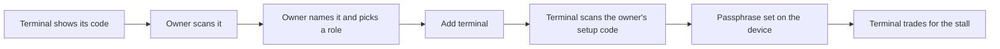

# Terminals guide

A stall is rarely one person with one phone. There's a device at the door that
only needs to take coupons back, a full till at the counter, and the phone the
owner carries. A **terminal** is one of those extra devices: it trades for your
stall, it can only do the job you gave it, and you can take that job away again
without touching anything else.

This guide is for both sides of the setup: the **stall owner**, who creates and
revokes terminals, and the **staff member**, who opens one and serves customers.

- [What a terminal is](#what-a-terminal-is)
- [Before you start](#before-you-start)
- [Adding a terminal](#adding-a-terminal)
- [Opening a terminal for trade](#opening-a-terminal-for-trade)
- [Serving customers from a terminal](#serving-customers-from-a-terminal)
- [Your terminal list](#your-terminal-list)
- [Revoking a terminal](#revoking-a-terminal)
- [Taking a terminal out of service from the device](#taking-a-terminal-out-of-service-from-the-device)
- [Subscriptions, and what a lapse does](#subscriptions-and-what-a-lapse-does)
- [What a terminal can never do](#what-a-terminal-can-never-do)
- [When things go wrong](#when-things-go-wrong)
- [Known gaps today](#known-gaps-today)
- [Common questions](#common-questions)

## What a terminal is

A terminal is a device you authorise to act for your stall in a **fixed role**.

| Role | What it can do |
| --- | --- |
| **Redemption only** | Honours your coupons. Cannot sell. |
| **Sell and redeem** | A full till: sells coupons and honours them. **Selling is switched off on every terminal for now**; see [Known gaps today](#known-gaps-today). |

The device makes its own key, which it never shows anyone, and you hand it back
an authority locked to that key. It is not a copy of your account. It has no
wallet of its own, it never holds your money, and it cannot see your figures.

**Your own phone is not a terminal.** It stays exactly as it is: it holds your
stall's key, it does everything it does today, and you never enrol it. Terminals
are the devices *besides* yours.

## Before you start

- **You need a connection.** Adding a terminal is the one step with no offline
  path. Set your terminals up before the market opens, while you still have
  signal. Once a terminal is running, redemption keeps working on a poor
  connection.
- **Both devices need to be in front of you.** The QR exchange is physical: the
  terminal shows a code, you scan it from your phone.
- **Neither QR is a secret.** The code the terminal shows is a public key, and
  what travels back is useless to anyone who does not hold the terminal's own
  key. They can be photographed across a busy market without giving anything
  away.
- **Your first extra till is free.** Beyond that you need a subscription, see
  [below](#subscriptions-and-what-a-lapse-does).

## Adding a terminal

On **the terminal**, start enrolment so it displays its code. On **your own
phone**:

1. Go to **Settings → Terminals → Add a terminal**.
2. Type a **name** you'll recognise later: `Front counter`, `Door`, `Sam's
   phone`. The name is how you'll tell devices apart when you come to revoke
   one.
3. Choose **what it can do**. This is the security decision of the whole flow,
   so pick the smaller role when the smaller role is enough. A device at the
   door that only takes coupons back should be **Redemption only**: it then has
   no Sell button, and there is no way around that through the interface either.
4. **Scan the code** on the other device. Scanning only fills the key in, it does
   not enrol anything — if you scanned the wrong device of two on the counter,
   tap **Rescan**.
5. Tap **Add terminal**.
6. Choose **Lock when idle**: how long the terminal may sit untouched before
   it asks for its passphrase again. Ten minutes unless you change it, or
   **Never**.
7. Your phone then shows a **setup code**. Scan it with the terminal (or type
   it in). The terminal only accepts the authority your setup code names, so
   someone who photographed the terminal's own code cannot slip in theirs.
8. Finish on the terminal itself. It shows your stall's name and a six-digit
   **check code**: they must match what your phone shows. Then set a
   **passphrase** of at least 8 characters there.

Until the next version can open the till, a device set up as a terminal offers
**Remove this terminal from this device** on its first screen. That erases
everything logging out erases: the terminal's key and passphrase, its record,
every other piece of app data in the browser, and its local database. It does
not take the terminal out of service: revoke it from your list for that. If the
key cannot be erased, the screen says so instead of moving on.

The terminal now appears in your list, and it logs itself in from then on.

## Opening a terminal for trade

Staff open the terminal with its **passphrase**. That is what stops a stolen
tablet from simply being switched on and used.

Each time it opens, the terminal checks that its authority is still live. A
session lasts **up to 12 hours**, which is one trading day: a terminal
re-authenticates when it opens in the morning and never in the middle of a
shift.

If the mint cannot be reached when it opens, the terminal still opens, but on
**reduced authority**: it can redeem, never sell. Redemption must never wait for
a network, and selling creates value, so selling waits for a check that
succeeded.

## Serving customers from a terminal

Same as on the owner's own till, minus whatever the role excludes:

- **Redeem** — show the payment request QR, the customer scans and confirms, the
  screen goes to paid on its own.
- **Sell** — only on a *Sell and redeem* terminal, and **not at all yet**: a
  terminal's home screen has no Sell button and says selling is not available
  yet, and the Sell and cashback screens, if reached by typing the address,
  stop before anything is scanned, typed or issued. See
  [Known gaps today](#known-gaps-today).

Two things happen quietly and are worth knowing:

- **Coupons carry your stall, not the device.** A customer's coupon names your
  business and is honoured by your business. Nothing on it says which till
  served them.
- **Takings go to your key, wherever they were collected.** No money ever rests
  on a terminal. That is what makes revoking one safe: you destroy access, never
  funds.

On your own records, each movement remembers **which terminal handled it**, so
you can reconcile a till at the end of the day and answer a question about a
particular sale. That attribution is private to you.

## Your terminal list

**Settings → Terminals** shows every device you have out: its name, its role,
and when it was last used. A terminal that has never traded says *Never used*.

A terminal is only ready once the gateway has confirmed it. When the device
says it has its authority, your app also confirms it with the gateway, as your
stall, and keeps trying (waiting longer each time) if the gateway cannot be
reached. Until the gateway answers, the row says *Confirming with the gateway*.
If the gateway refuses because more than 24 hours have passed, the row says
*Lapsed before it was confirmed*: that terminal can never sell, so revoke it and
add the device again.

A row still *Waiting for the device* has **Show the setup code**, so you can
finish setting it up after closing the screen you added it from. If its
authority was never sent to the device (for example, the connection dropped),
the list sends it the next time you open it.

The list is your own record, held on your device. It needs no connection, which
matters at the moment you most need it: discovering a device is missing should
not also mean discovering you have no signal.

Revoked terminals **stay on the list**, greyed and labelled *No longer in
service*. Revoking withdraws authority, it does not erase history, and last
month's sale still needs to point at the till that took it.

## Revoking a terminal

When a device leaves the stall, is lost, or you simply no longer trust it:

1. **Settings → Terminals**.
2. Tap **Revoke** on the row.
3. Read the note about timing, then confirm with **Revoke &lt;name&gt;**.

Two things to hold on to:

- **You can revoke a device you cannot reach.** Lost, stolen, drowned, or
  smashed, it makes no difference: you hold what is needed to withdraw its
  authority, and the device is not consulted. Revoking spends the terminal's
  authority at the mint with your stall's key. If that does not get through,
  the terminal stays on your list as in service and the screen says so: tap
  **Revoke** again when you have a connection. A terminal set up before this
  existed says *Set up before revocation existed*: add the device again to
  replace it.
- **Revocation bites within 12 hours,** when the terminal's session next
  expires. The screen tells you this before you confirm, because the real
  question you are answering is *"is twelve hours good enough, or do I close the
  stall as well?"*. If the device is in the wrong hands and twelve hours is too
  long, close your stall too.

**There is no pause.** No suspend, no disable, no toggle that could be read as
either. To bring a terminal back you add it again from the device, which is
seconds of work.

## Taking a terminal out of service from the device

Staff handing a device back, or an owner wiping one before it leaves, use
**Settings → Security → Take this terminal out of service** on the terminal
itself.

It hands back the terminal's authority **first**, then erases it. That ordering
is the point: a wiped device that was still authorised would be the worst of
both. If handing back the authority fails, **nothing is erased** and the screen
says so, so you can retry or ask the owner to revoke it from their list.

Every sale that terminal made stays with the stall. The device stops trading
immediately, and only the stall owner can bring it back.

> This is not the customer logout. There are no coupons held on a terminal, no
> backup key to write down, and no way to recover the device by itself.

## Subscriptions, and what a lapse does

- **One extra till is free.** Your own phone is counted, never converted, so
  the first terminal you enrol is the free one.
- **More than that needs a subscription**, sold per stall rather than per
  device: one licence, however many terminals.
- **A lapse suspends, it never revokes.** Terminals stop serving and are marked
  *Not trading while your subscription is inactive* on your list. Nothing is
  burned and nothing needs setting up again — renewing starts them again
  straight away.
- **Your stall keeps trading either way.** A lapse takes tills, not trade: your
  own device is unaffected.

The licence and a terminal's authority are two different things that fail in
opposite directions on purpose. A missing terminal authority refuses. An
unverifiable licence keeps working through its grace window, so a connectivity
problem never reads as an unpaid bill.

## What a terminal can never do

By design, and not merely by hiding a button:

- **Create or revoke other terminals.** Delegating a job never delegates
  control.
- **Change your business details.** Your stall's identity stays yours.
- **See your dashboard, stats, or notifications.** A till is a device in
  somebody else's hands.
- **Act for another stall.** Its authority names your stall specifically, so it
  is inert everywhere else.
- **Sell, if its role is redemption only.** The button is absent *and* the
  action is refused underneath, so going around the interface fails too.
- **Hold money.** Ever.

## When things go wrong

| What the terminal says | What it means | What to do |
| --- | --- | --- |
| *This device is not set up as a terminal yet* | Never enrolled, or it has been wiped | Ask the owner to add it |
| *This terminal's authority cannot be read* | The stored authority is damaged | Ask the owner to set it up again |
| *This authority is not for this device* | The authority belongs to another terminal or another stall | Ask the owner to set it up again |
| *This terminal is no longer in service* | It was revoked | Ask the owner to add it again if that was a mistake |
| Sell is missing on a full till | It opened without reaching the mint, so it is on reduced authority | Get it a connection and open it again |
| *Selling from a terminal is not supported yet* / *not available yet* | No terminal can sell a coupon the customer's wallet will accept (see Known gaps) | Sell from the owner's own device. Do not take payment for the sale on the terminal |
| *Cashback from a terminal is not supported yet* | The same gap, for cashback codes | Issue cashback from the owner's own device |
| *Not trading while your subscription is inactive* | A lapsed subscription, not a revocation | Renew; terminals resume immediately |

A terminal record left in a browser for a *different* device (for example a
set-up that was abandoned) is ignored. The owner's own phone keeps its normal
home screen rather than showing *This authority is not for this device*.

If a terminal has lost its authority it says so plainly and stops, rather than
failing repeatedly in front of a queue. Stop serving on it and use another
device.

## Known gaps today

Being straight about it: the rules, the screens, and the enforcement all exist
and are tested, but three seams between them are not yet wired, so **a second
till cannot be run end to end right now**. The plan to close them is
[the terminals-in-service spec](spec-terminals-in-service.md).

1. **A terminal is set up, but cannot yet open its till.** On the device,
   choose **Set this device up as a terminal** on the first screen. It shows a
   code. On your phone, **Add terminal** creates the terminal's authority,
   checks it, sends it to that code, and shows a setup code for the device to
   scan, which names the one authority it may accept. The device then shows your stall's
   name and a six-digit check code: confirm both match your phone, and set a
   passphrase of at least 8 characters. Your list then shows the terminal as in
   service. Opening the till on the device with that passphrase arrives in the
   next version. A terminal still waiting for its device is cancelled
   automatically after 24 hours, at most two can wait at once, and waiting
   terminals do not use up your free terminal. The gateway enforces the
   two-waiting limit and the 24 hours too, so a second phone or a cleared
   browser cannot get round them. The screen refuses a code that is not a real
   device key, and a device that is already on your list with a live
   authority: cancel or revoke that one first, so its authority is never left
   without a way to revoke it. Setup refuses to run on a device that still
   holds a wallet (log out first, keeping the backup key).

   If your connection drops while a terminal is being added, the row says
   **Still being set up**. The next time you open Terminals with a connection,
   it is finished (it becomes **Waiting for the device**) or cleared if nothing
   was created. A waiting row added by an older version of the app, before
   anything was sent to the device, shows **Remove**: nothing was ever created
   for it, so removing it is all there is to do. Only a clear refusal from the
   gateway clears the row. A server error, a timeout or a dropped connection
   leaves it **Still being set up**, because the authority may already exist.

   **Every terminal authority must be confirmed before it can sell.** The
   gateway refuses Sell for an authority that neither its device nor your stall
   has confirmed, and lapses it after 24 hours. The app does this for you. If you
   mint one yourself, `scripts/mint-terminal-credential.mjs` confirms it as the
   stall. The card-purchase issuer (`services/purchase-issuer`) confirms each
   credential it holds, as its device, the first time it reads it. Anything else
   that mints a terminal credential must call
   `POST /api/v1/wallet/terminal-credentials/{id}/confirm` itself.
2. **Login does not ask whether the authority is still live.** Every terminal
   therefore opens on reduced authority (redeem, never sell), and revocation
   does not bite at login. This fails safe rather than open — a revoked terminal
   still cannot sell — but no full till can currently sell either.
3. **A terminal cannot sell a coupon a customer will accept, so it does not
   sell at all** (#159). Every coupon carries the stall's own signed
   authorisation for the sale (an issuance warrant). A terminal's key is not the
   stall's key, so the most it can send is a signed "none". Every wallet that
   receives a coupon refuses one without the stall's authorisation — the
   customer's as well as yours — so a terminal sale used to take the customer's
   money, show "It is in their wallet now" on the terminal, and show "Coupon not
   authorised" in the customer's wallet with nothing added. Sell on a terminal
   now stops on arrival, before anything is scanned, issued or paid, and the
   same request made around the screen is refused before anything is minted.
   **Cashback is stopped the same way**: a cashback code from a terminal would
   carry the same signed "none", and although the customer can claim it, your
   own till would refuse it when they came to spend it.
   Terminal sales need the `delegated` warrant form, which signs with the key
   you locked the terminal's authority to; it is not supported yet. Until then,
   sell from your own device.

Everything else described above is built and running: role gating, the lapse
notice, the dashboard guard, decommissioning, attribution on records, and
revocation that genuinely spends at the mint. Subscriptions work end to end.

## Common questions

**Can staff run off with my stall?**
No. A terminal holds a disposable key with one job attached to it. It cannot
issue on your behalf outside its role, cannot change your business, cannot make
more terminals, and never touches your takings.

**Someone photographed the QR codes. Is that a problem?**
No. One is a public key and the other is inert without the key it was locked to.
That is the whole reason the exchange is built this way.

**A device was stolen. What now?**
Revoke it from your list. You do not need the device. It stops trading within 12
hours; if that is too long for the situation, close your stall as well until it
expires.

**Can I pause a terminal for a week?**
No, and deliberately. Revoke it and add it again when you need it, which takes
seconds.

**Do I lose the sales a revoked terminal made?**
No. Revoking withdraws authority. Your records keep every movement, still
attributed to that terminal.

**Can customers tell which till served them?**
No. A coupon names your stall and nothing else. Which device handled it is your
record, kept on your side.

**Does a terminal work with a bad connection?**
Redeeming, yes. Selling needs a check that succeeded, so a terminal that opened
without reaching the network redeems only. Adding a terminal always needs a
connection. (Selling on a terminal is switched off for now in any case; see
[Known gaps today](#known-gaps-today).)

**Why does my customer's wallet refuse a coupon instead of keeping it?**
Because a coupon your stall did not authorise is one your own till would refuse
too. Refusing it when it arrives means the coupon goes back to whoever sent it,
rather than sitting in the customer's wallet looking like money nobody will
honour.

---

Back to the guides: **[Merchants](merchants.md)** · **[Shoppers](customers.md)**
· **[How it works](how-it-works.md)**
