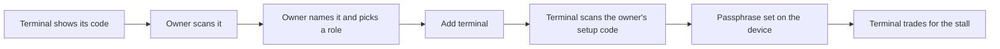

# Terminals guide

A stall is rarely one person with one phone. There's a device at the door that
only needs to take coupons back, a full till at the counter, and the phone the
owner carries. A **terminal** is one of those extra devices: it trades for your
stall, it can only do the job you gave it, and you can take that job away again
without touching anything else.

This guide is for both sides of the setup: the **stall owner**, who creates and
revokes terminals, and the **staff member**, who opens one and serves customers.

- [What a terminal is](#what-a-terminal-is)
- [Before you start](#before-you-start)
- [Adding a terminal](#adding-a-terminal)
- [Opening a terminal for trade](#opening-a-terminal-for-trade)
- [Serving customers from a terminal](#serving-customers-from-a-terminal)
- [Your terminal list](#your-terminal-list)
- [Revoking a terminal](#revoking-a-terminal)
- [Taking a terminal out of service from the device](#taking-a-terminal-out-of-service-from-the-device)
- [Subscriptions, and what a lapse does](#subscriptions-and-what-a-lapse-does)
- [What a terminal can never do](#what-a-terminal-can-never-do)
- [When things go wrong](#when-things-go-wrong)
- [Known gaps today](#known-gaps-today)
- [Common questions](#common-questions)

## What a terminal is

A terminal is a device you authorise to act for your stall in a **fixed role**.

| Role | What it can do |
| --- | --- |
| **Redemption only** | Honours your coupons. Cannot sell. |
| **Sell and redeem** | A full till: sells coupons and honours them. |

The device makes its own key, which it never shows anyone, and you hand it back
an authority locked to that key. It is not a copy of your account. It has no
wallet of its own, it never holds your money, and it cannot see your figures.

**Your own phone is not a terminal.** It stays exactly as it is: it holds your
stall's key, it does everything it does today, and you never enrol it. Terminals
are the devices *besides* yours.

## Before you start

- **You need a connection.** Adding a terminal is the one step with no offline
  path. Set your terminals up before the market opens, while you still have
  signal. Once a terminal is running, redemption keeps working on a poor
  connection.
- **Both devices need to be in front of you.** The QR exchange is physical: the
  terminal shows a code, you scan it from your phone.
- **Neither QR is a secret.** The code the terminal shows is a public key, and
  what travels back is useless to anyone who does not hold the terminal's own
  key. They can be photographed across a busy market without giving anything
  away.
- **Your first extra till is free.** Beyond that you need a subscription, see
  [below](#subscriptions-and-what-a-lapse-does).

## Adding a terminal

On **the terminal**, start enrolment so it displays its code. On **your own
phone**:

1. Go to **Settings → Terminals → Add a terminal**.
2. Type a **name** you'll recognise later: `Front counter`, `Door`, `Sam's
   phone`, up to 64 characters. The name is how you'll tell devices apart when
   you come to revoke one.
3. Choose **what it can do**. This is the security decision of the whole flow,
   so pick the smaller role when the smaller role is enough. A device at the
   door that only takes coupons back should be **Redemption only**: it then has
   no Sell button, and there is no way around that through the interface either.
4. **Scan the code** on the other device. Scanning only fills the key in, it does
   not enrol anything — if you scanned the wrong device of two on the counter,
   tap **Rescan**.
5. Tap **Add terminal**.
6. Choose **Lock when idle**: how long the terminal may sit untouched before
   it asks for its passphrase again. Ten minutes unless you change it, or
   **Never**.
7. Your phone then shows a **setup code**. Scan it with the terminal (or type
   it in). The terminal only accepts the authority your setup code names, so
   someone who photographed the terminal's own code cannot slip in theirs.
8. Finish on the terminal itself. It shows your stall's name and a six-digit
   **check code**: they must match what your phone shows. Then set a
   **passphrase** of at least 8 characters there.

The terminal now appears in your list as in service, and the device offers
**Open the till**.

### Renewing a terminal

A terminal's authority lasts **a year**. Your list warns you a month before it
runs out (an amber **Renew** button and *"Front counter stops on 12 March. Renew
it."*), and again, in red, a week before. Tap **Renew** on the row: your phone
creates a fresh authority for the **same device** and sends it there. The
terminal picks it up the next time it is opened (or within five minutes if it
is open), with **its usual passphrase**. There is no new setup code. The old
authority is handed back by the terminal itself as soon as it has the new one.

A terminal set up before you signed each terminal shows **Renew to keep
selling**: it can redeem but not sell. The same **Renew** puts it back on sale.

If the terminal is not opened within 24 hours, the renewal lapses and your list
says *"The renewal did not reach Front counter. Open the till, then renew
again."* At most two terminals can be waiting at once, renewals included. If
more need renewing, the list tells you how many are waiting their turn.

**Your list is on all your phones.** It is kept, encrypted to your own key,
beside your other records, so a terminal added on one phone appears on another
after you restore your backup key there, and can be revoked from it. Logging
out no longer loses it.

## Opening a terminal for trade

Staff open the terminal with its **passphrase**. That is what stops a stolen
tablet from simply being switched on and used. A terminal never signs in as an
account: it has no balance, no inbox and no login, only its authority for your
stall.

Each time it opens, the terminal checks with the mint that its authority is
still live, and reads its stall and role from the authority itself, never from
anything stored beside it. A session lasts **up to 12 hours**, which is one
trading day: a terminal re-authenticates when it opens in the morning and never
in the middle of a shift.

The authority must also be **signed by a key this app was built to trust**
(`VITE_VOUCHER_ISSUER_PUBKEYS`, the gateway's voucher issuing key). A build that
names none opens no terminal at all, and says it *cannot confirm who issued this
terminal's authority*. This is deliberate: the signature is checked against a key
the authority itself carries, so without the list anyone could sign one.

If the mint cannot be reached when it opens, the terminal still opens, but on
**reduced authority**: it can redeem, never sell. Redemption must never wait for
a network, and selling creates value, so selling waits for a check that
succeeded.

If you revoked it, it does not open: it says it is **no longer in service** and
offers only **Take this terminal out of service**.

If its authority cannot be read, is not for this device, or was signed by a key
the app does not trust, it does not open either, and that authority can never be
handed back from the device. It offers **Remove this terminal from this device**
instead, which erases everything the terminal kept on the device (as logging out
does). It does not revoke anything: revoke it from your terminal list too.

**Lock when idle.** After the time you chose when adding it (ten minutes unless
you changed it), an untouched till locks itself and asks for the passphrase
again. The time is signed into the terminal's authority, so editing the device
cannot switch it off. (Terminals added before this read it from the device.) Staff can also tap **Lock**. Unlocking again within the 12 hours needs
only the passphrase. Reloading the page locks it too.

What a terminal shows:

| Screen | Redemption only | Sell and redeem |
| --- | --- | --- |
| Till: its name and your stall's | yes | yes |
| Redeem | yes | yes |
| Sell, and Cashlinks under it | no | yes, once it opened with a connection |
| Settings → Security → Take out of service | yes | yes |
| Lock | yes | yes |
| Your dashboard, coupons, records, backup, terminals | no | no |

## Serving customers from a terminal

Same as on the owner's own till, minus whatever the role excludes:

- **Redeem** — show the payment request QR, the customer scans and confirms, the
  screen goes to paid on its own. The customer's coupon goes to your stall, not
  to the terminal, so the terminal learns it was paid by asking the gateway, a
  few seconds after the customer confirms. It says **Paid** only when the
  gateway confirms your stall received at least the amount asked, in your own
  coupons, swapped at the mint. Before showing the QR the terminal tells the
  gateway what it is asking for, so a customer who reads the code cannot change
  the terms; if the gateway cannot be told, the terminal does not show the code. Your own phone receives the coupon
  the next time it is open.
- **Sell** — only on a *Sell and redeem* terminal, and only when it opened with a
  connection (a full session). Scan the customer, type the amount, send. The
  coupon is signed for your stall by the terminal itself: its own key signs the
  sale, and the coupon carries the terminal's authority, which your stall's
  issuing service signed. The customer's wallet checks both, offline, and shows
  the coupon as authorised by your stall. A **Cashlink** (cashback) works the same way, from
  **Create a Cashlink instead** on the Sell screen.

  The gateway checks the terminal's authority on every Sell: a revoked terminal
  is refused within about a minute, even with its till still open, and the same
  sale cannot be sent twice. A terminal that opened without a connection
  (reduced authority) has no Sell button, and typing the address takes it back
  to the till, before anything is scanned or issued.

Two things happen quietly and are worth knowing:

- **Coupons carry your stall, not the device.** A customer's coupon names your
  business and is honoured by your business. Nothing on it says which till
  served them.
- **Takings go to your key, wherever they were collected.** No money ever rests
  on a terminal. That is what makes revoking one safe: you destroy access, never
  funds.

On your own records, each movement remembers **which terminal handled it**, so
you can reconcile a till at the end of the day and answer a question about a
particular sale. That attribution is private to you.

## Your terminal list

**Settings → Terminals** shows every device you have out: its name, its role,
and when it was last used. A terminal that has never traded says *Never used*.

A terminal is only ready once the gateway has confirmed it. When the device
says it has its authority, your app also confirms it with the gateway, as your
stall, and keeps trying (waiting longer each time) if the gateway cannot be
reached. Until the gateway answers, the row says *Confirming with the gateway*.
If the gateway refuses because more than 24 hours have passed, the row says
*Lapsed before it was confirmed*: that terminal can never sell, so revoke it and
add the device again.

A row still *Waiting for the device* has **Show the setup code**, so you can
finish setting it up after closing the screen you added it from. If its
authority was never sent to the device (for example, the connection dropped),
the list sends it the next time you open it.

The list is your own record, held on your device. It needs no connection, which
matters at the moment you most need it: discovering a device is missing should
not also mean discovering you have no signal.

Revoked terminals **stay on the list**, greyed and labelled *No longer in
service*. Revoking withdraws authority, it does not erase history, and last
month's sale still needs to point at the till that took it.

## Revoking a terminal

When a device leaves the stall, is lost, or you simply no longer trust it:

1. **Settings → Terminals**.
2. Tap **Revoke** on the row.
3. Read the note about timing, then confirm with **Revoke &lt;name&gt;**.

Two things to hold on to:

- **You can revoke a device you cannot reach.** Lost, stolen, drowned, or
  smashed, it makes no difference: you hold what is needed to withdraw its
  authority, and the device is not consulted. Revoking spends the terminal's
  authority at the mint with your stall's key. If that does not get through,
  the terminal stays on your list as in service and the screen says so: tap
  **Revoke** again when you have a connection. If you had sent the terminal a
  renewal it has not picked up yet, revoking spends that renewal too, first,
  so the device cannot adopt it and keep selling. Until both have been spent
  the terminal stays in service and the screen says so. A terminal set up before this
  existed says *Set up before revocation existed*: add the device again to
  replace it.
- **When it bites.** The terminal is refused the next time it opens its till,
  with *"no longer in service"*: after a reload, or at the latest when its
  12-hour session ends. A till that is open and unlocked when you revoke keeps
  redeeming until then, which costs you nothing because the money goes to your
  stall, not to the terminal. The screen tells you the 12 hours before you
  confirm, because the real question you are answering is *"is twelve hours
  good enough, or do I close the stall as well?"*. If the device is in the
  wrong hands and twelve hours is too long, close your stall too.
- **A refused terminal can still be cleaned up.** It offers **Take this
  terminal out of service**, which erases it from the device.

**There is no pause.** No suspend, no disable, no toggle that could be read as
either. To bring a terminal back you add it again from the device, which is
seconds of work.

## Taking a terminal out of service from the device

Staff handing a device back, or an owner wiping one before it leaves, use
**Settings → Security → Take this terminal out of service** on the terminal
itself.

It hands back the terminal's authority **first**, then erases it. That ordering
is the point: a wiped device that was still authorised would be the worst of
both. If handing back the authority fails, **nothing is erased** and the screen
says so, so you can retry or ask the owner to revoke it from their list.

Every sale that terminal made stays with the stall. The device stops trading
immediately, and only the stall owner can bring it back. Your list shows it as
**Revoked** the next time you open **Settings → Terminals** with a connection:
the list asks the mint about each terminal, so it also catches one revoked from
another of your phones.

> This is not the customer logout. There are no coupons held on a terminal, no
> backup key to write down, and no way to recover the device by itself.

## Subscriptions, and what a lapse does

- **One extra till is free.** Your own phone is counted, never converted, so
  the first *Sell and redeem* terminal you enrol is the free one.
- **A Redeem-only terminal never takes the free slot.** Adding one first does
  not use up your free till. Until subscriptions are available
  (imani-wallet#197), only your stall's earliest *Sell and redeem* terminal can
  sell.
- **More than that needs a subscription**, sold per stall rather than per
  device: one licence, however many terminals.
- **A lapse suspends, it never revokes.** Terminals stop serving and are marked
  *Not trading while your subscription is inactive* on your list. Nothing is
  burned and nothing needs setting up again — renewing starts them again
  straight away.
- **Your stall keeps trading either way.** A lapse takes tills, not trade: your
  own device is unaffected.

The licence and a terminal's authority are two different things that fail in
opposite directions on purpose. A missing terminal authority refuses. An
unverifiable licence keeps working through its grace window, so a connectivity
problem never reads as an unpaid bill.

## What a terminal can never do

By design, and not merely by hiding a button:

- **Create or revoke other terminals.** Delegating a job never delegates
  control.
- **Change your business details.** Your stall's identity stays yours.
- **See your dashboard, stats, or notifications.** A till is a device in
  somebody else's hands.
- **Act for another stall.** Its authority names your stall specifically, so it
  is inert everywhere else.
- **Sell, if its role is redemption only.** The button is absent *and* the
  action is refused underneath, so going around the interface fails too.
- **Hold money.** Ever.

## When things go wrong

| What the terminal says | What it means | What to do |
| --- | --- | --- |
| *This device is not set up as a terminal yet* | Never enrolled, or it has been wiped | Ask the owner to add it |
| *This terminal's authority cannot be read* | The stored authority is damaged | Ask the owner to set it up again |
| *This authority is not for this device* | The authority belongs to another terminal or another stall | Ask the owner to set it up again |
| *This terminal is no longer in service* | It was revoked | Ask the owner to add it again if that was a mistake |
| Sell is missing on a full till / *Selling needs the network* | It opened without reaching the mint, so it is on reduced authority | Get it a connection, lock it and open it again |
| *This terminal cannot sell right now* / *cannot create a Cashlink right now* | Reduced authority, or a redemption-only role | Lock and open it again with a connection, or ask the owner |
| *This terminal is locked or has lost its authority* | The till locked during the sale | Open it again and retry. Nothing was issued |
| *Not trading while your subscription is inactive* | A lapsed subscription, not a revocation | Renew; terminals resume immediately |

A terminal record left in a browser for a *different* device (for example a
set-up that was abandoned) is ignored. The owner's own phone keeps its normal
home screen rather than showing *This authority is not for this device*.

If a terminal has lost its authority it says so plainly and stops, rather than
failing repeatedly in front of a queue. Stop serving on it and use another
device.

## Known gaps today

Being straight about it: a terminal can be set up, opened, used to **redeem**
and, with the *Sell and redeem* role, to **sell**. The plan is
[the terminals-in-service spec](spec-terminals-in-service.md).

1. **Setting a terminal up.** On the device,
   choose **Set this device up as a terminal** on the first screen. It shows a
   code. On your phone, **Add terminal** creates the terminal's authority,
   checks it, sends it to that code, and shows a setup code for the device to
   scan, which names the one authority it may accept. The device then shows your stall's
   name and a six-digit check code: confirm both match your phone, and set a
   passphrase of at least 8 characters. Your list then shows the terminal as in
   service, and the device opens its till with that passphrase. A terminal still waiting for its device is cancelled
   automatically after 24 hours, at most two can wait at once, and waiting
   terminals do not use up your free terminal. The gateway enforces the
   two-waiting limit and the 24 hours too, so a second phone or a cleared
   browser cannot get round them. The screen refuses a code that is not a real
   device key, and a device that is already on your list with a live
   authority: cancel or revoke that one first, so its authority is never left
   without a way to revoke it. Setup refuses to run on a device that still
   holds a wallet (log out first, keeping the backup key).

   If your connection drops while a terminal is being added, the row says
   **Still being set up**. The next time you open Terminals with a connection,
   it is finished (it becomes **Waiting for the device**) or cleared if nothing
   was created. A waiting row added by an older version of the app, before
   anything was sent to the device, shows **Remove**: nothing was ever created
   for it, so removing it is all there is to do. Only a clear refusal from the
   gateway clears the row. A server error, a timeout or a dropped connection
   leaves it **Still being set up**, because the authority may already exist.

   **Every terminal authority must be confirmed before it can sell.** The
   gateway refuses Sell for an authority that neither its device nor your stall
   has confirmed, and lapses it after 24 hours. The app does this for you. If you
   mint one yourself, `scripts/mint-terminal-credential.mjs` confirms it as the
   stall. The card-purchase issuer (`services/purchase-issuer`) confirms each
   credential at enrolment (the app's **Turn on card sales**, see below, or
   `attachDelegation.ts` when `PURCHASE_GATEWAY_URL` is set) and again for every credential it holds when it starts, as its
   device. It does not wait for the first card sale: a stall may take none for
   days, and an unconfirmed credential lapses after 24 hours (imani-wallet#296).
   One that already lapsed is logged (`purchase_issuer_credential_expired`),
   counted in `imani_purchase_issuer_credentials{standing="expired"}`, and its
   card purchases stay owed with "re-enrol the purchase issuer" as the reason.
   Settings › Card payments then reads **Card sales: needs setup**: tap **Set up
   card sales again**. Anything else
   that mints a terminal credential must call
   `POST /api/v1/wallet/terminal-credentials/{id}/confirm` itself.
2. **More than one terminal needs a subscription** (#197). One terminal is free.
   The server-checked licence that lets a subscribed stall run more is a
   separate piece of work. A renewal keeps your free terminal free.
3. **A coupon sold by a till keeps its authorisation after the till expires or
   is revoked.** That is on purpose: it was sold while the till was in service,
   and the customer paid for it. Expiry and revocation stop new sales only.

Everything else described above is built and running: role gating, the lapse
notice, the dashboard guard, decommissioning, attribution on records (a till's
sales reach your history and Vouchers list, named by till), renewal, the
terminal list on all your phones, and revocation that genuinely spends at the
mint. Subscriptions work end to end.

## Card sales: the purchase issuer's terminal (imani-wallet#298)

Connecting Stripe (Settings › Card payments) lets shoppers PAY you by card. The
voucher they paid for is issued by Imani's purchase issuer, and it can only issue
for your stall once you have given it a terminal of its own. That is the
**Turn on card sales** step, under the Stripe card on the same screen. It
appears once Stripe can take charges in your voucher currency.

One tap does the whole enrolment, on your phone:

1. The purchase issuer makes a fresh key for your stall and sends back only its
   public half (`POST /api/v1/card-sales/enrolment/begin`, signed by you).
2. Your phone mints an *issue-and-redeem* terminal credential locked to that key,
   signed by your stall key with your owner attestation, exactly like Add
   terminal, and checks the token it gets back.
3. Your phone signs a `coupon:issue` delegation (kind 30078) naming that key for
   380 days, enough to cover a 365-day voucher plus the 7-day margin.
4. Your phone sends the credential id and the signed delegation
   (`POST /api/v1/card-sales/enrolment`, signed by you). The purchase issuer
   checks the delegation, **confirms the credential at the gateway at once**
   (#296), seals it, and issues your next card sale without a restart (#290).

**Your stall key never leaves your phone.** Everything sent is a signature or
public data: NIP-98 headers, the credential id, the signed delegation event. The
purchase issuer's key never leaves the purchase issuer either. Turning card sales
on again replaces the old credential.

The screen then reads **Card sales: on**, **Card sales: needs setup** (with the
reason), or **Couldn't check card sales**. Until it reads on, your stall's Buy
button is disabled with *Card sales aren't ready for this merchant yet* beside it,
so nobody is charged for a voucher that cannot be issued. If the purchase issuer
cannot be reached, Buy stays disabled: an unknown answer never sells.

### For operators

- purchase-issuer needs `PURCHASE_PUBLIC_ORIGIN` (the wallet's public origin, for
  example `https://wallet.example`) to accept enrolments. Unset, enrolment answers
  503 and Buy stays disabled for stalls that are not already enrolled.
- The edge must route `/api/v1/card-sales/` to purchase-issuer (port 8791), with
  the original `Host`, so the NIP-98 `u` tag matches.
- `GET /api/v1/card-sales/ready/<stall>` is public and answers only
  `{"ready": true|false}`.
- The vault follows its file: a record sealed by the operator script
  (`attachDelegation.ts`, the S1/S3 enrol scripts) is picked up on the next pass
  and confirmed at once, with no restart. Those scripts are for TEST stalls whose
  keys we already hold; a real merchant enrols from the app.
- `imani_purchase_issuer_owed_unenrolled` is the number of paid card purchases,
  at the last pass, for stalls with no enrolled issuer. Above zero for more than a
  few minutes means a buyer has paid and holds nothing: alert on it.
  `imani_purchase_issuer_attempts_total{outcome="no_credential"}` counts the same
  thing per pass, and each such stall is logged once an hour as
  `purchase_owed_stall_not_enrolled`.
- `imani_purchase_issuer_enrolments_total{result}` counts enrolments
  (`enrolled`, `refused`, `unauthenticated`).

## Common questions

**Can staff run off with my stall?**
No. A terminal holds a disposable key with one job attached to it. It cannot
issue on your behalf outside its role, cannot change your business, cannot make
more terminals, and never touches your takings.

**Someone photographed the QR codes. Is that a problem?**
No. One is a public key and the other is inert without the key it was locked to.
That is the whole reason the exchange is built this way.

**A device was stolen. What now?**
Revoke it from your list. You do not need the device. It stops trading within 12
hours; if that is too long for the situation, close your stall as well until it
expires.

**Can I pause a terminal for a week?**
No, and deliberately. Revoke it and add it again when you need it, which takes
seconds.

**Do I lose the sales a revoked terminal made?**
No. Revoking withdraws authority. Your records keep every movement, still
attributed to that terminal.

**Can customers tell which till served them?**
No. A coupon names your stall and nothing else. Which device handled it is your
record, kept on your side.

**Does a terminal work with a bad connection?**
Redeeming, yes. Selling needs a check that succeeded, so a terminal that opened
without reaching the network redeems only. Adding a terminal always needs a
connection.

**Does a coupon sold on a terminal look different to the customer?**
No. It names your stall, and their wallet shows it as authorised by your stall.
Which till sold it is on your records only.

**Do sales made on a till show up in my records?**
Yes. A till sends each sale (and each Cashlink) to your stall, signed with
its own key, and your phone files it in your history after checking that the
till is one you signed. Your Vouchers list says *Sold on Front counter*. If the
till was offline it keeps the record and sends it later; don't take it out of
service while it says sale records have not reached you yet.

**My terminal's year is nearly up. Do I have to set it up again?**
No. Tap **Renew** on its row. The terminal picks it up the next time it is
opened, with the same passphrase.

**The till says its authority ran out.**
It still redeems. It stops selling on the date shown, and asks you to renew it.
Renew it from your list, then open the till again.

**I lost my phone. Can I still revoke my terminals?**
Yes. Restore your backup key on another phone: your terminal list comes back
with it, and **Revoke** works from there.

**The till says "Ask the owner to renew", but it is not on my list.**
Tap **Ask the owner to renew** on the till. It sends its authority to your
stall; your list adds it (only if it really is one of yours and still valid),
and you can renew or revoke it.

**I got "A coupon came back from a till that is not on your list".**
A coupon signed by a till under your stall came back to you, but your list has
never had that till. The coupon is honoured, because the customer paid. If you
did not set that till up, contact support.

**Why does my customer's wallet refuse a coupon instead of keeping it?**
Because a coupon your stall did not authorise is one your own till would refuse
too. Refusing it when it arrives means the coupon goes back to whoever sent it,
rather than sitting in the customer's wallet looking like money nobody will
honour.

---

Back to the guides: **[Merchants](merchants.md)** · **[Shoppers](customers.md)**
· **[How it works](how-it-works.md)**
