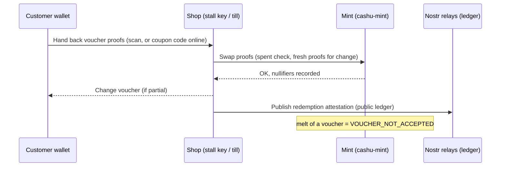

# Units and redemption

Two facts about Imani surprise people who know Cashu. Both are deliberate.

1. **A voucher is redeemed at the shop that issued it, never at the mint.**
2. **"Sats" in Imani are a unit of account, not bitcoin.** No real sats back a
   voucher, and none can be withdrawn.

## 1. Redemption happens at the shop

In a normal Cashu mint, ecash is a claim on the mint: you can `melt` it back to
Lightning or swap it for fresh ecash from anyone. Imani uses the **Model B**
voucher design from [`cashu-voucher`](https://github.com/398ja/cashu-voucher):

- Every voucher carries an issuer-signed **voucher document** naming one shop
  (its stall key), the face value, the currency and the expiry.
- The mint signs the proofs, so a voucher can't be forged or copied, but the
  mint **refuses vouchers in `melt`** and returns `VOUCHER_NOT_ACCEPTED` for
  any attempt to cash one out. There is nothing to cash out to.
- The only way a voucher ends is **redemption**: the customer hands it back to
  the shop that issued it, at the counter (scan a QR in the app) or at the
  shop's online checkout (a coupon code, see below). The shop receives it as
  **takings**, gift-wrapped (NIP-17) to its own key.
- A shop only ever accepts its own vouchers. A voucher from shop A is worth
  nothing at shop B.

The mint is a **signing and double-spend service**, not a bank. It never holds
a shop's money and never pays anyone. When the shop is paid for a voucher (by
card, through Stripe), the money goes straight to the shop's own Stripe account
(direct charge). Imani never holds the float.

## 2. Sats are only the unit of account

Cashu proofs are denominated in powers of two of a base unit. Imani keeps the
standard `sat` unit so it can use the Cashu protocol and libraries unchanged,
but in Imani:

- A "sat" is an **accounting unit** that lets a voucher be split precisely into
  power-of-two pieces. It is **not** a satoshi anyone owns.
- What the customer sees, and what a shop honours, is the **face value** in the
  voucher's own currency (GBP, EUR, ...), recorded in the signed voucher
  document. The sats count is only how that value is carried.
- Face value is converted to sats at an operator-set rate from
  `imani-xrate` (for example `1 sat = 0.0694 c` on staging). Splits round
  once with a largest-remainder method so the pence always add up.
- The Lightning backend the mint talks to (phoenixd, mocked outside
  production) exists because the Cashu protocol expects mint quotes. It does
  not make vouchers redeemable for bitcoin.

The user-facing app never shows the word "sats". A customer holds "£25 at
Harbour Bakery", not 36,000 sats.

## Online checkout codes

A shop with a website takes vouchers through a coupon code
(`IMANI-XXXX-XXXX-XXXX`). The code is a **reference**, not a bearer secret: the
customer deposits voucher parts locked (P2PK) to the shop's key in the code
store, and only that shop can redeem them at checkout. The wire contract is
`docs/checkout-codes/contract.md`. See [architecture.md](architecture.md) for
the platform plugins.
